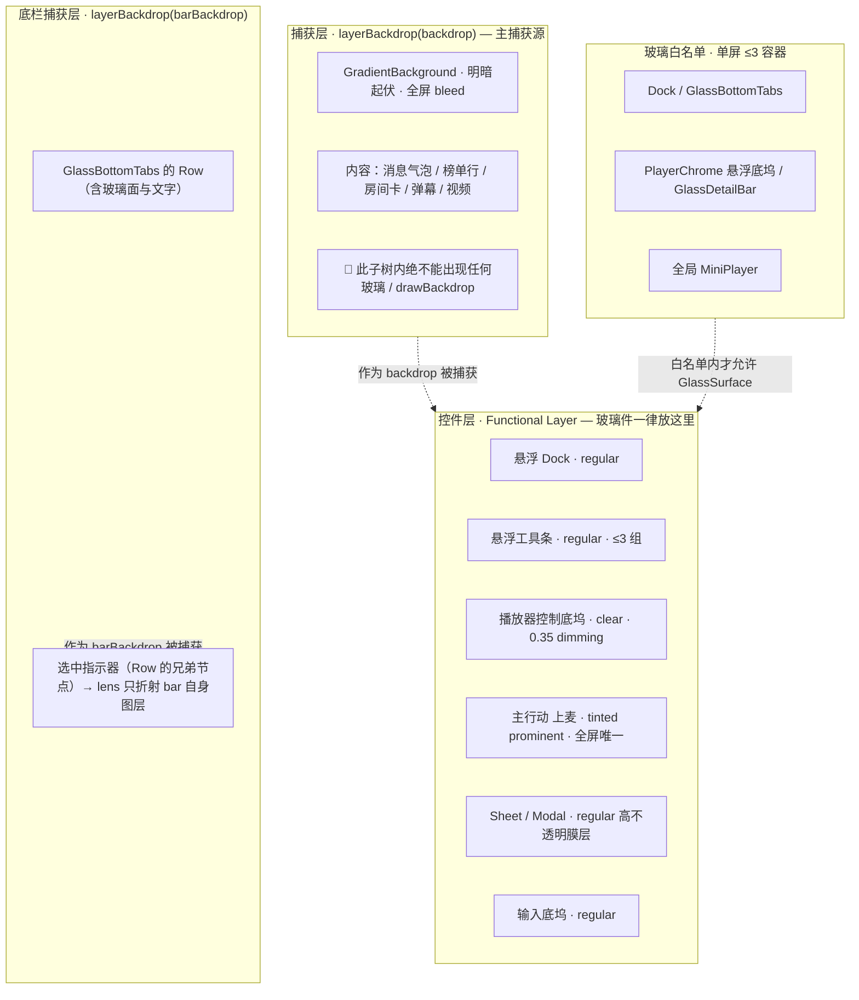

# 口袋48 · Liquid Glass 高级审美 UI 重构文字方案 **v2**

> **交付角色**：许清楚（产品经理） · 软件团队 · 任务 #5
> **性质**：纯文字视觉方案，**完整可独立阅读**。**未修改任何 App / 引擎源码、未新增依赖、未写 TS/Kotlin 实现代码块**（仅含数值表、ASCII 线框与分层图）。
> **v1 保留**：`03-liquid-glass-visual-redesign-plan.md` 不删，便于追溯；本文件为增量修订后的完整版。
> **上游输入**：`01-architecture-and-component-inventory.md`（架构盘点）、`02-apple-liquid-glass-spec.md`（Apple 规范硬约束，**本次不改**）、`03-...-plan.md`（v1）、**新引擎 4 文件全文**（`GlassKit.kt` / `GlassColors.kt` / `GlassSettings.kt` / `README.md`，路径 `repo/liquid-glass-compose/`，已逐行 Read 复核）。

## 前提变更（本轮用户纠正，优先级最高）

| # | 变更 | 影响 |
| --- | --- | --- |
| 1 | `Xenia0922/yaya_msg_mobile` 是**朋友的仓库**；`shufajiaok` 才是**用户自己的账号**。上一轮「self-fork」判断作废 | App 侧仓库归属需重新表述；引擎是用户**自有资产** → Phase 2 的 fork / 授权 / 维护成本显著低于旧判断（见 §12 第 2 条） |
| 2 | 液态玻璃引擎改用 **`https://github.com/shufajiaok/liquid-glass-compose`**（`com.jiale.glasskit`），不再是 `shufajiaok/LiquidGlass`（`com.jiale.liquidglass`） | v1 中所有基于旧引擎的表述必须重判，尤其「静态背板 / 独立 window 退化」两条不适配理由（见 §2.1、§12 第 1 条） |
| 3 | `02-apple-liquid-glass-spec.md` **不受影响，不改** | Apple M/D/S 条款、5.3 验收清单全部沿用 |

## 依据优先级

| 优先级 | 依据 |
| --- | --- |
| 1 | **用户本轮前提变更 + 主理人裁决**（含 v1 已确立的 transparent「看角色不看字面」判定） |
| 2 | `02-apple-liquid-glass-spec.md`（Apple HIG M/D/S 与 §5.3 验收清单） |
| 3 | **新引擎 4 文件源码原文**（本轮已 Read 复核） |
| 4 | `01-architecture-and-component-inventory.md`（项目事实；其中基于旧引擎的复用性判定**已失效**） |

> ⚠️ **口径提示（沿用 v1）**：架构报告 v1.1 正文若干处（第 25 / 384 / 625 / 635 / 636 / 682 行附近）仍残留「收回所有 transparent、页面根恒不透明」的**已被否决的旧口径**，本方案一律以主理人裁决为准，不照抄。数量基线统一 **378 处硬编码圆角 / 30 个 screens**。
> ✅ **依据 04 收口（v2.1）**：架构师 `04-engine-swap-architecture-revision.md` 已交付并核验落盘（510 行）。本方案已按其核实结论逐条收口：Kyant0 backdrop **双档 API 门槛**、**Maven Central 依赖与上游版本链**、**循环捕获红线在路径 A 下的转译**、**独立 window「官方未说明」**等均已写成确定结论或正式风险登记，**全文不再保留悬置标记**。逐条改动（位置 → 旧口径 → 新口径 → 04 出处）见 **§13**，待用户拍板项收敛于 **§14**。

---

## 0. TL;DR：一页纸说清新 UI（v2 修订）

**一句话**：彩色内容一路铺到屏幕边缘，只有三块玻璃浮在它上面。

打开 App，第一眼看到的不再是一排贴边的页头和密排的实心小卡片，而是——内容（房间背景、直播画面、成员封面、彩色弹幕）**占满整块屏幕并延伸到悬浮栏下方**；控件不再和内容抢同一平面，而是**抬升成唯一的一层功能平面**：底部一枚大圆角悬浮 Dock、顶部一条悬浮工具条、直播时一条贴在画面上的透明控制底坞。除此之外，屏幕上只有一处醒目的粗体左对齐大字（房间名 / 直播标题），和一枚品牌粉的主行动按钮「上麦」。

**与现状的根本差别，不是「加了多少模糊」，而是「层级被重新分配」**：

| 维度 | 现状 | 新 UI |
| --- | --- | --- |
| 平面关系 | 页头贴边、卡片实心、控件与内容挤压在同一平面 | 内容铺满全屏并 bleed 到栏下；控件抬升为单一悬浮功能平面 |
| 玻璃 | 2 处真模糊 + 一堆自称「玻璃」的半透明色块，散落内容层 | **只有功能层能用玻璃，单屏 ≤3 个容器**；内容层一律实色 |
| 标题 | 30 页统一 `ScreenHeader` 贴边、24/800、`largeTitle` 全 src 0 命中 | 每屏 1 处英雄文字（31sp / Bold / 左对齐） |
| 圆角 | 378 处孤立硬编码；`AppTabBar` bar 28 / cell 28 同值 | 同心 `child = parent − padding`；胶囊 = 高度/2；大容器 28–32dp |
| 导航 | 4 Tab 胶囊贴屏底、可全站隐藏 | 4 Tab 悬浮 Dock、离边留白、常驻、单色、filled 图标、可挂 MiniPlayer accessory |
| 颜色 | 品牌粉可出现在任意处 | 内容层保留社区彩色；导航强制单色；品牌粉**只**作唯一 tinted prominent 的背景 |
| 可访问性 | reduceMotion / fontScale / 4 套色 token 全 0 覆盖 | 四条降级矩阵 + 4 套色 token + Dynamic Type 全档，P0 新建 |

**v2 最重要的三处变化**：

1. **换了引擎，但本轮落地路径不变**：新引擎是 **成品功能层组件集**（基于 `layerBackdrop` 图层捕获，能采到滚动内容），旧引擎「背板必须静态、不适配滚动列表」这条不适配理由**被推翻**；然而 RN 0.81.5 + Expo 54 + `newArchEnabled=false`（Paper）与 Compose 的视图树鸿沟仍在，`DESIGN_SYSTEM.md:71-72` 禁改原生 / 禁加依赖仍在，且新引擎需新增 2 个 maven 依赖 → **路径 A（RN 侧 expo-blur + 自定义渲染等效实现）仍推荐为本轮落地路径**（v2.1 升级为**路径 A+**：引擎契约作 `glass.ts` / `GlassSurface` 设计蓝本），理由按 **04 §8.1 七条**全部重写，并给出 **Phase 2 提前的八项触发条件（04 §8.3）**（§2.1）。
2. **新引擎把「内容层不放玻璃」从设计规范升级为引擎级硬约束（C9 加分项）**：`drawBackdrop` 元素绝不能位于 `layerBackdrop` 捕获子树内，否则循环捕获 → RenderThread **SIGSEGV** 栈溢出（README L36、GlassKit L60-61）。这与 Apple **D1** 高度一致，是路径 A 分层架构的正向依据。**⚠️ v2.1 口径（04 §6.2）**：该崩溃风险**只属引擎原生侧 / Phase 2**；路径 A 下 RN 无 `layerBackdrop`，不存在 SIGSEGV，红线转译为 **A1–A6 六条架构约束**（§2.3）。
3. **「我的组件哪些能直接用上」不再是笼统的「0 个」**：分三类正面回答 —— ① 概念 / 规范 / 数值 / 组件分工 / 全局调参范式**可直接搬**；② 具体 `@Composable` 组件**需桥接后落地**；③ 代码直接可用为 0 的**确切原因**。详见 **§2.6**。

**唯一判定标准**：`02` §5.3 验收清单（本方案 §11 全文引用 + 追加 SIGSEGV 条目）。尤其记住：**只做一层 `BlurView` 不达标**——Lensing 近似必须含边缘折射高光 + 亮度自适应 + 触摸实时响应。

---

## 1. 设计定位与视觉语言

### 1.1 五个关键词

| 关键词 | 含义 | 落到界面上是什么 |
| --- | --- | --- |
| **悬浮 Levitation** | 控件与内容不在同一平面 | 栏离屏边 ≥16dp、离内容 ≥24dp，靠分层阴影与 scroll edge effect 抬起，**绝不垫实色/半透明底板** |
| **同心 Concentricity** | 所有嵌套圆角围绕同一个圆心 | `child = parent − padding`；Dock 28 / cell 20；大容器 28–32dp；胶囊 = 高度/2 |
| **留白 Breathing Room** | 用空间而非线条表达层级 | 组间 ≥24dp、组内 8–12dp、屏幕水平 ≥16dp；工具条 ≤3 组、次要动作收进 More |
| **单色克制 Monochrome Restraint** | 彩色属于内容，不属于控件 | 直播/房间/榜单页的 Dock 与工具条强制单色；filled 符号、无边框、vibrancy 自适应明暗 |
| **一处英雄 One Hero** | 每屏只有一个视觉锚点 | 31sp Bold 左对齐大字 + 唯一一枚品牌粉主行动按钮 |

### 1.2 明确的反词

- 🚫 **满屏毛玻璃**（弹幕/气泡/榜单行/房间卡/礼物/麦位套 blur）—— 同时违反 Apple D1 与**新引擎循环捕获红线**。
- 🚫 **实心卡片压边**、**小圆角小字密排**（378 处孤立圆角、10–13sp 小字、靠透明度区分层级）。
- 🚫 **彩色导航**、**每屏多个主按钮**、**把「高度适配液态玻璃」理解成「到处加玻璃」**。
- 🚫 新增反词：**大面积面板用 lens**（新引擎铁律 2）、**tint alpha > 0.12**（新引擎铁律 1）、**玻璃身后是纯黑/纯色无起伏**（新引擎铁律 3）。

### 1.3 参考气质

取其**层级逻辑**而非照搬截图：Apple Music 的悬浮 tab bar + MiniPlayer accessory、Apple TV 的直播内容优先与一键起播、iOS 26 alerts / onboarding 的粗体左对齐排版（[W356] 已核验 *"bolder and left-aligned"*）。**内容层依然是口袋48 社区 App 自己的彩色气质**——成员应援色、封面、房间背景、礼物与弹幕都保留，玻璃只做「承托内容的那层透明功能平面」。

### 1.4 色彩策略

| 层 | 策略 | 具体 |
| --- | --- | --- |
| **内容层** | **彩色，保留** | 房间背景图、直播封面、成员应援色、礼物特效、弹幕文字色 |
| **功能层 / 导航** | **单色（monochromatic）** | 黑白灰 + vibrant 语义色；符号/文字随背后内容明暗自适应；直播/房间/榜单页强制单色 |
| **品牌粉** | **唯一 tinted prominent 的背景色** | `#ff6f91`（亮）/ `#ff8fa8`（暗）只用于主行动「上麦」按钮**背景**（[C]：颜色加在背景而非符号/文字；不要给多个控件背景加色） |
| **玻璃上文字** | vibrant 语义色 | 用 4 套色 token 中的 `glassLabel`，禁止固定灰值硬编码 |

> ⚠️ **与新引擎的冲突**：`GlassColors.kt` 是**深色优先单一调色板**，`Accent = #7CA6FF`（蓝），与本项目品牌粉、[C] M18 四套色 token 均冲突 → 见 §3.1、§10 R16。

### 1.5 材质策略

| 变体 / 处理 | 用在 | 参数 |
| --- | --- | --- |
| `regular` | Dock、悬浮工具条、输入底坞、Sheet / Modal、资料卡、筛选条 | 模糊 + 亮度调整（vibrancy + blur）+ scroll edge effect；**大面积禁 lens** |
| `clear` | **仅**直播播放器悬浮控制底坞（浮在视频上） | 高透 + 亮底 `#000` @ **0.35** dimming；底层够暗则不加 |
| 内容层可读性遮罩 | `App.tsx` ImageBackground 之上的整体压暗（现状 0.88 / 0.92） | 归一到单一 `contentScrim` token；[LV] darkening 同性质的**内容层可读性手段**，不是玻璃 |
| 内容层卡片 | 消息气泡、榜单行、房间卡、礼物卡、麦位 | 不透明实色或 standard material 近似 + 圆角 + 分层阴影 |
| **玻璃身后背板** | 全屏背景 | **必须有明暗起伏**（新引擎铁律 3）；`GradientBackground` 是现成范式（§2.4） |

> **两档 dimming 必须分档管理**：`glassDimming = #000000 @ 0.35` 是 [M] **官方硬值**，只作用于 `clear` 玻璃背后、只在底层亮时触发；`contentScrim` 是 [LV] *subtle darkening*、**官方未给数值**（【建议值】），作用于内容层整体压暗。二者**不同层、不同对象，不冲突**。

> 🆕 **C2 机制缺口（04 §5 C2，v2.1 补入）**：`tint α ≤ 0.12` 管的是**玻璃自身 tint**，`#000@0.35` dimming 管的是**玻璃背后一层独立压暗**，二者**语义不同、可共存**（与上段 `contentScrim` / `glassDimming` 分档口径一致）。新引擎 4 文件**没有实现 `02` M7**（全文件无 dimming 层），因此直播页 `clear` + 亮底场景**必须由 App 侧补一层 `#000@0.35`**——`PlayerChrome` 已有的 `bottomShade` 渐变遮罩即可承载。**不得用提高 tint 来替代 dimming**：那会同时违反新引擎铁律①（tint ≤0.12）与 `02` D2（控件下方不垫底板）。

### 1.6 五个风格词的定义与边界

| 词 | 定义（可验收） | 边界 |
| --- | --- | --- |
| **大悬浮 UI** | 控件离屏边 ≥16dp、离内容 ≥24dp，有分层阴影，内容从其下方滚过并可透出 | 只给 3 类功能层组件 + 主行动按钮；**不靠增加玻璃数量营造大气** |
| **大圆角** | 功能层大容器 28–32dp；中等控件 16–22dp；胶囊 = 高度/2；嵌套同心 | 内容层卡片仍 12–16dp；不牺牲信息密度 |
| **英雄文字** | 31sp / 700 / 左对齐 / lineHeight 38 / 每屏 1 处 / Dynamic Type 到 44sp | 仅限房间名、直播标题、空态主文案；不得用于 tab 标签、工具条、弹幕、按钮文字 |
| **简洁** | 工具条 ≤3 组、次要动作进 More、≤5 tab、每屏 1 个 prominent | 简洁 ≠ 删掉背景 bleed（§2.4） |
| **高度适配液态玻璃** | 背景 bleed + scroll edge effect（每 view 1 个 / automatic）+ 按语义选 regular/clear + vibrant 色 + 同屏 ≤3 容器 | ≠ 更多玻璃；≠ 只加一层 BlurView 就算完成 |

### 1.7 🆕 新引擎三条铁律 → 可验收设计规则（含与 Apple 规范的对应与冲突）

| 铁律（源码出处） | 可验收规则 | 与 Apple 规范的对应 | 冲突 / 边界处理 |
| --- | --- | --- | --- |
| **① tint alpha ≤ 0.12**（README L60；GlassKit L54；`GlassTint = #DCE6FF @ 0.10`） | 所有玻璃膜层 tint alpha **≤ 0.12**；`GlassSettings.tintScale` 默认 1f，滑块上限 3 时须以 `min(0.12, alpha × scale)` 钳制 | 对应 [M]「材质上用 vibrant 色保证对比」、[C]「Apply color sparingly to the Liquid Glass material」——都是「玻璃本身不上重色」 | **引擎内部不一致**：`GlassChipsRow` 选中态 `color.copy(alpha = 0.34f)`（GlassKit L193）、`CardTint alpha = 0.55f`（GlassColors L21）**均超 0.12**。落地须按铁律收敛到 ≤0.12，或明确「选中态是强调色、不是 tint 膜层」并单列 token。**Apple [C] 的「主行动把颜色加在背景」指不透明实色 prominent 按钮背景，不是玻璃 tint**，二者对象不同、不冲突 |
| **② 大面积面板只用 vibrancy + blur，禁 lens；lens 只给小面积选中指示器**（README L61；GlassKit L55-56） | Dock / 工具条 / 输入底坞 / 播放器底坞 / Sheet **一律 `regular`（vibrancy + blur + 1dp 边缘高光）**；**唯一允许 lens 的位置是 `GlassBottomTabs` 的小面积选中指示器** | 对应 [M] `regular`「模糊并调整亮度以保证文字可读，大量文字用 regular」、[SW]「lensing 是动态折弯光线，不是简单高斯模糊」、[M] `Use Liquid Glass effects sparingly` | Apple 把 lensing 视为材质标志（[W219] 未二次核验摘录），但同样强调克制；新引擎把 lens 限到小面积是**实现层的性能/可读性取舍**，与 Apple「大面板用 regular」不矛盾。**`GlassBottomTabs` 指示器折射的是 `barBackdrop`（bar 自身图层），文字跟着被折射、不挡字**（GlassKit L214-219），正好满足 v1 的同心与可读性要求，且不会降低对比度 |
| **③ 背景必须有明暗起伏**（README L62；GlassColors L29-33） | 玻璃身后必须存在可辨识的明暗/色彩变化；纯黑或纯色背景下玻璃退化为一块纯色 | 对应 **M9**（全屏背景延伸到 bar 下方）与 scroll edge effect 前提（控件下方必须有可透出的内容）；也支撑 [M]「内容从下方滚动透出」 | 与 `#000@0.35` dimming **不冲突**：dimming 是 `clear` 玻璃**背后**的压暗层（仅亮底视频上方触发），`GradientBackground` 是**内容层背板本身**。深色房间背景不需要 dimming；亮直播画面需要 |

> **「内容层不放玻璃」现在有双重证据**：Apple **D1**（「Don't use Liquid Glass in the content layer」）＋ 新引擎 README L37「玻璃件一律放控件层，内容层里不放玻璃」与 L36 循环捕获 SIGSEGV 红线。前者是设计规范，后者是运行时崩溃约束（§2.3）。

---

## 2. 分层架构

### 2.1 技术前提、引擎重判与本轮路径（v2 核心）

| 事实 | 证据 |
| --- | --- |
| App = RN 0.81.5 + Expo ~54 + TS 5.9 + React 19 + React Navigation 7 + zustand + expo-blur ~15.0.8 | `package.json` |
| **`newArchEnabled = false`（Paper 老架构）** | `app.json:9`、`android/gradle.properties:38` |
| **新引擎** = `shufajiaok/liquid-glass-compose`，package `com.jiale.glasskit`，是 **4 个文件的源码组件集**（`GlassKit.kt` / `GlassColors.kt` / `GlassSettings.kt` / `README.md`；**非 AAR、非 Gradle 工程**，README:14「拷 3 个 kt 进 ui 包改 package 即可」），按功能层组织的**成品组件集**而非底层渲染库 | 4 文件全文复核；04 §0.2 / §2.1 |
| 依赖 `io.github.kyant0:backdrop:2.0.1` + `io.github.kyant0:shapes:1.2.1`（**Kyant0/AndroidLiquidGlass，CMP 多平台库**，`org.jetbrains.compose.*`）；基于 `com.kyant.backdrop` 的 `layerBackdrop` **图层捕获**。**口径精确化（E1）**：相对旧引擎的根本变化是**背板获取方式**从静态 `ImageBitmap` 改为图层捕获，但**效果层仍是 `RenderEffect`**（上游「Backdrop effects are `RenderEffect`s radically」），不是「不用 RenderEffect」 | README L8-12、GlassKit L38-46；04 §7.2 口径修正 / §1 对比表 |
| `android/` 无 Compose 依赖 / 无 `buildFeatures compose`；`DESIGN_SYSTEM.md:71-72` 禁改 `android/` 原生、禁新增依赖、禁动播放器覆盖层 | 架构报告 §1.4 / §9 R6 |

**旧引擎不适配理由的作废与保留（v2.1 按 04 §3.1 Q2/Q3、§9 R9 收口）**：

| v1 理由 | v2.1 判定 | 依据 |
| --- | --- | --- |
| 旧引擎「背板必须静态，不适配滚动列表」 | ❌ **整条作废**（04 §3.1 Q2 完全推翻） | 新引擎用 `layerBackdrop` 图层捕获，README L19-27 把「内容 + 背景」整棵子树挂为捕获源，**能采到滚动内容**；v1「引擎与全屏滚动列表天然错配」不再成立。**「不模糊滚动列表」这条一并删除**（新引擎恰恰能模糊滚动内容，04 §10 第 2 条）。**但**「玻璃只用于浮层、不进内容层」的**结论保留**，理由由「技术做不到」升级为「**循环捕获红线 + `02` D1/M1**」（04 §3.1 Q2、§5 C9） |
| 旧引擎「对话框 / 底部弹层独立 window 里玻璃退化成膜层」 | ❌ **整条作废**（该说法仅属旧引擎 README L262，04 §3.1 Q3 / §9 R9 已整体作废，不得再作为硬约束引用） | **官方未说明、未实测 → 登记为风险 R14**（04 §7.4）：上游 10 篇官方文档全部无 Dialog / Popup / separate window / 主窗口 backdrop 可见性表述；唯一线索 `rememberLayerBackdrop` 是 `coordinates-dependent`，据此**可推断**独立 window 可能取不到主 backdrop，但**是推断非核实结论**。**做法保留**（Modal 内不用真模糊），**理由改写**为「跨 window backdrop 采样行为未核实（04 §7.4）+ `02` M31/D18 一次只 1 个 sheet」（04 §6.2 A5） |
| RN / Compose 视图树不互通，代码直接可用 = 0 | ✅ **仍成立**（04 §3.1 Q1 主结论保留） | Paper 老架构 + `MainActivity : ReactActivity()`（非 `ComponentActivity`）+ TSX/Yoga vs Kotlin `@Composable`/Compose runtime；Metro JS bundle 不含 Kotlin；无共享视图树/布局/绘制/手势/生命周期 |
| `DESIGN_SYSTEM.md:71-72` 禁改原生 / 禁加依赖 | ✅ **仍成立，且约束更重** | 新引擎是**源码组件集**，需 2 个 maven 依赖 + `buildFeatures compose=true` + kotlin-compose 插件 + ViewManager + `ViewTreeLifecycleOwner` 注入 → 集成步骤多于旧引擎（04 §8.1 理由 2） |
| 本轮「只出文字方案、不改代码」 | ✅ 仍成立 | 用户约束 |

> **结论：路径 A（RN 侧 `expo-blur` + 自定义渲染等效实现、不引入原生 Compose 引擎）仍推荐为本轮落地路径**，「代码级直接可用 = 0」主结论保留（04 §3.1 Q1）。**推荐理由按 04 §8.1 七条全部重写，不再引用已作废的「静态背板 / 弹层退化」**：① RN Paper + `ReactActivity` 技术栈鸿沟；② 源码组件集集成步骤更多；③ 版本链更激进（Kotlin 2.4.10 / AGP 9.3.2 / CMP 1.12.0 / compileSdk 37）且 CMP 与 `androidx.compose.*` 混用未核实；④ API 31/33 双档门槛；⑤ 照搬会引入 6+ 处 Apple 规范违规（10sp / 单一深色板 / 硬编码 / 无 a11y 降级 / 22dp / 44dp / X1·X2），需一次完整规范化重写；⑥ `DESIGN_SYSTEM.md:71-72` 治理约束仍是阻塞级；⑦ 新引擎 90% 价值是纯契约（结构 / 尺寸 / 铁律 / 分层 / 红线），路径 A 可 100% 复刻、无需原生。
>
> **🆕 路径 A+（04 §8.2）**：以路径 A 为实现主体，把新引擎的**组件契约 / 尺寸字号圆角 / 三条铁律 / 内容层-控件层分层 / 循环捕获红线**，全部作为 `src/theme/glass.ts` 与 `GlassSurface` 等 RN 组件 API 的**设计蓝本**，不触碰 `android/` 原生、不新增依赖。这样既拿到新引擎 90% 的架构价值，又不改原生。**Phase 2 定性从「不推荐」上调为「有条件提前、但本轮不启动」**（04 §8.2）。

**🆕 Phase 2 提前的触发条件（v2.1 按 04 §8.3 由五项改为八项，全部满足才启动）**：

| # | 条件 | 状态 |
| --- | --- | --- |
| 1 | 【阻塞】用户**明确解禁**「改 `android/` + 新增 `backdrop:2.0.1` / `shapes:1.2.1` 两个 maven 依赖 + 开 Compose 构建特性」 | 待确认（阻塞级） |
| 2 | `assembleDebug` 实测通过：上游版本链（04 §7.2 已核实）minSdk 21 / compileSdk 37 / buildTools 37.0.0 / Kotlin 2.4.10 / AGP 9.3.2 / CMP Compose 1.12.0 / JVM 11 / `shapes:1.2.1`，发布在 **Maven Central**、App `android/build.gradle:6,18` 已配 `mavenCentral()` → **无需新增仓库**；但上述数值来自 `kmp` 分支构建文件**反推**（`get-started.md` 只有版本占位符、无官方「要求」声明，04 附录 B #6），且 **App 侧 Kotlin/AGP/compileSdk 由 Expo 54 注入、显式版本仍未找到**（04 附录 B #10）→ **上游版本链已核实；App 侧注入值未知，必须 `assembleDebug` 实测**，不得写成「已对齐」；并验证 CMP Android target 产物在纯 Android 工程可用（04 §6.3 B2 未核实项） | 部分已核实 / 待实测 |
| 3 | 目标机型 API ≥33 占比达标，或用户接受「26–32 无 lens、26–30 无任何效果」的降级分层（04 §8.3 第 3 条，R2 双档化） | 待确认 |
| 4 | 真机回归通过：`GlassBottomTabs` 兄弟节点拓扑**不触发** `Fatal signal 11 (SIGSEGV) ... (RenderThread)`（04 §6.3 B6）；`exportedBackdrop` fallback 已备好；`Capsule` 满足 `CornerBasedShape` 或已替换（X5） | 待实测 |
| 5 | 实测 RN `Modal` 独立 window 内 `ComposeView` 的 backdrop 行为并给出明确结论（04 §7.4 未核实项） | 未核实 |
| 6 | `ViewTreeLifecycleOwner` / `ViewModelStoreOwner` / `SavedStateRegistryOwner` 注入方案验证通过（`MainActivity : ReactActivity()` 非 `ComponentActivity`，04 §6.3 B4） | 待验证 |
| 7 | 新引擎组件完成规范化重写：字号 ≥11sp、4 套色 token、降级开关、圆角按 28–32dp 分类、触控 ≥48dp、去硬编码、修 X1/X2 | 待落地 |
| 8 | 维护策略确认：fork 到 `shufajiaok` 账号后，明确「跟随 `backdrop` 上游版本升级」的同步责任与回归范围（替代旧 HealthCheckIn 同步表，04 §3.2 #23） | 待确认 |

> 引擎为**用户自有账号**（`shufajiaok`）这一前提，使 Phase 2 的 fork 授权、上游同步、长期维护风险低于 v1 判断，是条件 1 与 8 更有利的一面。

### 2.2 三层结构



| 层 | 可用材质 | 硬规则 |
| --- | --- | --- |
| **捕获层 / 内容层** | 实色 / standard materials / 内容层压暗 / `GradientBackground` | 🚫 **禁止任何 `drawBackdrop` / 玻璃**（Apple D1 + 引擎 SIGSEGV 红线）；承载背景的容器透明必须保留 |
| **控件层 / 功能层** | `regular`（默认）/ `clear`（仅视频上方） | 控件下方不垫底板；靠 scroll edge effect 抬起；符号优先；成组渲染 |
| **玻璃白名单** | 单一 `GlassSurface` | **单屏 ≤3 容器 / ≤6 元素**；直播页 ≤3；白名单外一律实色 |

**同屏计数**：`useGlassBudget()` 统计挂载数，超限自动 `degrade()`。弹幕（`DanmakuOverlay` 纯白字 + textShadow，无玻璃无底板）、`AppToast`、模态 Sheet **不计入 ≤3**。旧引擎性能预算「同屏 1–3 块无感、一页 5 张全玻璃掉帧」不再适用（该数据来自旧引擎 README），v2 的 ≤3 依据改为：Apple [SW]「Limit the use of Liquid Glass effects onscreen at the same time」＋ 新引擎铁律 2（大面积禁 lens）＋ 直播视频解码/弹幕的叠加风险（【建议值】，需真机实测）。

**Sheet 与 TabBar 协同**：任一 Sheet / Modal 打开时按 [SH] 一次只 1 个 + [TB] 模态覆盖例外，**收起或降级 Dock 为实色**，避免叠到 4 个玻璃容器。

**4 Tab 事实校准**：当前 **Home / Media(直播) / Rooms(房间) / Settings** 共 4 Tab + 26 Stack，**无「我的」Tab**。`02` §6.1 的 5 tab 是通用建议，本项目**保持 4 Tab 不变**，不新增路由（§9.2 不动清单）。

### 2.3 🆕 双 `layerBackdrop` 结构与循环捕获 SIGSEGV 红线

README L16-31 给出的结构**必须这么搭**：

```
Box( fillMaxSize )
├─ 捕获层 A（主）  Box.layerBackdrop(backdrop)
│    ├─ GradientBackground()      ← 玻璃身后的明暗起伏（铁律 3）
│    └─ 内容（🚫 这里不能出现任何玻璃）   ← 整棵子树是 backdrop 捕获源
├─ 控件层        Column(statusBarsPadding)
│    ├─ GlassTopBar / GlassChipsRow / GlassRoundButton ...
│    └─ （所有 drawBackdrop 玻璃件只能在这里）
└─ GlassBottomTabs(backdrop, barBackdrop)
     ├─ 捕获层 B  Row.layerBackdrop(barBackdrop)
     │    └─ drawBackdrop(backdrop = 主backdrop) + 图标 + 文字
     └─ 选中指示器（★ Row 的兄弟节点，不在 Row 子树内）
          └─ drawBackdrop(backdrop = barBackdrop) + lens(8dp,10dp,色散)
```

| 红线 | 内容 | 后果 |
| --- | --- | --- |
| **循环捕获** | `drawBackdrop` 的元素**绝不能位于 `layerBackdrop` 捕获子树内**（README L36；GlassKit L60-61） | **RenderThread SIGSEGV 栈溢出，点一下就崩** |
| 安全写法 | `GlassBottomTabs` 的选中指示器是 bar `Row` 的**兄弟节点**（GlassKit L219 红线自查、L288-307），折射 `barBackdrop` 而非主背景；指示器滑到哪个 tab，那个 tab 的文字从透镜里折射出来，**不会被盖住** | 既避免循环捕获，又保证文字可读 |

**它如何迫使「玻璃只用于浮层」**：内容层本身就是捕获层 A 的子树，任何玻璃件放进内容层即构成循环捕获、直接崩溃。于是「玻璃只用于浮层」在 v1 里是 **Apple D1 的设计规范**，在引擎原生侧（Phase 2）升级为**运行时崩溃红线**——这解释了为何新引擎 README 会主动写出「玻璃件一律放控件层，内容层里不放玻璃」这句与 Apple HIG 几乎同义的话。

> 🆕 **C9 加分项（04 §5）**：新引擎「内容层零玻璃、控件层玻璃」结构硬要求与 `02` **D1 完全一致且更强**——它把「规范条文」升级为**引擎级硬约束**（违反即 `RenderThread SIGSEGV` 崩溃，而非只是视觉层级混乱）；README L19-27 的「背景 bleed + 内容层 + 控件层兄弟结构」又与 **M9 / M8** 同向。这是新引擎相对旧引擎最大的**规范契合度提升**，应作为本方案「内容层禁玻璃、彩色内容层 + 单色功能层」的正向依据写入（结论保留，理由升级为「循环捕获红线 + D1/M1」，04 §3.1 Q2）。

**落地约束（v2.1 按 04 §6.2 明确区分路径 A 与 Phase 2）**：

> ⚠️ **关键口径（04 §6.2）**：RN 侧**没有** Compose `layerBackdrop` 图层捕获，`expo-blur` 是 View 级 backdrop 采样，因此 **RenderThread `SIGSEGV` 循环崩溃风险在路径 A 下不存在**——上文的引擎红线是 **Phase 2 原生桥接**才面对的问题。它在本轮必须转译为下列 **A1–A6 六条架构约束**（否则会出现等价的「采样自身 / 视觉黑洞」问题），而非照搬崩溃措辞：

| # | 路径 A 转译约束（04 §6.2） | 本方案落点 | 对应 `02` |
| --- | --- | --- | --- |
| A1 | RN 视图树显式分两层**兄弟节点**：内容层（`ImageBackground` + `ScrollView`/`FlatList` + 卡片，**零玻璃**）/ 控件层（`AppTabBar`、悬浮工具条、`PlayerChrome` dock、`MiniPlayer`、`AppToast`）；玻璃容器不得作为内容层滚动容器后代 | §2.2 三层、`App.tsx:641,701-709`、`navigation/index.tsx` 全局浮层挂载点 | D1 / M1 / M9 / M8 |
| A2 | `BlurView` **不得采样自身或祖先链中的玻璃容器**；每个 `GlassSurface` 单一容器承载全部效果，禁止 4 层独立平铺互相采样 | 拟建 `GlassSurface`；替换 `AppTabBar.tsx:119-158` | M23 / D9 |
| A3 | `glass.ts` 增加 `layer` 白名单断言：`layer === 'content'` 时直接 `degrade()` 为实色 / 开发期报错 | 拟建 `src/theme/glass.ts`（§3.5） | D1 |
| A4 | 玻璃容器计数白名单固定「直播页 ≤3 个真玻璃容器」；弹幕 / `AppToast` **不计入**；Sheet 按模态例外 | §2.2 计数、`useGlassBudget()` | M24 / D9 / M31 |
| A5 | RN `Modal` / sheet 内**不做真模糊**（高不透明膜层 + 边缘光 + 同心圆角），理由为「跨 window backdrop 采样行为未核实（04 §7.4）+ M31/D18」 | §5.10、§2.5 | M31 / D18 |
| A6 | 背景必须有明暗起伏（铁律③）：纯色/纯黑背景时给出提示或降级；`glowScale` 类参数下限 >0 | `glass.ts` + 设置页 | 铁律③ / M19 |

- CI 静态守卫新增规则：内容层组件树内禁止出现 `drawBackdrop` / `BlurView` / `GlassSurface` 等价物（§9 P4、§11）。
- **Phase 2 才需要**（04 §6.1 / §6.3 B5/B6）：优先采用上游官方 `exportedBackdrop`（`drawBackdrop` 的 `exportedBackdrop` 参数「skip drawing the content」，比新引擎 README「把玻璃移出捕获子树」更通用）；对 `GlassBottomTabs` 兄弟节点拓扑真机回归 `Fatal signal 11 (SIGSEGV) ... (RenderThread)` 并备 fallback。混合视图树 / SurfaceView 上的捕获属 Phase 2 未核实项（04 附录 B #2/#4/#5），不混进路径 A 结论。

### 2.4 🛑 防误删说明：背景 bleed 不得删除（裁决仍有效，且新引擎更依赖它）

> **本条为最高优先级实施防呆条款，任何「清理透明」的工作都必须先读这张表。**

HIG Layout **M9** 要求「全屏背景延伸到 sidebar / toolbar / tab bar 下方」；RN 中让 `ImageBackground` 铺到悬浮 Dock 底下**恰恰依赖承载背景的容器透明**。删掉透明不仅违反 M9，还破坏 scroll edge effect 前提（浮动控件下方必须有可透出的内容）——**在 v2 里还会额外违反新引擎铁律 3**：玻璃身后失去明暗起伏，模糊完只剩一坨纯色，看不出「透」。

**`GradientBackground` 正是 bleed 的内容层背板**：`fillMaxSize + drawBehind` 的深色垂直渐变（`#0B1022 → #121A36 → #0C1226`）+ 3 个柔光团（蓝 `0.55×glow` / 紫 `0.42×glow` / 青 `0.36×glow`），它整棵挂在 `layerBackdrop(backdrop)` 捕获子树里，既是捕获源又是 bleed 背板。因此**「背景 bleed 不得删除」在 v2 从「合规保留」升级为「玻璃效果成立的前提」**。

### 2.5 透明对象角色判定表（对象 / 角色 / 判定 / 处理）

| 对象（文件:行） | 角色 | 判定 | 处理 |
| --- | --- | --- | --- |
| `src/navigation/index.tsx:185` `sceneStyle: {backgroundColor:'transparent'}` | 承载全屏背景的容器 | ✅ **合规且必须保留** | 保持。M9 bleed + scroll edge 前提 + 新引擎铁律 3 |
| `App.tsx:641` 根容器 `transparent` | 承载全屏背景的容器 | ✅ **合规且必须保留** | 保持 |
| `src/theme/colors.ts:98-102` `usePageBackground() → transparent` | 承载全屏背景的容器 | ✅ **合规且必须保留** | 保持 |
| `src/navigation/index.tsx:266-267` navTheme / `:303` cardStyle `transparent` | 承载全屏背景的容器 | ✅ **合规且必须保留** | 保持 |
| `App.tsx:701-709` `ImageBackground` + 0.88 / 0.92 压暗遮罩 | **内容层可读性遮罩**（[LV] darkening / [M] dimming 同性质） | ✅ **合规保留** | 归一到单一 `contentScrim` token；与 `glassDimming=0.35` 分档管理；同时可借用 `GradientBackground` 的柔光团思路补明暗起伏 |
| `src/theme/ui.ts:8-9` `card: rgba(255,255,255,0.88)` | **卡片自身底板** | ❌ **违规** | 改不透明实色或 standard material 近似（D1 / D2 / M2） |
| `src/theme/ui.ts:9` `cardOnImage: 0.72` | **卡片自身底板** | ❌ **违规** | 同上 |
| `src/components/GlassCard.tsx` 在 `HomeScreen.tsx:614,790`、`RechargeScreen.tsx:64` | **内容层普通卡片**（伪玻璃） | ❌ **违规** | 降级为不透明实色内容卡；浮层分支并入 `GlassSurface` |
| `src/player/chrome/PlayerChrome.tsx:37-41` 渐变遮罩 + 悬浮底坞 | 视频上方控件可读性处理 | ⚠️ **需归一** | 收敛到 `clear`：亮底 `#000@0.35` dimming + 单一渐变 token + 边缘高光；不做 backdrop blur（SurfaceView 采样不到） |
| `MediaScreen.tsx:1505-1522` 公告面板 `rgba(18,18,20,0.92)` | 浮层面板自身底（RN `Modal` 独立 window） | ⚠️ **按浮层规则** | `regular` 高不透明膜层（建议 `opacity ≥ 0.9`）+ 边缘光 + 同心圆角；弹层内不用真模糊；改可收起 chip。**做法保留，理由改写**：跨 window backdrop 采样行为未核实（04 §7.4）+ `02` M31/D18 一次只 1 个 sheet（04 §6.2 A5）；**官方未说明、未实测 → 登记为风险 R14**（详见 §10） |
| `navigation/index.tsx:270` `bgScrim 0.34` | 全局遮罩 | ⚠️ **需归一** | 从 `glass.ts` 单一来源取值，取消内联 |
| `src/components/DanmakuOverlay.tsx` 纯白字 + `textShadow rgba(0,0,0,0.95)` | **内容层弹幕，无玻璃无底板无 blur** | ✅ **天然合规** | 🚫 **保持原样，禁止误改**；仅补注释防止后续加 backdrop blur |

> **一句话口径**：**承载全屏背景的容器透明 = 合规且必须保留；控件 / 卡片自身底板的半透明 = 违规需替换。**

### 2.6 🆕 正面回答：我的组件哪些能直接用上

> 这是用户原始问题，v1 只给了「代码直接可用项 = 0」的笼统结论，v2 分三类正面回答。

#### ① 概念 / 规范 / 数值 / 组件分工 / 调参范式 —— **可直接搬（无需桥接）**

| 具体项 | 来源 | 搬到本方案哪里 |
| --- | --- | --- |
| **「内容层不放玻璃、玻璃件一律放控件层」** | README L37 + GlassKit L60 | §2.2 三层架构、§1.7 双重证据（Apple D1 + 引擎红线） |
| **循环捕获 SIGSEGV 红线**（`drawBackdrop` 不得进 `layerBackdrop` 子树） | README L36；GlassKit L60-61、L219 | §2.3 架构约束、§9 P4 CI 守卫、§11 验收追加项 |
| **双 `layerBackdrop`（主捕获层 + barBackdrop）结构** | README L19-20、L22-31；GlassKit L214-219 | §2.3 分层图 |
| **选中指示器作为兄弟节点、只折射 bar 自身图层、文字跟着被折射不挡字** | GlassKit L214-219、L288-307 | §4.2 Dock 交互、§1.7 铁律 2 的可读性论证 |
| **三条铁律**（tint ≤0.12 / 大面积禁 lens / 背景明暗起伏） | README L58-62；GlassKit L53-58 | §1.7 可验收设计规则、§3.5 参数钳制 |
| **组件分工按功能层组织**：TopBar / BottomTabs / DetailBar / ChipsRow / RoundButton / GradientBackground | README L41-49 | §4、§5 每页「对应新引擎组件」、§6 三方映射 |
| **模糊半径按控件尺寸分档**：`glassSurface 14dp` / `glassCompact 8dp` / `GlassDetailBar 12dp` / `GlassBottomTabs bar 10dp` | GlassKit L73、L99、L330、L243 | §3.5 `resolveGlass(kind)`、§3.6 分派表 |
| **形状与几何**：`Capsule`（64dp bar → 32dp）、`RoundedCornerShape(22.dp)`（56dp TopBar）、`RoundedCornerShape(50)`（Chip 胶囊）、`CircleShape`（44dp 圆钮） | GlassKit L117、L192、L242、L151 | §3.2 同心档位、§4.1 取舍 |
| **同心范本**：bar 64dp Capsule → 圆角 32dp；padding 5dp → 指示器 54dp Capsule → 圆角 27dp = **32 − 5** | GlassKit L252-254、L292-294 | §3.2 —— 正是 v1 `child = parent − padding` 的现成证明 |
| **`GlassSettings` 四倍率范式**：倍率制 1f 默认 / 0 关闭、区间 0–2.5 / 0–3 / 0–2 / 0–2、SharedPreferences 持久化、`init/persist/reset` 三段式、设置页拖滑块实时重绘 | GlassSettings.kt 全文；README L51-56 | §3.5 `GlassProvider` 补强、§5.8 设置页「统一玻璃控制面板」 |
| **按压缩放数值**：`GlassRoundButton 0.92` / `BarAction 0.93` / `Chip 0.94` | GlassKit L148、L353、L187 | §7 按压反馈（与 v1 建议 0.97 对齐为 0.92–0.97 区间） |
| **指示器动效**：`spring(dampingRatio = 0.85f, stiffness = 380f)` | GlassKit L234 | §7 morph 参考 |
| **lens 参数**：`lens(8dp, 10dp, chromaticAberration = true)` | GlassKit L299-303 | §1.7 / §7 —— 仅小面积选中指示器可用 |
| **1dp 白色边缘高光 `alpha 0.14`** | GlassKit L88-90 | §3.5 玻璃参数、§11「只做一层 BlurView 不达标」的落地依据 |
| **`GradientBackground` 明暗起伏配方**（深色渐变 + 3 柔光团，亮度乘 `glowScale`） | GlassColors.kt L35-70 | §2.4 bleed 背板、§1.7 铁律 3 |

#### ② 需桥接后才能落地 —— **具体组件清单**

| 新引擎组件 | 需桥接的原因（本轮） | Phase 2 落地形式 |
| --- | --- | --- |
| `Modifier.glassSurface` / `glassCompact` | Kotlin Modifier 扩展 + `drawBackdrop` / `vibrancy` / `blur` | Paper ViewManager + ComposeView 桥接（照 `LiveExoViewManager.java` 先例），RN 侧 `requireNativeComponent` 封装，参数由 `glass.ts` 映射 |
| `GlassTopBar` / `GlassRoundButton` | `@Composable` + `Painter` + `MutableInteractionSource` | 同上；图标资源需跨端传递 |
| `GlassChipsRow` / `Chip` | `@Composable` + 横向滚动 + 选中态 | 同上 |
| `GlassBottomTabs` | `@Composable` + 双 `LayerBackdrop` + `Animatable` | 同上；**`barBackdrop` 循环捕获红线必须在原生侧守卫** |
| `GlassDetailBar` / `GlassBarAction` | `@Composable` + 动作列表 | 同上 |
| `GradientBackground` | `@Composable` + `drawBehind` Canvas 渐变 | 本轮可用已装的 `expo-linear-gradient` + 绝对定位柔光团**等效近似**（架构 §7.3 #12 已指出），Phase 2 再换原生 |

> 前置条件全部指向 §2.1 的 **04 §8.3 八项触发条件**（全部满足才启动）：用户解禁改 `android/` + 新增依赖、`assembleDebug` 实测（上游版本链已核实 / App 侧注入值未知）、API ≥33 占比或降级分层接受、`SIGSEGV` 真机回归 + `exportedBackdrop` fallback + `Capsule` 核实、独立 window 行为实测、`ViewTreeLifecycleOwner` 注入、组件规范化重写、维护策略。其中「独立 window 表现」为 04 §7.4 明确未核实项（登记为风险 R14），不是已确认事实。

#### ③ 明确不可「直接」落地的原因 —— **RN / Paper 鸿沟（不是引擎不好）**

| 维度 | App | 新引擎 | 结果 |
| --- | --- | --- | --- |
| UI 框架 | RN 0.81.5 TSX / React Component / Yoga | Jetpack Compose `@Composable` / Compose runtime | ❌ 不共享视图树 |
| 渲染架构 | **Paper 老架构**（`newArchEnabled=false`），RN View → Android View | `GraphicsLayer` / `layerBackdrop` / `drawBackdrop` / RenderEffect | ❌ 捕获链无法跨树建立 |
| 模糊实现 | `expo-blur` BlurView | `com.kyant.backdrop.backdrops.LayerBackdrop` + `vibrancy/blur/lens` | ❌ 算法不可直接调用 |
| 语言 / 构建 | TypeScript 5.9 / Metro JS bundle / Expo Gradle Groovy | Kotlin / `.kt` 源文件 / Gradle Kotlin DSL / maven AAR | ❌ Kotlin 进不了 JS bundle |
| 治理 | `DESIGN_SYSTEM.md:71-72` 禁改 `android/`、禁新增依赖 | 需 2 个 maven 依赖 + `buildFeatures compose=true` + kotlin-compose 插件 | ❌ 需用户先解禁 |

**所以准确表述是**：**代码级「直接可用」= 0，但可复用资产不是 0** —— 上表 ① 的 16 项概念/规范/数值/分工/调参范式**今天就能写进 `glass.ts` 与设计规范**，且新引擎按功能层组织的组件分工与 v1 三层架构几乎一一对应，使 `glass.ts` 成为「本轮 RN 等效实现」与「Phase 2 原生桥接」共用的**同一份契约**（**仅指契约层面不需二次设计**）。**⚠️ 勿与 R4 混淆**：v2.1 已按 04 §8.2 五项**重做**该契约（删八项旧参数、改四倍率 + 4 档 blur + 双档 API + zustand/AsyncStorage），且 **Phase 2 桥接仍需二次设计与实测**（CMP 混用、`ViewTreeLifecycleOwner` 注入、`SIGSEGV` 回归、独立 window、`Capsule` 类型）——见 §3.5、§10 R4。

---

## 3. 全局 Design Token 表

> 数值集中到 `src/theme/`，**禁止内联**。换算：iOS `pt` ≈ Android `dp`（1:1），字号用 `sp` 并跟随 `fontScale`。

### 3.1 四套色 token（结构 + 关键值）＋ 🆕 `GlassColors` 差距

现状 `src/theme/colors.ts` 仅 light / dark 两套（[C] M18 要求 4 套）。`inc-*` 为【官方未规定·建议值】，需对比度实测校准。

| 语义 token | light | dark | inc-contrast light | inc-contrast dark | 用途 |
| --- | --- | --- | --- | --- | --- |
| `bg` | `#ECEDF1` | `#0B0B0F` | `#FFFFFF` | `#000000` | 全屏背景（bleed 到底） |
| `surface` | `#F4F5F9` | `#1C1C1F` | `#FFFFFF` | `#16161A` | 内容层实色卡片 |
| `label` | `#111114` | `#F5F5F7` | `#000000` | `#FFFFFF` | 主文字 |
| `labelSecondary` | `#55555C` | `#A9A9B2` | `#33333A` | `#DEDEE4` | 次级文字 |
| `labelTertiary` | `#9A9AA1`（现状，on `#F4F5F9` 对比存疑） | `#8A8A93` | `#4A4A52`（须 ≥4.5:1） | `#C4C4CC` | 三级文字；**inc 变体必须修对比度** |
| `tint` | `#ff6f91` | `#ff8fa8` | `#d94f73` | `#ffb0c2` | **唯一** tinted prominent 主行动背景（上麦） |
| `onTint` | `#FFFFFF` | `#1A1013` | `#FFFFFF` | `#000000` | prominent 按钮上的文字/符号 |
| `glassLabel` | vibrant 语义（随底内容明暗自适应） | 同 | 高对比固定值 | 高对比固定值 | 玻璃上的文字/符号（[M] vibrant） |
| `hairline` | `rgba(0,0,0,0.06)` | `rgba(255,255,255,0.10)` | `rgba(0,0,0,0.20)` | `rgba(255,255,255,0.28)` | 分隔线 |
| `contentScrim` | 归一单值（由 0.88/0.92 收敛） | 归一单值 | 同 | 同 | 内容层整体压暗（[LV] darkening） |
| `glassDimming` | `#000000 @ 0.35` | 同 | 同 | 同 | **仅** `clear` + 亮底（[M] 官方硬值） |

**🆕 `GlassColors.kt` 与 M18 四套色 token 的差距 → 列为 P0**：

| 差距 | 引擎现状 | 违反 / 风险 | P0 处置 |
| --- | --- | --- | --- |
| **只有 1 套深色优先调色板** | `TextPrimary #F2F5FA` / `TextSecondary #9CA8BC` / `TextTertiary #6B7688` / `GlassTint #DCE6FF @0.10` / `CardTint #18213A @0.55` / `Accent #7CA6FF` | 违反 [C] **M18**（4 套变体）与 [A] 对比度要求；无 light / inc-contrast | 保留引擎色作为「深色档参考」，补齐 4 套语义 token；引擎色值**不直接落地** |
| **硬编码色值** | 6 个顶层 `Color(0xFF...)` 常量 | 违反 **D7**（禁止硬编码系统色值 / 重定义语义色） | 全部改为语义 token 引用 |
| **Accent 蓝 `#7CA6FF` vs 品牌粉** | 引擎单色蓝 | 与本项目品牌粉、[C]「品牌色只作唯一 prominent 背景」冲突 | 品牌粉保留；蓝仅作 Phase 2 桥接时的对比参考，不落地 |
| **引擎内部 tint 不一致** | 铁律 ≤0.12，但选中 Chip `0.34` / `CardTint 0.55` | 与铁律 1 冲突 | 落地以铁律为准（§1.7），单列「选中态强调色」token |
| **`TextTertiary #6B7688` 对比存疑** | 深色档三级文字 | 可能 < 4.5:1 | inc 变体必须实测修正 |

### 3.2 同心圆角与档位（含 🆕 引擎尺寸对照）

| 档位 | 数值 | 适用 |
| --- | --- | --- |
| 功能层大容器 | **28–32 dp** | Dock、播放器控制底坞、大 Sheet |
| 中等控件 | **16–22 dp** | 悬浮工具条（56dp 高 → **22dp**）、按钮、输入底坞、筛选条 |
| 胶囊 Capsule | **= 高度 / 2**（高度 ≤64dp 的按钮 / chip / bar / 头像） | 主行动、Pill、返回键、麦位头像、Dock、DetailBar |
| 内容层卡片 | **12–16 dp** | 消息气泡、榜单行、房间卡、礼物卡 |
| 同心公式 | **`child = parent − padding`** | 一切嵌套容器 |

**🆕 新引擎尺寸与同心公式对照（重要：现成范本）**：

| 引擎组件 | 高度 | 形状 / 圆角 | 内边距 | 子件圆角 | 是否符合 `child = parent − padding` |
| --- | --- | --- | --- | --- | --- |
| `GlassBottomTabs` bar | 64dp | `Capsule()` → **32dp** | 5dp | 指示器 54dp Capsule → **27dp** | ✅ **32 − 5 = 27，完美同心** |
| `GlassDetailBar` | 64dp | `Capsule()` → **32dp** | horizontal 8dp | — | ✅ 落在 v1 28–32dp 上限 |
| `GlassTopBar` | 56dp | `RoundedCornerShape(22.dp)` | horizontal 18dp | `GlassRoundButton` 44dp `CircleShape` | ⚠️ 22dp 属「中等控件」档，取舍见 §4.1 |
| `GlassRoundButton` | 44dp | `CircleShape` → 22dp 半径 | — | 图标 20dp | ✅ 胶囊语义 |
| `Chip` | — | `RoundedCornerShape(50)`（胶囊） | 14dp / 8dp | — | ✅ 胶囊 = 高度/2 |

> **必须点名的反例（沿用 v1）**：`AppTabBar.tsx:188` bar 28 / `:231` cell 28 同值 → 新值 bar 28 / padding 8 → **cell 20**。`src/theme/radii.ts` 被 **378 处**硬编码绕过，`ui.ts` tabBar radius 32、`tabBarStyle.ts` 死代码三套并存 → P0 收敛。

### 3.3 排版（含 🆕 引擎字号违规）

| token | 值 | 性质 |
| --- | --- | --- |
| 默认正文 | `17 sp` | 官方硬值 |
| 最小字号 | **≥ 11 sp**（含弹幕角标、榜单序号、时间戳、**tab 标签**） | 官方硬值（iOS 最小 11pt） |
| 英雄文字 | **31 sp / 700 / 左对齐 / lineHeight 38 / 每屏 1 处** | Large Title + 强调 Bold |
| 英雄文字（品牌增强可选） | 34–41 sp | 【建议值】待拍板（§10 R6） |
| Dynamic Type 最大档 | 英雄文字 → **44 sp**，lineHeight 52；正文 → 28 sp | 官方 AX1 |
| Title 1 / 2 / 3 | 25 / 19 / 17 sp | 官方硬值 |
| Headline / Body / Callout / Subhead / Footnote / Caption | 14/600 · 14或17 · 13 · 12 · 12 · 11 sp | 官方 xSmall 档 |
| **字重白名单** | **400 / 500 / 600 / 700**（禁用 100–300） | 官方硬值（现状 `ScreenHeader` 用 800 须收敛） |
| 字体家族 | ≤2 套（1 主字体 + 1 等宽数字字体） | 【建议值】 |
| 层级手段 | 字重 + 字号 + 颜色；**禁止靠透明度单独区分层级** | 官方硬值 |

**🆕 引擎字号必须改（P0）**：

| 引擎内硬编码 | 位置 | 判定 | 处置 |
| --- | --- | --- | --- |
| **10 sp** | `GlassBottomTabs` tab 标签（GlassKit L278）、`GlassDetailBar` 动作标签（L362） | ❌ **违反官方最小 11pt**（[T] 官方硬值）；且 [TB] 要求 tab 用单词标签 | **提到 ≥11 sp，建议 12 sp**；不得照搬 10sp |
| 11 / 12 / 13 / 14 / 16 sp | `TertiaryStyle` / `SecondaryStyle` / `Chip` / `BodyStyle` / `TitleMedium` | 数值本身合规，但**硬编码且无 Dynamic Type** | 全部改为 token 并支持 `fontScale`；`TitleMedium 16sp Bold` 不是英雄文字（31sp），不得混用 |
| 组件内 `TextStyle(...)` 直写 | GlassKit 多处 | 违反 token 单一来源 | 收敛到 `typography.ts` |

> 现状 `ScreenHeader.tsx` 硬编码 `fontSize:24 / fontWeight:'800'`，`typography.ts` 里 `largeTitle 34` 全 src **0 使用** → 英雄文字完全缺失，P0 新建。

### 3.4 间距与阴影

| token | 值 | 用途 |
| --- | --- | --- |
| 组间 | **≥ 24 dp** | 分组留白 |
| 组内 | **8–12 dp** | 控件间距（引擎 `GlassChipsRow` `spacedBy(8.dp)` 可作参照） |
| 屏幕水平安全边距 | **≥ 16 dp** | 大悬浮 UI 基线 |
| 悬浮栏离屏边 | ≥16 dp，胶囊与边缘另留 **≥8 dp** | 【建议值】 |
| 玻璃容器 spacing | **20–40 dp** 统一常量 | 对应 v1 `GlassEffectContainer(spacing:)`；引擎侧对应双 `layerBackdrop` 的分离关系 |
| 触控目标 | ≥48×48 dp（引擎 `GlassRoundButton` 为 44dp，属可接受下限；麦位/播放按钮 ≥44 dp，间距 ≥8 dp） | 【建议值】 |
| 阴影 | 4 档 token（ambient + key 分层），Android 走 elevation | **阴影 ≠ 半透明底板**；不得用底板替代 scroll edge effect |
| **1dp 白色边缘高光** | `Color.White @ 0.14`，跟随圆角描边 | 来自 `glassSurface`（GlassKit L88-90），替代 v1 笼统的「边缘高光」 |

### 3.5 玻璃参数单一来源 `src/theme/glass.ts`（v2.1 按 04 §8.2 L424 五项必改重做）

> ⚠️ **本节为 v2.1 收口的核心实质修订**：v1 / v2 沿用的「不可变六参数 + Provider 一次下发全树 + 旧基础参数表」**整组作废**。04 §3.2 #4/#5/#6/#16/#21 已核实：新引擎既无不可变参数类、无折射模式枚举、无旧版背板开关、无背板遮罩概念，也无集中默认值对象——默认值全部散落在各 Modifier 签名与函数体；全局调参机制是 **`object` 可变单例 + 4 个 `mutableFloatStateOf` + draw lambda 内直读**（不是 `CompositionLocal` 隐式下发）。因此 v2.1 按 04 §8.2 五项必改重建契约；**被删除的八项旧参数逐项列名见 §13（作为「已删除项」的唯一登记处）**。

**① 全局状态：zustand + AsyncStorage（不是 React Context / `LocalGlassParams`）**

| 项 | v2.1 契约 | 依据 |
| --- | --- | --- |
| 状态容器 | **zustand store**（运行时可变全局单例）+ **AsyncStorage** 持久化 | 对应 `GlassSettings` 的 `object` 单例 + `mutableFloatStateOf` + SharedPreferences("glass")；04 §3.2 #4 明确「路径 A 应映射为 zustand + AsyncStorage，而非 React Context」 |
| 三段式 | `init() / persist() / reset()`，四倍率回到 `1f` | `GlassSettings.kt:26-47`；RN 侧等价 |
| 读取方式 | 组件订阅 store selector，改值不重建视图树 | 对应引擎 draw lambda 内直读状态（GlassKit L81/84/300） |
| 设置页 | §5.8 四倍率滑块，拖滑块实时重绘 | README L51-56 |

**② 四倍率（照抄 `GlassSettings.kt`，作为 zustand store 的第一等公民）**：

| 倍率 | 默认 | 滑块区间 | 作用对象 | 对应引擎实现 |
| --- | --- | --- | --- | --- |
| `blurScale` | `1f` | **0–2.5** | 所有 blur 半径（14/12/10/8dp 统一乘） | `blur(blurDp.toPx() * GlassSettings.blurScale)`（GlassKit L81） |
| `tintScale` | `1f` | **0–3** | 所有 tint alpha（**须以 `min(0.12, alpha×scale)` 钳制**，见③） | `tint.alpha * GlassSettings.tintScale`（L84） |
| `lensScale` | `1f` | **0–2** | **仅**小面积选中指示器的 lens | `lens(8dp*scale, 10dp*scale, chromaticAberration=true)`（L299-303） |
| `glowScale` | `1f` | **0–2**（**下限须 >0**，否则触发铁律③ 反例 X4） | 背板柔光团亮度 | 3 个 `radialGradient` 的 `alpha * glow`（GlassColors L49/56/63） |

> **倍率制语义**：`1f = 默认 / 0f = 关闭该效果`。引擎无「关闭玻璃」总开关且四倍率互不连带（04 §2.4 契约缺口②）→ v2.1 由 `degrade()` 统一收口，见③。

**③ 三项硬约束（本轮新增，04 §8.2 ③）**：

| # | 硬约束 | 说明 |
| --- | --- | --- |
| H1 | **`Math.min(tintAlpha, 0.24)` 上界** | 修引擎自身矛盾 **X2**：`tintScale` 上限 3、`GlassTint 0.10 × 3 = 0.30`，而 `glassSurface` 只 `coerceIn(0f,1f)` 未夹到上界（GlassKit L84、GlassSettings L17）；也覆盖 X1（选中 Chip `0.34`）。任何 tint 计算最后一步必须过此上界。**it.19 P0-5：上界 0.12 → 0.24**，对齐原版 `GlassSurfaceKt.java:317` 的 `coerceAtMost(tintAlpha × tintScale, 0.24f)`（档位 tintAlpha：BAR/CONTROL 0.10、OVERLAY 0.12）；JS `glass.ts TINT_ALPHA_MAX` 与 Kotlin `DEFAULT_TINT_ALPHA_MAX` 两处同改 |
| H2 | **`canBlur(≥31)` / `canLens(≥33)` 双档** | 取代 v1 的「按 API 31 单档一刀切」判断（04 §3.2 #17 / §7.2 / B8）：blur + vibrancy = **API 31（Android 12）**；`lens` / `chromaticAberration` / `gammaAdjustment` = **API 33（Android 13）**。App `minSdk 26` → 26–30 无任何效果、31–32 有 blur 但无折射 |
| H3 | **`degrade(reason)` 单一路径覆盖 6 类** | `api<31` / `lens 不可用 api<33` / `reduceTransparency` / `reduceMotion` / `lowEnd` / `budget`。同时补齐引擎缺失的 4 项（04 §2.4）：无「关闭玻璃」总开关、无 `reduceTransparency` / `reduceMotion` / DynamicType 任何分支 |

**④ 基础参数表（v2.1 重做：仅四倍率 + 4 档 blur + 单一边缘高光 + 保留的分档项）**：

| 参数 | 默认 | 区间 / 档位 | 说明 |
| --- | --- | --- | --- |
| 四倍率 | `blurScale / tintScale / lensScale / glowScale = 1f` | `0–2.5 / 0–3 / 0–2 / 0–2` | 见②；`tint` 过 H1 上界 |
| **`blurDp`（四档）** | `14 dp`（`glassSurface` 默认）/ `12 dp`（`GlassDetailBar`）/ `10 dp`（`GlassBottomTabs` bar）/ `8 dp`（`glassCompact`） | 按 `resolveGlass(kind)` 分派 | GlassKit L73 / L330 / L243 / L99；四档统一乘 `blurScale` |
| `tintAlpha` | **`0.10`** | **上限 0.24（H1，it.19 P0-5）** | `GlassTint = #DCE6FF @0.10` × tintScale 默认 2.0 = 0.20；铁律① |
| `edgeHighlight` | **`1dp / #FFF @0.14` 单层描边** | 固定 | 引擎 `onDrawSurface`（GlassKit L88-90）；**新引擎只有这一层，无三层渐变、无 12dp 顶部白雾**（04 §3.2 #14） |
| `glassDimming` | `#000000 @ 0.35` | 固定、[M] 官方硬值 | **保留**：仅 `clear` + 亮底；与 `contentScrim` 分档管理 |
| `contentScrim` | 归一单值（由 `0.88 / 0.92 / 0.34` 收敛） | — | **保留**：内容层整体压暗（[LV] darkening），归一而非删除 |

**⑤ 配套契约逐行对照（v1 对应物 → v2.1 对应物，04 §8.2 / §10 L478）**：

| v1 契约 | v2.1 对应物 | 判定 |
| --- | --- | --- |
| `GlassParams` + `LocalGlassParams` / React Context 隐式下发全树 | **`GlassSettings` 四倍率 ↔ zustand + AsyncStorage** 可变全局单例 | **机制替换**（04 §3.2 #4） |
| `GlassProvider` / `useGlassParams()` | zustand store + selector（无 Provider 包裹） | **替换** |
| `resolveGlass(kind)` ↔ `COMPACT_*` 档 | `resolveGlass(kind)` ↔ 4 档 `blurDp`（14/12/10/8） | 保留、数值重做 |
| v1 的「按 API 31 单档一刀切」判断 | `canBlur(≥31)` + `canLens(≥33)` **双档** | **替换**（H2） |
| `degrade()` ↔ 仅 `api<31` 膜层 | `degrade()` ↔ 6 类单一路径 | 扩展（H3） |
| `GlassSurface` ↔ `LiquidGlassSurface` 语义 | `GlassSurface` ↔ **`glassSurface`**（vibrancy + blur + tint + 1dp@0.14 描边，单一容器 / M23） | 换对应物 |
| `useGlassBudget()` ↔ 引擎性能预算数值 | `useGlassBudget()` 的**引擎性能预算依据删除**（04 §3.2 #18：新引擎无性能预算数值，上游 `llms.txt` 10 页无 performance 专页）→ 改标 **`02` M24 / D9 建议值 + 待真机实测**；**白名单计数口径保留**（只计真玻璃容器、弹幕 / Toast 不计入、直播页 ≤3） | **依据作废、计数保留** |
| `layer` 白名单断言 / `childRadius()` | **保留且升格**：`layer` 对应循环捕获红线转译 A3（04 §6.2），`childRadius()` 对应 D1 / S17 同心几何 | **升格** |
| `dimming = 0.35` 与 `contentScrim` 分档管理、`0.88/0.92/0.34` 归一 | **保留不动**（不来自引擎，来自 `02` M7 与 App 背景遮罩） | 保留 |

> **禁止内联清单（沿用 v1，取值来源随①改为 zustand store）**：`AppTabBar` intensity 62/82、`FollowedRoomsScreen` 70、`MediaScreen` `rgba(18,18,20,0.92)`、`navigation` bgScrim 0.34、`App.tsx` 0.88/0.92、`tabBarStyle.ts` 0.96/0.94/0.76/0.72 —— 全部改从 zustand store 的 `glass.ts` 单一来源取值（不再是 `useGlassParams()`）。

### 3.6 `resolveGlass(kind)` 分派表（🆕 补引擎组件对照）

| kind | 变体 | 模糊 | 边缘光 | dimming | 新引擎对应 | 本项目组件 |
| --- | --- | --- | --- | --- | --- | --- |
| `compact` | `regular` | `8 dp` | 1dp @0.14 | 无 | `glassCompact` / `GlassRoundButton` / `Chip` | 返回键胶囊、Pill、筛选 chip |
| `regular` | `regular` | `14 dp` | 1dp @0.14 | 无 | `glassSurface` / `GlassTopBar` | 悬浮工具条、输入底坞 |
| `large` | `regular` | `14 dp` + 更不透膜层 | 1dp @0.14 | 无 | `glassSurface`（大面积禁 lens） | Sheet / Modal（独立 window 不做真模糊：**官方未说明、未实测 → 风险 R14**，04 §7.4；理由见 §5.10） |
| `tabs` | `regular` | `10 dp` | tint @0.10 | 无 | `GlassBottomTabs` bar | 悬浮 Dock |
| `detail` | `regular` | `12 dp` | 1dp @0.14 | 无 | `GlassDetailBar` | 聊天输入底坞 / 播放器控制底坞 |
| `media` | **`clear`** | 不做 backdrop blur（SurfaceView 采样不到） | 边缘高光 + 渐变 | **亮底 `#000@0.35`** | 无直接对应（引擎无 clear 语义） | 直播播放器悬浮控制底坞 |
| `indicator` | **唯一允许 lens** | — | `lens(8,10,色散)` × `lensScale` | 无 | `GlassBottomTabs` 选中指示器（**兄弟节点**） | Dock 选中态 |

---

## 4. 全局布局重构（🆕 每节补「对应新引擎组件」）

### 4.1 页头：贴边 `ScreenHeader` → 悬浮工具条 ↔ **`GlassTopBar` + `GlassRoundButton`**

现状：`ScreenHeader.tsx:70-100` `position:'relative'`、`paddingHorizontal:12`、无圆角、`fontSize:24/800`、返回键 36×36 圆，全 30 页复用。

```
┌──────────────────────────────────────────────┐
│  ← 全屏背景 / 内容从这里开始 bleed（不裁切）  │
│   ╭──────────────────────────────────────╮   │ ← GlassTopBar：56dp 高 / 22dp 圆角
│   │ [←]   [符号组 A]      [⋯] [ ★ 主行动 ] │   │   horizontal padding 18dp
│   ╰──────────────────────────────────────╯   │   scroll edge effect（automatic，每 view 1 个）
│   英雄文字 31sp / 700 / 左对齐 · 每屏 1 处    │
│   ─────────────────────────────────────────  │
│   （内容层：实色卡片 / 列表 / 视频）           │
│   ... 内容从工具条下方滚过并透出 ...           │
└──────────────────────────────────────────────┘
```

| 项 | 规则 |
| --- | --- |
| **对应新引擎组件** | `GlassTopBar`（56dp / `RoundedCornerShape(22.dp)` / title + subtitle / 单个 `actionIcon`）+ `GlassRoundButton`（44dp 圆钮 / 按压缩放 0.92） |
| 分组 | **≤3 组**：① 导航 + 标题 ② 主功能符号组 ③ More + 唯一 prominent（置尾端） |
| 符号 | filled 系统符号、无边框（[TO] M27/D13）；引擎 `GlassRoundButton` 只有**一个** action 位 → 多动作须由 RN 侧工具条分组扩展，不能把多个动作塞进单个圆钮 |
| 文字 / 符号隔离 | 带文字控件与带符号控件**分开**并插 fixed space（M28/D12） |
| 次要动作 | 收进 More（ellipsis）；不手动加溢出菜单（D11） |
| prominent | 每 view 仅 1 个、置尾端；用样式而非尺寸区分主次 |
| 背景 / 圆角 | 不自定义背景（M29）；所有自定义控件圆角 = bar 圆角 − padding（同心） |

> ⚠️ **`GlassTopBar` 56dp / 22dp 与 v1「功能层大容器 28–32dp」的取舍**：
> **不是冲突，是按控件尺寸分档**（[SW] 大组件用 `.rect(cornerRadius:)`、[W356] 密集环境用圆角矩形）。**高度沿用 56dp**（与 44dp 圆钮 + 上下留白同心，接近 iOS 导航栏）；**圆角采用 22dp，归入 v1 的「中等控件 16–22dp」档**。v1 的 **28–32dp 保留给 64dp 高的胶囊大容器**——而 `GlassBottomTabs` / `GlassDetailBar` 都是 64dp `Capsule()`，圆角 = 高度/2 = **32dp**，正好落在 v1 上限。结论：**22dp（工具条）与 32dp（Dock/底坞）并存，统一由 `child = parent − padding` 与「胶囊 = 高度/2」两条公式解释**，不修改 v1 的档位表，只补一档说明。引擎 TopBar 的 `padding(horizontal = 18.dp)` 与 `GlassRoundButton` 的 `CircleShape` 不参与同心计算（圆形是独立语义）。

### 4.2 底部：悬浮胶囊 Dock ↔ **`GlassBottomTabs`**

现状 `AppTabBar.tsx`：`outer bottom:0`、`bar borderRadius:28 / minHeight:64`、`cell` 定宽 76 / `borderRadius:28`（同值非同心）、4 层独立平铺、可由 `useUiStore.tabBarHidden` 全站隐藏。

```
        ╭────────────────────────────────────────╮
        │  [首页]  [直播]  [房间]  [设置]        │ ← GlassBottomTabs：64dp Capsule → 圆角 32dp
        │   filled 图标 + 单词标签 · 单色外观     │   padding 5dp → 指示器 54dp Capsule → 27dp
        ╰────────────────────────────────────────╯   ✅ 32 − 5 = 27 完美同心
          ↕ 离屏边 ≥16dp + 胶囊额外 ≥8dp
   ── 内容层继续延伸到 Dock 下方（bleed，不得裁切）──
```

| 项 | 规则 |
| --- | --- |
| **对应新引擎组件** | `GlassBottomTabs`（64dp Capsule bar，挂 `layerBackdrop(barBackdrop)`；选中指示器为**兄弟节点**，`lens(8dp,10dp,chromaticAberration=true)` 只折射 bar 自身图层） |
| 🆕 **指示器不挡字如何满足 v1 同心/可读性** | 指示器折射的是 `barBackdrop`（**bar 的最终渲染结果，含玻璃面与文字**），滑到哪个 tab 上方，那个 tab 的文字是**从透镜里折射出来**而非被盖住（GlassKit L214-219）→ 文字对比度不降低，满足 M19；同时指示器 54dp / 27dp 与 bar 64dp / 32dp 满足 `child = parent − 5`，满足同心几何。这是 v1 抽象公式的**现成实现范本** |
| 数量 | **保持 4 Tab**，≤5，不用 More 溢出 |
| 常驻 | **移除 `tabBarHidden` 全站隐藏**，仅模态覆盖时可隐藏（M14/M15/D8） |
| 职责 / 标签 | 只做导航；单词标签 + filled 图标；**标签字号提到 ≥11sp（建议 12sp），禁止照搬引擎 10sp** |
| 外观 | 内容层花哨时强制单色；引擎 `Accent #7CA6FF` 不落地，选中态用本项目语义 accent |
| accessory | 可挂 MiniPlayer / 正在上麦条；滚动最小化、内联；点 tab 或滚到顶恢复（S6） |
| 材质 | 单一 `GlassSurface` 容器（1 个）；**大面积禁 lens**，仅指示器可用（铁律 2） |
| 计数 / 崩溃红线 | 计入白名单 W1；**指示器必须是 Row 的兄弟节点**，不得放入 `layerBackdrop` 捕获子树（§2.3） |

### 4.3 全屏背景 bleed 与 scroll edge effect ↔ **`GradientBackground`**

| 项 | 规则 |
| --- | --- |
| **对应新引擎组件** | `GradientBackground`（L0 背板，深色垂直渐变 + 3 柔光团，亮度乘 `glowScale`） |
| 背景 | `ImageBackground` / 房间背景全屏铺满并**延伸到 Dock / 工具条下方**，不裁切、不垫底板（M9）；承载它的透明容器**必须保留**（§2.4 防误删表） |
| 🆕 明暗起伏 | 借用 `GradientBackground` 配方补内容层明暗变化（铁律 3）；RN 侧本轮可用已装的 `expo-linear-gradient` + 绝对定位柔光团等效近似，Phase 2 再换原生 |
| scroll edge effect | 只在浮动控件背后有滚动视图时使用；**每 view 1 个**；优先 `automatic`；禁止装饰性 overlay |
| 禁止 | 同方向嵌套 scroll view（D17）；**内容层（捕获层 A 子树）内不得出现任何玻璃 / drawBackdrop**（§2.3 SIGSEGV） |

### 4.4 安全区

现状 `src/hooks/useSafeAreaInsets.ts:27-36` 是纯 JS 经验值（Android top 24 / bottom 48），`package.json:17-23` exclude 了 `react-native-safe-area-context` 原生部分，`edgeToEdgeEnabled=true` → 违反 M22。新引擎用 `statusBarsPadding()`（README L29）也从侧面说明**必须拿真实 insets**。

| 方案 | 说明 | 约束 |
| --- | --- | --- |
| **首选** | 接入真实系统 insets，Dock / 工具条 / Toast / FAB 全部改用实际值 | 需**用户解禁**重新接入原生 Provider（§10 R5） |
| **退路** | 经验值集中单一来源 + `max(insets.top, 经验值)` 兜底（参考 `AppToast.tsx:54`），逐机型回归 | 【建议值】，须标为遗留风险 |

> 仓库无 `ios/`、Android 单端 → 风险表述用「Android 挖孔 / 状态栏 / 系统栏避让」，不用「动态岛」。

---

## 5. 逐页面重构描述（🆕 每页补「对应新引擎组件」）

### 5.0 页面 ↔ 新引擎组件总表

| # | 页面 / 场景 | 对应新引擎组件 |
| --- | --- | --- |
| 5.1 | 首页 `HomeScreen` | `GradientBackground` + `GlassTopBar` + `GlassChipsRow`（快捷入口）+ `GlassBottomTabs` |
| 5.2 | 直播列表 `MediaScreen` | `GlassTopBar` + `GlassChipsRow`（直播/录播、筛选）+ `GlassBottomTabs` + `GlassDetailBar`（列表内嵌播放控制） |
| 5.3 | 直播间 `PlayerScreen` ★ | `GradientBackground`（视频背板明暗）+ `GlassDetailBar`（控制底坞，`clear` 语义需扩展）+ `GlassRoundButton` |
| 5.4 | 房间聊天室 `FollowedRoomsScreen` ★ | `GlassTopBar` + `GlassChipsRow`（大/小房间 segmented）+ `GlassDetailBar`（输入底坞）+ `GlassBottomTabs` + `GradientBackground`（房间背景 bleed） |
| 5.5 | 上麦 `OnMicScreen` | `GlassTopBar` + `GlassChipsRow`（筛选）+ `GlassRoundButton`（主行动需扩展为 tinted prominent）+ `GlassBottomTabs` |
| 5.6 | 榜单 `MeleeRankScreen` | `GlassTopBar` + `GlassChipsRow`（周/总/年）+ `GlassBottomTabs`；Sheet 用 `glassSurface` 大面积（禁 lens） |
| 5.7 | 社区 `CommunityScreen` | `GlassChipsRow`（推荐/最新）+ `GlassTopBar` + `GlassRoundButton`（FAB）+ `GlassBottomTabs`；发帖 Sheet |
| 5.8 | 设置 `SettingsScreen` | `GlassTopBar` + `GlassBottomTabs` + **`GlassSettings` 四滑块控制面板**（新引擎现成范式） |
| 5.9 | 全屏播放器与弹幕 | `GradientBackground` + `GlassDetailBar`；⚠️ 弹幕 `DanmakuOverlay` **保持原样、无引擎对应**（内容层禁玻璃） |
| 5.10 | Sheet 与弹层 | `glassSurface` 大面积（vibrancy+blur，**禁 lens**）；独立 window backdrop 行为**官方未说明、未实测 → 风险 R14**（04 §7.4），故 Modal 内不做真模糊 |

> 每页的「现状 → 新布局线框 → 关键尺寸 → 玻璃白名单」见下，高频两页（聊天室、直播间）展开最细。

### 5.1 首页 `HomeScreen.tsx`

**现状**：贴边 ScreenHeader；ScrollView + 直播 banner 轮播 + 2 列网格 + 快捷入口 + 工具手风琴 + 续播卡；`GlassCard` 2 处（L614, L790）当内容卡用；无英雄文字。

```
┌──────────────────────────────┐
│ [GlassTopBar: ← | ⋯ ]  56/22 │
│  你好，今天想看谁？          │ ← 英雄文字 31sp/700，每屏唯一
│  ─────────────────────────  │
│  ╭────── 直播 banner ─────╮  │ ← 内容层实色/图片，圆角 12–16dp
│  │  [ LIVE badge ]  ▶ 观看 │  │    一键起播（[LV]）
│  ╰────────────────────────╯  │
│  [GlassChipsRow] 快捷入口    │ ← 符号/文字分开，胶囊 = 高度/2
│  ╭────╮ ╭────╮              │ ← 2 列房间卡：实色，无玻璃
│  ⋯ 内容从悬浮 Dock 下滚过 ⋯  │
│      ╭── GlassBottomTabs ╮   │
└──────┴──────────────────┴───┘
```

- **关键尺寸**：英雄文字 31sp/700/左对齐；banner 16dp；卡片 12–16dp；组间 ≥24dp；TopBar 56dp/22dp，Dock 64dp/32dp。
- **玻璃白名单**：Dock（W1）仅 1 个；工具条为 `regular` 不新增独立玻璃容器。`GlassCard` 两处**降级实色**。
- **对应新引擎组件**：`GradientBackground` + `GlassTopBar` + `GlassChipsRow` + `GlassBottomTabs`。
- 直播标识用 badge/symbol/sash 一眼区分 VOD；提供进度指示。

### 5.2 直播列表 `MediaScreen.tsx`（Tab · 1956 行）

**现状**：ScreenHeader + 直播/录播双 tab 双列网格 + 首条 banner；**20 处浮层**：公告面板（L1505-1522）、送礼 Modal（L1587）、贡献榜 Modal（L1649）、日历（L1802）、弹幕设置 Sheet（L1674）、`PlayerScreen` + `DanmakuOverlay`。

```
┌──────────────────────────────────────┐
│ [GlassTopBar: ← | 直播/录播 | 🔍 | ⋯] │ ← ≤3 组，符号优先
│  正在直播                            │ ← 英雄文字（或留给直播间）
│  ╭────── LIVE · 全幅封面 ──────╮     │ ← 一键起播，点击后 UI 让位全屏
│  │  ▶ Watch Now   [LIVE sash]  │     │
│  ╰────────────────────────────╯     │
│  [GlassChipsRow] 筛选             │
│  ╭────╮ ╭────╮  ... 2 列网格       │ ← 实色卡，绝无玻璃
│  [公告 chip] ← 可收起，不长时遮挡    │
│      ╭── GlassBottomTabs ──╮       │
└──────┴────────────────────┴────────┘
```

- **关键尺寸**：封面全幅 + `contentScrim` + 白字上浮；卡片 12–16dp；公告改**可收起 chip**，不再 `position:absolute top:0 zIndex:29` 长时占顶。
- **弹层收敛**：送礼 / 贡献榜 / 日历 / 弹幕设置统一 sheet 管理器，**一次只 1 个**；打开时收起 Dock；RN `Modal` 内不用真模糊（`regular` 高不透明膜层 `opacity ≥ 0.9` + 边缘光 + 同心圆角）——**做法保留，理由改写**为「跨 window backdrop 采样行为未核实（04 §7.4）+ `02` M31/D18 一次只 1 个 sheet」；**官方未说明、未实测 → 登记为风险 R14**。
- **玻璃白名单**：Dock（W1）；进播放态切换为 PlayerChrome 底坞（W2）+ 可选 MiniPlayer（W3），合计 ≤3。
- **对应新引擎组件**：`GlassTopBar` + `GlassChipsRow` + `GlassBottomTabs` + `GlassDetailBar`（列表内嵌播放控制）。

### 5.3 直播间 `src/player/PlayerScreen.tsx` ★高频

**现状**：`PlayerCore`（Exo/Native/Web 内核）+ `PlayerChrome`（渐变遮罩顶栏 + 悬浮底坞，`CONTROLS_HIDE_MS=3500`）+ `FullscreenManager` + 弹幕插槽；`LiveExoView` 是 SurfaceView，**内容无法被 backdrop 采样**。

```
┌──────────────────────────────────────────────┐
│                                              │
│        全屏直播画面（SurfaceView）            │ ← 内容层，UI 让位沉浸
│     弹幕：白字 + textShadow，无底板无 blur     │   （DanmakuOverlay 保持原样）
│                                              │
│  ╭──────────────────────────────────────╮   │
│  │ ⏵  ⏸  🔊  [进度]  弹幕  清晰度  ⛶  │   │ ← clear 悬浮控制底坞（GlassDetailBar 语义）
│  ╰──────────────────────────────────────╯   │   亮底：#000 @ 0.35 dimming
│   ↑ 3.5s 自动隐藏；唤起/收起方式可预期        │   边缘高光，不做 backdrop blur
└──────────────────────────────────────────────┘
```

- **必须**：`clear` 是**唯一**合法高透场景；亮底 `#000@0.35` dimming，底层够暗则不加；相关符号控件**共享同一块玻璃**；`interactive()` 实时按压；一键起播后 UI 让位全屏沉浸（M32/D21）；切频道即时反馈；离开 Media Tab 停音频。
- **禁止**：不用 `regular` 遮住画面；不加控件底板；不做淡入淡出作为唯一出现方式；Reduce Motion 下不做 z 轴 / morph；**大面积面板禁 lens**（铁律 2）。
- **关键尺寸**：dimming **0.35**；玻璃容器 **1 个**；按压 80–150ms；控制底坞 64dp Capsule → 32dp / padding 5 → 27dp；最小文字 11sp、对比 ≥4.5:1。
- **玻璃白名单**：PlayerChrome 底坞（W2）；播放态 Dock 收起，MiniPlayer 若存在算 W3 → ≤3。
- **SurfaceView 特别约束**：控制条**不做 backdrop blur**（采样不到视频内容会出现黑块），用渐变 + 0.35 dimming + 边缘高光近似 `clear`；弹幕保持透明无底板；z-order / 触摸穿透需真机回归（§10 R3）。
- **对应新引擎组件**：`GradientBackground`（视频背板明暗起伏）+ `GlassDetailBar`（控制底坞，需扩展 `clear` 语义——**引擎无 clear 变体，这是本方案对引擎的增量需求**）+ `GlassRoundButton`。

### 5.4 房间聊天室 `FollowedRoomsScreen.tsx` ★高频（**不是独立路由**，内嵌 Rooms Tab）

**现状**：`ScreenHeader overlay`(L2341)；大/小房间 segmented + 搜索 + 粉丝过滤 + 上麦入口包在 `BlurView intensity 70`（L2361-2419，功能层工具条，**可保留改造**）；FlatList 消息流；18 处浮层；25 处 rgba；`RoomRankPanel`；房间背景图。

```
┌──────────────────────────────────────────────┐
│  ← 房间背景图全屏 bleed（透明容器必须保留）   │ ← GradientBackground 语义
│  ╭──────────────────────────────────────╮   │
│  │ [←] [大房间|小房间] [🔍] [⋯] [★上麦] │   │ ← GlassTopBar + GlassChipsRow
│  ╰──────────────────────────────────────╯   │   56dp/22dp；唯一 prominent
│  「星梦剧院 · 今日公演」                     │ ← 英雄文字 31sp/700/左对齐
│  ─────────────────────────────────────────  │
│  ╭ 消息气泡 · 实色 · 12–16dp ╮              │ ← 内容层，🚫 禁止逐条玻璃
│  ╭ 消息气泡 ╮        ╭ 我 ╮                │   （且禁止进入捕获子树 → SIGSEGV）
│  ⋯ 消息从工具条/输入底坞下滚过并透出 ⋯      │
│  ╭──────────────────────────────────────╮   │
│  │ [😊][@][📎]  |  输入……  |  [发送]   │   │ ← GlassDetailBar 语义，64dp Capsule
│  ╰──────────────────────────────────────╯   │   文字/符号分开 + fixed space
│        ╭── GlassBottomTabs ──╮              │
└────────┴────────────────────┴──────────────┘
```

- **大悬浮 UI 如何落地**：工具条与输入底坞各自抬升、离内容 ≥24dp、分层阴影；内容从二者下方滚过并可透出；**不垫任何底板**。这就是「大悬浮」在聊天室的全部表达——**不是给气泡加玻璃**。
- **大圆角如何落地**：工具条 22dp（56dp 高档）、输入底坞 32dp（64dp 胶囊）、内部 cell 同心（32−5=27dp）；返回键/上麦/Pill 胶囊；消息气泡 12–16dp 保密度。
- **英雄文字如何落地**：房间名 31sp/700/左对齐，每屏 1 处；Dynamic Type 到 44sp 时房间头与麦位行改纵向堆叠。
- **输入区**：**1 个**玻璃容器（对应 `GlassDetailBar`，12dp blur）；「发送」（文字）与符号按钮**分开** + fixed space（M28/D12）；仅 1 个 prominent；次要动作收进 More 或同组符号共享一块玻璃；大字号高度自适应。
- **上麦**：全页**唯一 tinted prominent**，品牌粉加在**背景**；麦位列表内容层实色。
- **玻璃白名单**：工具条 + 输入底坞 + Dock → **≤3**；`experimentalBlurMethod="dimezisBlurView"` 收敛到统一 GlassSurface。
- **禁止**：给气泡套玻璃（D1 + SIGSEGV 红线）；同方向嵌套 scroll view；贴边页头；25 处内联 rgba 与 378 处硬编码圆角中的本页部分须收敛。
- **对应新引擎组件**：`GradientBackground` + `GlassTopBar` + `GlassChipsRow` + `GlassDetailBar` + `GlassBottomTabs` + `GlassRoundButton`（**全部按功能层组织，与 v1 三层架构一一对应**）。

### 5.5 上麦 `OnMicScreen.tsx`

```
┌──────────────────────────────┐
│ [GlassTopBar: ← | 筛选 | ⋯ ] │
│  正在上麦                    │ ← 英雄文字 31sp/700
│  [GlassChipsRow] 筛选        │
│  ╭──── 麦位行 · 实色 ────╮   │ ← 内容层，胶囊头像 + 同心圆角
│  │ (头像) 成员名  [静音] │   │
│  ╰────────────────────────╯   │
│  ╭──────────────────────╮    │
│  │   ★ 申请上麦          │    │ ← 唯一 tinted prominent（品牌粉背景）
│  ╰──────────────────────╯    │   胶囊 = 高度/2，宽敞区可 XLarge
│      ╭── GlassBottomTabs ╮   │
└──────┴──────────────────┴───┘
```

- **关键尺寸**：主行动 XLarge（宽敞区 + 玻璃强调）；胶囊按钮；按钮 ≥44dp、间距 ≥8dp；组间 ≥24dp。
- **玻璃白名单**：主行动按钮（`compact` 档 `regular`）+ Dock；**麦位行一律内容层实色**。
- 状态切换用 `interactive()`；瞬时状态可用 [M] M3 的「激活时呈现玻璃」例外，不作常驻玻璃。
- **对应新引擎组件**：`GlassTopBar` + `GlassChipsRow` + `GlassRoundButton`（主行动需扩展为 tinted prominent，见 §1.4 品牌粉）+ `GlassBottomTabs`。

### 5.6 榜单 `MeleeRankScreen.tsx`（+ MediaScreen 贡献榜 Modal + RoomRankPanel）

```
┌──────────────────────────────┐
│ [GlassTopBar: ← | ⋯ ]        │
│  本周榜单                     │ ← 英雄文字
│  [GlassChipsRow] 周/总/年    │
│  ╭────────────────────────╮   │
│  │ ① 头像 成员名  12,480  │   │ ← 榜单行：内容层实色，无玻璃
│  │ ② ...          9,210   │   │   数字等宽，≥11sp，≥4.5:1
│  ╰────────────────────────╯   │
│      ╭── GlassBottomTabs ╮   │
└──────┴──────────────────┴───┘
```

- **Sheet 形态**：`regular` 大面积（**禁 lens**，铁律 2）、medium / large detent + grabber + 下滑关闭、**一次只 1 个**、Done 配 Cancel 或 Back；按钮圆角同心。
- **玻璃白名单**：筛选工具条（1 容器）+ Dock；**榜单行绝无玻璃**（D1 + SIGSEGV）。
- 分类与直播 content footer / EPG 一致；数字不用 Ultralight 字重。
- **对应新引擎组件**：`GlassTopBar` + `GlassChipsRow` + `GlassBottomTabs`；Sheet 对应 `glassSurface`（大面积，vibrancy + blur）。

### 5.7 社区 `CommunityScreen.tsx`（+ 帖子详情）

```
┌──────────────────────────────┐
│ [GlassTopBar: ← | ⋯ ]        │
│  社区                         │ ← 英雄文字
│  [GlassChipsRow] 推荐/最新   │
│  ╭──── CommunityPostCard ──╮  │ ← 内容层实色，无玻璃
│  │ 作者 → 标题 → 正文 → 图 │  │
│  ╰────────────────────────╯  │
│                    ╭────╮    │
│                    │ ＋ │    │ ← GlassRoundButton 语义；FAB 尊重系统 insets
│      ╭── GlassBottomTabs ╮ ╰────╯  │
└──────┴──────────────────┴─────────┘
```

- **关键尺寸**：发帖 sheet `regular` + medium detent + grabber；FAB 44–56dp；卡片 12–16dp。
- **玻璃白名单**：工具条 + Dock（≤2）；发帖 Sheet 打开时**收起 Dock**。`CommunityPostCard` 实色。
- **对应新引擎组件**：`GlassChipsRow` + `GlassTopBar` + `GlassRoundButton`（FAB）+ `GlassBottomTabs`。

### 5.8 设置 `SettingsScreen.tsx`（Tab）🆕 玻璃控制面板

```
┌──────────────────────────────┐
│ [GlassTopBar: 设置 | ⋯ ]     │
│  设置                         │ ← 英雄文字 31sp/700
│  ╭─ 外观 ─────────────────╮  │ ← 分组留白 ≥24dp
│  │ 深浅外观 / 减少透明效果  │ ← a11y 开关（P0）
│  │ 减少动态效果 / 字号      │
│  ├─ 🆕 玻璃视效 ──────────┤
│  │ 模糊      ──●──  0–2.5 │ ← GlassSettings 四倍率滑块
│  │ 着色      ──●──  0–3   │   （tintScale 须钳制 ≤0.12）
│  │ 透镜      ──●──  0–2   │   （仅指示器）
│  │ 柔光      ──●──  0–2   │
│  │ [重置默认]              │ ← reset() 回 1f
│  ╰────────────────────────╯  │
│      ╭── GlassBottomTabs ╮   │
└──────┴──────────────────┴───┘
```

- **🆕 对应新引擎组件 / 范式**：`GlassSettings` 四倍率（**现成范式**）—— 倍率制 1f 默认、滑块区间 0–2.5 / 0–3 / 0–2 / 0–2、拖滑块实时重绘、`persist()` 持久化、`init()` 恢复、`reset()` 归零。这**正是 v1「设置页统一玻璃控制面板 + 全局滑块单一来源」的实现范本**，本轮即可把四倍率写进 `glass.ts` 契约（RN 侧用 zustand + AsyncStorage 等效）。
- 同时承载「减少透明效果」开关（映射 `degrade('reduceTransparency')` → `blurScale=0 / lensScale=0`）。
- **玻璃白名单**：工具条 + Dock（≤2）；分组卡实色。

### 5.9 全屏播放器与弹幕

| 项 | 规则 |
| --- | --- |
| 弹幕层 | **`DanmakuOverlay.tsx` 保持原样**——纯白字 + textShadow，无玻璃无底板无 blur，**天然合规、禁止误改**；**无新引擎对应组件**（内容层禁玻璃，正是引擎红线的体现） |
| 弹幕可读性 | 文字 ≥11sp、对比 ≥4.5:1；可用内容层渐变遮罩（[LV] darkening），**不是玻璃底板** |
| 礼物 / 闪光特效 | 内容层；响应 **Dim Flashing Lights**；Reduce Motion 下减少自动/重复动画；不以动效为唯一反馈 |
| 精简模式 | 可整体隐藏弹幕与礼物特效（Assistive Access，【建议值】） |
| 全屏沉浸 | 起播后导航层让位；control 3.5s 自动隐藏方向合规；公告改可收起 chip；一次只 1 个 sheet |
| 玻璃白名单 | 仅 PlayerChrome 控制底坞（`clear`）；SurfaceView 之上不做 backdrop blur |
| **对应新引擎组件** | `GradientBackground` + `GlassDetailBar`；⚠️ 新引擎**无 clear 变体**，播放器控制底坞的 `clear` + 0.35 dimming 是本方案对引擎的增量需求 |

### 5.10 Sheet 与弹层（统一规则）

| 项 | 规则 |
| --- | --- |
| 数量 | **一次只显示 1 个**（M31/D18） |
| 退出 | Done 配 Cancel 或 Back；**不同时出现三者** |
| 变体 | `regular`（文字多）；**不用 `clear`**（D3）；**大面积禁 lens**（铁律 2） |
| detents | `medium`（≈半高）/ `large`；可缩放 sheet 带 **grabber**；支持**下滑关闭** |
| 材质 | RN `Modal` 是独立 window → 统一「**不用真模糊**」→ 高不透明膜层（建议 `opacity ≥ 0.9`）+ 边缘光 + 同心圆角；同时满足 Reduce Transparency 降级。**做法保留，理由改写**：上游 10 篇官方文档（主页 / Release / get-started / faq / backdrops / backdrop-effects / glass-bottom-sheet / llms.txt 索引）**全部没有** Dialog / Popup / separate window / 主窗口 backdrop 可见性表述（04 §7.4）；唯一线索 `rememberLayerBackdrop` 是 `coordinates-dependent`，可推断但**非核实结论**。故口径为「**官方未说明、未实测 → 登记为风险 R14**」+「跨 window backdrop 采样行为未核实 + `02` M31/D18 一次只 1 个 sheet」（04 §6.2 A5）。**旧引擎「退化成膜层」结论（README L262）已整体作废，不得沿用** |
| 与 Dock | Sheet 打开时**收起或降级 Dock**，避免玻璃容器超 ≤3 |
| 排版 | 关键文案更粗、左对齐（[W356]）；按钮圆角与 sheet 同心 |
| 覆盖组件 | 上麦申请、资料卡、榜单详情、举报、送礼、贡献榜、日历、弹幕设置、`FullScreenPlayer` 播放列表 sheet、`ZoomImageModal` 工具条、`MemberPicker`、公告 Modal |
| **对应新引擎组件** | `glassSurface`（大面积，vibrancy + blur + 1dp 边缘高光） |

---

## 6. 组件映射表（🆕 三方映射：App 现有组件 ↔ 新引擎组件 ↔ 重构后角色）

| App 现有组件（路径） | 新引擎组件 | 重构后角色 | 处置要点 |
| --- | --- | --- | --- |
| `src/components/AppTabBar.tsx` | **`GlassBottomTabs`** | **保留改造 · 白名单 W1** | 大悬浮化、4 层合并单一 `GlassSurface`、64dp Capsule → 32dp / 指示器 54dp → 27dp 同心、单色、常驻、filled 图标、**标签 ≥11sp（禁 10sp）**；指示器必须为 Row 兄弟节点（SIGSEGV 红线） |
| `src/components/GlassCard.tsx` | `glassSurface`（仅浮层分支） | **拆分 · 降级为内容层实色** | 内容卡（HomeScreen:614,790 / RechargeScreen:64）改不透明实色；去掉「伪玻璃」命名与半透明底 |
| `src/components/ScreenHeader.tsx` | **`GlassTopBar` + `GlassRoundButton`** | **保留改造 → 悬浮工具条** | 56dp/22dp、≤3 组、符号优先、文字/符号分开、唯一 prominent 置尾端、英雄文字档、字重收敛到 700；引擎单 action 位需 RN 侧扩展 |
| `src/components/AppToast.tsx` | `glassCompact`（语义近似） | **保留改造 · 不计入 ≤3** | 顶部胶囊、尊重实际 safe area、单色；不带玻璃；Reduce Motion 改静态/短 fade |
| `src/components/MiniPlayerBar.tsx` | `glassSurface` | **保留改造 · 白名单 W3** | 改单一 `GlassSurface`（`regular`）；去伪玻璃命名 |
| `src/components/MiniPlayer.tsx` | `GlassBottomTabs` accessory 语义 | **保留改造 · Dock accessory** | 滚动时内联；elevation 盖过 SurfaceView 的经验保留 |
| `src/components/Pill.tsx` | **`glassCompact` / `Chip`** | **保留（语义修正）** | 胶囊 = 高度/2；去「玻璃底」误导命名；`compact` 8dp blur |
| `src/components/Button.tsx` | `GlassRoundButton`（按压 0.92） | **保留改造** | 唯一 tinted prominent（品牌粉加背景）；字重白名单；圆角同心；按压 80–150ms |
| `src/components/HeaderAction.tsx` | `GlassRoundButton` | **保留改造** | 文字控件与符号控件分开 + fixed space；次要动作收 More |
| `src/components/DanmakuOverlay.tsx` | **无（内容层禁玻璃）** | ✅ **完全保留 · 禁止误改** | 纯白字 + textShadow、无玻璃无底板无 blur；仅补注释防后续加 backdrop blur |
| `src/components/Skeleton.tsx` | 无（内容层） | **保留（语义修正）** | 去「玻璃」命名；实色脉冲；不加 blur |
| `src/components/DanmakuSettingsSheet.tsx` | `glassSurface`（大面积，禁 lens） | **保留改造 · Sheet** | `regular` 高不透明膜层、medium detent + grabber、一次只 1 个、不用真模糊 |
| `src/components/FullScreenPlayer.tsx` | `glassSurface` | **保留改造 · Sheet** | 播放列表 sheet 统一规则；一次只 1 个 |
| `src/components/ZoomImageModal.tsx` | `GlassRoundButton` | **保留改造 · 浮层工具条** | 工具条走 `glass.ts`；Reduce Motion 下缩放降级 |
| `src/components/MemberPicker.tsx` / `RuntimeLogViewer.tsx` | `glassSurface` | **保留改造 · Sheet** | 统一 `regular` 高不透明膜层 |
| `src/components/CommunityPostCard.tsx` / `StateViews.tsx` / `LoginPrompt.tsx` | 无（内容层） | **降级为内容层实色** | 去内联 rgba，12–16dp，禁止玻璃 |
| `src/components/Motion.tsx` (`FadeInView`/`ScalePressable`) | 按压缩放 0.92/0.93/0.94、`spring(0.85, 380)` | **保留改造** | 按压 80–150ms flex + 边缘高光；**不得只用 opacity** 表现玻璃出现；Reduce Motion 降级 |
| `CoverArt.tsx` / `NetworkImage.tsx` / `PerfFlatList.tsx` / `Loaders.tsx` / `ErrorBoundary.tsx` | 无 | ✅ **完全复用** | 无需改造；保持内容层无玻璃 |
| `src/player/chrome/PlayerChrome.tsx` | **`GlassDetailBar`**（需扩展 `clear`） | **保留改造 · 白名单 W2** | `clear` + `#000@0.35` dimming + 边缘高光；渐变收敛；符号共享一块玻璃；**不做 backdrop blur**；大面积禁 lens |
| `src/player/PlayerScreen.tsx` / `chrome/FullscreenManager.tsx` | `GradientBackground` + `GlassDetailBar` | **保留改造（外壳）** | 弹幕插槽保持透明；沉浸策略对齐 M32/D21；**core 内核不动** |
| `App.tsx` / `src/navigation/index.tsx` 背景容器 | **`GradientBackground`** | **保留（防误删）** | 🛑 承载全屏背景的透明容器必须保留；压暗归一 `contentScrim`；补明暗起伏 |
| **`src/theme/glass.ts`（新建）** | **`GlassSettings` 四倍率 + `GlassParams`** | **新建 · 单一来源** | §3.5 / §3.6 全部契约；四倍率 + 持久化 + 实时重绘 |
| **`GlassSurface`（新建）** | `glassSurface` / `glassCompact` | **新建 · 核心** | 单一容器承载模糊/膜层/tint/顶部高光/内缘亮带/1dp 边缘光；`layer` 白名单断言（**SIGSEGV 防线**）；`interactive()`；成组渲染 |
| `src/navigation/tabBarStyle.ts` (`mainTabBarStyle()`) | — | **废弃** | 死代码；删除或改为从 `glass.ts` 取值 |

---

## 7. 动效与交互（🆕 补引擎参数）

| 交互 | 参数 | 规则 |
| --- | --- | --- |
| **按压反馈** | **80–150 ms**，`scale 1.0 → 0.92–0.97` + 边缘高光增强 | `interactive()` 实时响应（M26）；引擎实测值：`GlassRoundButton 0.92` / `BarAction 0.93` / `Chip 0.94`（GlassKit L148/353/187）→ 与 v1 建议 0.97 合并为 **0.92–0.97 区间** |
| **出现 / 消失** | **200–300 ms** | 折光强度 / 高光 / 模糊半径 / 亮度联合调制；🚫 **不得只用 opacity 淡入淡出**（D22 / [W219]） |
| **菜单弹出** | — | 从触发按钮**原地 pop open**，维持单一悬浮平面隐喻 |
| **morph / 指示器滑动** | **300–400 ms**；引擎 `spring(dampingRatio = 0.85f, stiffness = 380f)`（GlassKit L234） | 间距内 `matchedGeometry` 语义、远距离 `materialize`；引擎指示器用 `Animatable` + spring 平移，可作 Phase 2 基准 |
| **lens（唯一允许处）** | `lens(8dp, 10dp, chromaticAberration = true)` × `lensScale` | **仅 Dock 小面积选中指示器**（铁律 2）；大面积面板一律禁 lens；指示器必须折射 `barBackdrop` 且为 Row 兄弟节点 |
| **玻璃容器 spacing** | 20–40 dp 统一常量 | 对应 v1 `GlassEffectContainer(spacing:)`；引擎侧对应双 `layerBackdrop` 的分离关系 |
| **scroll edge** | automatic，每 view 1 个 | 内容从玻璃控件下方滚过并透出；不做装饰性 overlay |
| **背板柔光** | 乘 `glowScale`（0–2） | 设置页滑块实时重绘（§5.8） |
| **高频交互** | 不加自定义动效 | 发消息、点赞、弹幕刷新、列表错峰入场 |
| **可取消 / 不以动效为唯一通道** | — | 补 haptics / 音频 / 文案（M34/D19） |
| **页面转场** | — | `withPageMotion` 的 opacity+translateY 入场须复核，不得与玻璃出现方式冲突 |

**Reduce Motion 降级**：关闭 lensing 形变 / morph / lift / 高光流动（可直接映射 `lensScale = 0`、`blurScale` 收敛）；控件切换改静态或短 fade；避免 z 轴深度变化、避免进出模糊动画；收紧弹簧；动画跟随手势。

---

## 8. 可访问性与降级

### 8.1 四条降级矩阵（现状全 src **0 覆盖 → P0 新建**）

| 系统设置 | 官方状态 | 本项目落地 |
| --- | --- | --- |
| **Reduce Transparency** | [M] 仅说明「变体外观会响应 reduce transparency / increase contrast 设置」，**HIG 未给具体降级数值或实现** | `degrade('reduceTransparency')`：关 blur / lensing / 折射高光 → 高不透明实色（建议 `opacity ≥ 0.9`，【建议值】）；保留圆角、间距、层级、单色外观、vibrant 文字色；🆕 **由 `degrade()` 统一收口四倍率**（`blurScale = 0 / lensScale = 0 / tintScale` 收敛）——引擎四倍率互不连带且无「关闭玻璃」总开关（04 §2.4 契约缺口②），**不能只靠把单个倍率调 0**；设置页提供「减少透明效果」开关兜底 |
| **Increase Contrast** | [A] 官方硬值 | 4 套色 token 齐备；玻璃切 `regular` / 提高不透明度；`labelTertiary`、`TextTertiary #6B7688` 等存疑色在 inc 变体必须修到 ≥4.5:1 |
| **Reduce Motion** | [A]/[MO] 官方硬值 | 见 §7 末；关闭 morph / lift / z 轴 / 进出模糊；补触觉/音频/文案替代反馈 |
| **Dim Flashing Lights** | [A] 官方硬值 | 直播礼物特效、闪光、弹幕高亮、连击动画必须可降级 / 关闭 |

> **一条降级路径复用（v2.1 按 04 §8.2 ③ / §3.5 H3 补为 6 类）**：`degrade(reason)` 单一路径同时服务 `api<31` / `lens 不可用 api<33` / `reduceTransparency` / `reduceMotion` / `lowEnd` / `budget`（超 ≤3 容器）。四倍率的「0f = 关闭」语义让这条路径更自然；但引擎本身**无「关闭玻璃」总开关且四倍率互不连带**（04 §2.4 契约缺口②），必须由 `degrade()` 统一收口，不能只靠把某个倍率调 0。

### 8.2 对比度

- ≤17sp **4.5:1**；18sp **3:1**；Bold **3:1**（WCAG AA）。
- 玻璃上文字、选中态 tab、弹幕白字、榜单数字全部实测；**加 0.35 dimming 后需复测**。
- 重点回归项：`labelTertiary #9A9AA1 on #F4F5F9`、引擎 `TextTertiary #6B7688`、`MediaScreen` 公告面板 11/13px 小字、`AppTabBar` 0.86/0.88 底 + 白色高光。
- 🆕 **tint alpha ≤ 0.12 与 `tintScale` 上限 3 的钳制**直接服务于对比度：`min(0.12, alpha × scale)`，防止滑块把玻璃拉成不透明色块（铁律 1）。

### 8.3 Dynamic Type 全档（🆕 含引擎字号违规）

- 全 `fontScale` 档位验收；**英雄文字 31 → 44 sp**、lineHeight 38 → 52；正文 → 28 sp。
- `fontScale ≥ 1.3` 时房间头 / 麦位行 / 榜单行 / 输入区**横排改纵向堆叠**、减少列数。
- 🆕 **引擎 10sp 必须提到 ≥11sp（建议 12sp）**：`GlassBottomTabs` 与 `GlassDetailBar` 的标签；`TitleMedium 16sp Bold` 不是英雄文字，不得混用；所有 `TextStyle(...)` 直写改为 token 并支持 `fontScale`。
- 图标随字号放大；玻璃容器高度自适应；尽量少截断；主元素在超大字号下仍保持在视图顶部（D15）。

### 8.4 其他

- **Bold Text**：字重白名单 400/500/600/700（禁用 100–300；现状 `ScreenHeader` 800 须收敛）。
- **Assistive Access**：精简模式（隐藏弹幕与礼物特效，只留播放 + 聊天 + 返回）——【建议值】。
- **安全区**：见 §4.4；尊重实际 insets 是 M22 硬要求。
- **多设备 / 多字号 / 多语言 / 横竖屏**预览；i18n 已有 en/ja/ko/zh-Hant，英雄文字 31–41sp 在窄屏长文案下需 `numberOfLines` / `flexShrink` 回归。

---

## 9. 分阶段落地顺序与改动清单

> **顺序原则不变**（沿用 v1）：先建单一来源与全局壳，再动高频页，最后按命中数分批改其余 30 页。预计触碰 **≈55–60 个源码文件 + 6 份文档**。**🆕 P0–P3 不因换引擎而扩大范围。**

### P0 · 新建基础能力（无视觉变化，先立规矩）

| 项 | 文件 | 要点 |
| --- | --- | --- |
| 玻璃单一来源 | **`src/theme/glass.ts`（新建）** | **v2.1 按 04 §8.2 五项重做**（§3.5 / §3.6）：`GlassSettings` 四倍率（`blurScale`/`tintScale`/`lensScale`/`glowScale`，区间 0–2.5/0–3/0–2/0–2）+ **4 档 `blurDp`（14/12/10/8）** + 单层 `1dp@0.14` 边缘高光；**全局状态 zustand + AsyncStorage**（非 `GlassProvider` / `useGlassParams()` / React Context）+ `init/persist/reset()`；`resolveGlass()` / **`canBlur(≥31)` + `canLens(≥33)` 双档** / **`Math.min(tintAlpha,0.12)` 上界** / **`degrade()` 六类单一路径** / `GlassSurface` / **`layer` 白名单断言（对应红线转译 A3，非 RN 侧真实 SIGSEGV）** / `useGlassBudget()`（`02` M24/D9 建议值 + 真机实测，删引擎性能预算依据） / `childRadius()`；**保留** `glassDimming 0.35` 与 `contentScrim` 分档、`0.88/0.92/0.34` 归一 |
| 主题出口 | `src/theme/index.ts` | 导出 glass |
| 4 套色 token | `src/theme/colors.ts` | 补 inc-contrast ×2；🆕 **明确不落地 `GlassColors` 的单一深色板 / `Accent #7CA6FF` / 硬编码 `Color(0xFF...)`**（§3.1 差距列 P0）；清理 `surfaceGlass*` 命名；**保留 `usePageBackground()` 的 transparent 分支** |
| 去半透明卡底 | `src/theme/ui.ts` | 删 `card` / `cardOnImage`；`tabBar` 并入 `glass.ts`；`contentScrim` 归一 |
| 圆角 / 字号 / 间距 | `src/theme/radii.ts` / `typography.ts` / `spacing.ts` | hero 档、同心公式、🆕 **引擎尺寸档（22dp 工具条 / 32dp 胶囊 / 8·10·12·14dp blur）**；收敛 **378 处**硬编码圆角；🆕 **字号最小 11sp 断言、禁止 10sp**；字重白名单 |
| a11y | `useAppTheme.ts`（或 `useA11y`）、`src/store/`（a11y 开关）、`theme/motion.ts` | 四条降级矩阵 + 4 套色订阅 + Dynamic Type + 动效档；🆕 四倍率与 Reduce Transparency 联动 |
| 安全区 | `src/hooks/useSafeAreaInsets.ts` | 改真实 insets（需解禁）或集中单一来源 + max 兜底 |
| 死代码 | `src/navigation/tabBarStyle.ts` | 删除 / 改从 `glass.ts` 取值 |
| **CI 静态守卫雏形** | `scripts/` | 🆕 三条基线：禁止新增内联 `rgba(...)` 玻璃底色 / `BlurView` / 硬编码 `borderRadius`；**新增「内容层（捕获子树）内禁止玻璃组件」的静态规则**（对应 SIGSEGV 红线） |

### P1 · 全局壳（视觉变化第一次可见）

- `AppTabBar.tsx`：大悬浮 Dock（对齐 `GlassBottomTabs` 64dp Capsule / 32dp、指示器同心 27dp、兄弟节点）、4 层合并单一 `GlassSurface`、单色、常驻（**移除 `tabBarHidden`**）、标签 ≥11sp、accessory 最小化。
- `ScreenHeader.tsx` → 悬浮工具条（对齐 `GlassTopBar` 56dp/22dp、≤3 组、符号优先、文字/符号分开、唯一 prominent、英雄文字）。
- `App.tsx`：🛑 **保留**根容器 transparent 与 ImageBackground 压暗遮罩（仅归一 `contentScrim`）；🆕 补 `GradientBackground` 语义的明暗起伏（`expo-linear-gradient` + 柔光团等效）；公告 Modal 改 `regular` 高不透明膜层 + 可收起 chip。
- `src/navigation/index.tsx`：🛑 **保留** `sceneStyle` / navTheme / cardStyle transparent（M9 bleed + 铁律 3）；`bgScrim 0.34` 改从 `glass.ts` 取；移除 `tabBarHidden`；`withPageMotion` 复核。
- 全屏背景 bleed + 每 view 1 个 automatic scroll edge effect 接入。

### P2 · 高频两页（用户最能感知「大悬浮 + 大圆角 + 英雄文字」）

- `FollowedRoomsScreen.tsx`：聊天工具条 `BlurView 70` → 单一 `GlassSurface`（对齐 `GlassTopBar`+`GlassChipsRow`）；输入底坞对齐 `GlassDetailBar`；英雄文字房间名；气泡实色；25 处 rgba 收敛；`RoomRankPanel` 按 Sheet 规则。
- `PlayerScreen.tsx` + `chrome/PlayerChrome.tsx` + `FullscreenManager.tsx`：`clear` + `#000@0.35` dimming、渐变归一、控制底坞共享一块玻璃、3.5s 隐藏与沉浸策略、SurfaceView 不做 backdrop blur、**大面积禁 lens**。
- `MediaScreen.tsx`：一键起播、LIVE sash、公告 chip 化、送礼/贡献榜/日历/弹幕设置统一 sheet 管理器（一次 1 个）。
- `HomeScreen.tsx`：`GlassCard` 两处降级实色、英雄文字、banner 一键起播。
- 🆕 `SettingsScreen.tsx`：**四倍率玻璃控制面板**（§5.8），本轮即用 RN 侧 zustand + AsyncStorage 等效实现 `GlassSettings` 范式。

### P3 · 其余 30 页

按内联 rgba / 硬编码圆角命中数排序分批：`MediaScreen`(26/17)、`FollowedRoomsScreen`(25/43)、`AnalysisScreen`(20)、`HomeScreen`(16)、`PrivateMessagesScreen`(16)、`VideoLibraryScreen`(7)、`RoomAlbumScreen`(7)、`BilibiliLiveScreen`(5)、`OnMicScreen`、`MeleeRankScreen`、`CommunityScreen`、`SettingsScreen` … 每页统一：实色内容卡、同心圆角、英雄文字每屏 1 处、浮层白名单化、🆕 按 §5.0 总表标注对应新引擎组件。

### P4 · 文档收敛、CI 守卫与 🆕 Phase 2 契约

- **六份 UI 文档**合并为**一份 Liquid Glass 版 `DESIGN_SYSTEM.md`** 作为唯一事实来源，其余 deprecated；修正 26/27/30 页与色值/圆角/字号漂移；写明「所有玻璃数值只能来自 `src/theme/glass.ts`」。
- 文档收敛时**明确解禁范围**：允许改 `src/player/chrome/` 视觉层（原「禁止动播放器覆盖层」），但 `core/` 内核不动。
- CI 静态守卫上线：禁止 `src/screens/` 新增内联 rgba 玻璃底色 / `BlurView` / 硬编码 `borderRadius`；白名单外的 `GlassSurface` 直接失败；🆕 **玻璃组件不得位于 backdrop 捕获子树内**。
- 🆕 **把新引擎组件作为「路径 A+ 设计蓝本」与 Phase 2 桥接的视觉基准写进规范（v2.1 推翻「不再二次设计」）**：本轮以**路径 A+** 为新引擎契约（尺寸/字号/圆角、三条铁律、内容层-控件层分层、循环捕获红线转译 A1–A6）落进 `glass.ts` 与 `GlassSurface` 等 RN 组件 API 的依据，不碰 `android/` 原生、不新增依赖；`resolveGlass(kind)` 分派 + 组件分工（TopBar/BottomTabs/DetailBar/ChipsRow/RoundButton/GradientBackground）是 Phase 2 的**视觉验收基准**。**但 Phase 2 桥接仍需二次设计与实测**（CMP 混用、`ViewTreeLifecycleOwner` 注入、`SIGSEGV` 回归、独立 window、`Capsule` 类型，04 §8.2），`glass.ts` 已按 §3.5 五项重做而非沿用 v1 六参数；**八项触发条件见 §2.1**（04 §8.3）。定性从「不推荐」上调为「有条件提前、但本轮不启动」。
- 🆕 **待解禁项**（不属 P0–P3 范围，仅登记）：新增 `io.github.kyant0:backdrop:2.0.1` + `shapes:1.2.1` 两个 maven 依赖、`buildFeatures compose=true`、kotlin-compose 插件、`android/` 桥接层。

### 9.1 预计改动文件

| 类别 | 数量 | 代表 |
| --- | --- | --- |
| 新增 | 1（+可能 1） | `src/theme/glass.ts`；`src/store/a11y.ts` |
| 主题 / 导航 / 根 | ≈9 | `theme/*`、`App.tsx`、`navigation/index.tsx`、`tabBarStyle.ts` |
| 组件 | ≈19 | `AppTabBar` / `GlassCard` / `ScreenHeader` / `AppToast` / `MiniPlayerBar` / `Pill` / `Button` / `HeaderAction` / 各 Sheet 与 Modal |
| 播放器外壳 / 控制层 | 3 | `PlayerScreen.tsx` / `chrome/PlayerChrome.tsx` / `chrome/FullscreenManager.tsx` |
| 页面 | **30** | `src/screens/*.tsx` 全部 |
| 文档 | **6** | 收敛为 1 份 |
| 建议改 | ≈8 | `useSafeAreaInsets.ts` / `useAppTheme.ts` / `motion.ts` / `Motion.tsx` / `Loaders.tsx` / `FollowedRoomsScreen` 模糊实现 / `store` a11y |

### 9.2 🚫 明确**不动**清单

- **全部业务逻辑层**：`src/api/*`、`src/auth/*`（WASM 签名）、`src/services/*`、`src/utils/*`、`src/types/*`、`src/i18n/*`、`src/constants/*`、`src/store/*`（仅新增 a11y 开关）、`src/native/*`。
- **播放器内核**：`src/player/core/PlayerCore.tsx` / `ExoKernel.tsx` / `NativeKernel.tsx` / `WebKernel.tsx`、`src/player/resolve/*`、`src/player/store/*`。
- **`android/` 全部**（路径 A 下）：`MainActivity.kt`、`LiveExoView*`、`LivePlayerActivity.java`、各 Module/Package/Service、`AndroidManifest.xml`、gradle 配置、`res/*`。
- `package.json` / `app.json`（**不新增依赖、不改 `newArchEnabled`**）/ `package-lock.json` / `metro.config.js` / `tsconfig.json`。
- **导航路由结构**：30 页路由名与 params 向后兼容，**保持 4 Tab 不变，不新增「我的」Tab**。
- `__tests__/` / `scripts/`（除新增 CI 守卫）/ `assets/` / `2.wasm` / `_r2.png`。
- `src/components/DanmakuOverlay.tsx`（保持原样，禁止误改）。
- **新引擎 4 个 `.kt` / `README.md` 源码**（本轮只读复核，不修改）。

---

## 10. 风险与待用户确认

| # | 风险 / 待确认 | 影响 | 建议 |
| --- | --- | --- | --- |
| R1 | **三星 / 中端真机卡顿** | 直播视频解码 + 4Hz 弹幕 + 全局 MiniPlayer SurfaceView + 页面入场动画 + 玻璃叠加 | ≤3 容器 + `useGlassBudget()` + 一键降级 + 中端机目标 **≥50 fps**（【建议值】）实测。**待确认**：目标机型、最低配置、现有帧率基线 |
| R2 | **API 双档门槛与降级分层是否接受**（v2.1 按 04 §7.2 / §3.2 #17 / B8 重述） | `minSdk 26`；**blur + vibrancy = API 31（Android 12）**；**`lens` / `chromaticAberration` / `gammaAdjustment` = API 33（Android 13）**；库自身 `minSdk 21` 不构成阻塞 → **26–30 无任何效果、31–32 有 blur 但无折射、≥33 全效果**（删去「新引擎最低 API 未在 README 声明」旧表述，04 已核实上游构建文件与效果页） | `canBlur(≥31)` / `canLens(≥33)` 双档 + `degrade('api')` 前置；26–32 指示器降级为「不透明选中胶囊 + 边缘高光」。**待确认**：用户机型 API≥33 占比、是否接受低版本降级分层（Phase 2 触发条件 3） |
| R3 | **直播 SurfaceView 与玻璃叠加** | SurfaceView 内容取不到 backdrop 采样，玻璃里可能是黑的；z-order / 触摸穿透 / 闪烁。04 §9 R3 判定「控制条不做 backdrop blur」**仍成立且属 App 侧事实、与引擎无关** | 控制条**不做 backdrop blur**，渐变 + 0.35 dimming + 边缘高光近似 `clear`；弹幕保持透明；`layerBackdrop` 在混合视图树 / SurfaceView 上的捕获行为**改写为 Phase 2 未核实项**（04 附录 B #2/#4/#5），不混进路径 A 结论 |
| R4 | **引擎是否留到 Phase 2 桥接**（v2.1 **推翻重述**） | 真 lensing / 色散 / 图层捕获在路径 A 下只能近似；v2 原写「`glass.ts` 已按四倍率 + 组件分工设计、Phase 2 无需二次设计」**不成立** | `glass.ts` **仍须按 §3.5（04 §8.2 五项）重做**——删八项旧参数、改四倍率 + 4 档 blur、补双档 API / tint 上界 / 6 类降级、全局状态改 zustand + AsyncStorage；Phase 2 桥接**需二次设计与实测**（CMP 混用、`ViewTreeLifecycleOwner` 注入、`SIGSEGV` 回归、独立 window、`Capsule` 类型）。定性按 04 §8.2 从「不推荐」上调为「**有条件提前、但本轮不启动**」；本轮采用**路径 A+**（引擎契约作 RN 组件设计蓝本，不碰原生 / 不加依赖）；八项触发条件见 §2.1 |
| R5 | **是否解禁改 `android/` 原生 / 新增依赖** | `DESIGN_SYSTEM.md:71-72` 明令禁止；🆕 新引擎需 **2 个 maven 依赖** + Compose 构建特性 | 本轮路径 A **不需要解禁**；§4.4 安全区最优方案与 Phase 2 需要。**待确认（阻塞级）** |
| R6 | **英雄文字 31 vs 34–41 sp 拍板** | 31sp 官方值；34–41sp 品牌增强【建议值】 | 建议默认 **31sp / 700**；**待用户拍板** |
| R7 | **文档以哪份为准** | 六份 UI 文档互相矛盾 | P4 收敛为一份；**待确认**是否同意合并 |
| R8 | **`opacity ≥ 0.9` 降级值 / 4 套色 token** | [M] 未给具体降级数值 | 【建议值】先行，对比度实测后定稿；**待确认** |
| R9 | **`tabBarHidden` 业务场景** | 现状可全站隐藏 Dock，违反 M14/M15/D8 | 改为「仅模态覆盖时隐藏」；**待确认**全屏播放器是否属该例外 |
| R10 | **多语言 / 窄屏 / 大字溢出** | 英雄文字 31–41sp + 大悬浮 UI 在小屏、en/ja/ko/zh-Hant 长文案下可能挤 | `numberOfLines` / `flexShrink` 回归；**待确认**目标语言与最小屏宽 |
| R11 | **iOS / 动态岛适用性** | 仓库无 `ios/`、Android 单端 | 风险表述用「Android 挖孔 / 状态栏 / 系统栏避让」；**待确认**是否扩展 iOS |
| R12 | **「禁止动播放器覆盖层」历史规约** | 本方案必须改 `PlayerChrome`（chrome 层） | 文档收敛时解禁「chrome 可改、core 内核不动」；**待确认** |
| **R13** 🆕 · v2.1 重写 | **循环捕获 SIGSEGV —— 路径 A 下不存在，转译为架构约束** | 04 §6.2 明确：**RN 侧没有 `layerBackdrop`，`expo-blur` 是 View 级 backdrop 采样，RenderThread `SIGSEGV` 循环崩溃风险在路径 A 下不存在**。原「内容层禁玻璃升级为崩溃红线」是**引擎原生侧（Phase 2）**的表述，不是本轮 RN 实现的真实风险 | 红线**转译为 A1–A6 六条架构约束**（§2.3）：内容层/控件层兄弟节点 / `BlurView` 不得采样自身或祖先玻璃容器 / `layer` 白名单断言 / 直播页 ≤3 个真玻璃容器白名单 / Modal 内不做真模糊 / 背景明暗起伏。**Phase 2 才需要** `exportedBackdrop`（04 §6.1 上游官方 CORRECT 方案，比 README「移出捕获子树」更通用）与 `Fatal signal 11 (SIGSEGV) ... (RenderThread)` 真机回归 |
| **R14** 🆕 · v2.1 重写 | **独立 window / `Modal` 内 backdrop 采样行为 —— 官方未说明、未实测（正式风险登记）** | 04 §7.4 已核实：上游 10 篇官方文档（主页 / Release / get-started / faq / backdrops / backdrop-effects / glass-bottom-sheet / llms.txt 索引）**全部没有** Dialog / Popup / separate window / 主窗口 backdrop 可见性表述；唯一线索 `rememberLayerBackdrop` 是 `coordinates-dependent`，据此**可推断**独立 window 可能取不到主 backdrop，但**是推断非核实结论**。旧引擎「弹层退化成膜层」结论（README L262）已整体作废（04 §3.1 Q3 / §9 R9），不得沿用 | **做法一律保留**：Sheet / Modal 内不用真模糊 → `regular` 高不透明膜层 `opacity ≥ 0.9` + 边缘光 + 同心圆角。**理由改写**为「跨 window backdrop 采样行为未核实（04 §7.4）+ `02` M31/D18 一次只 1 个 sheet」（04 §6.2 A5）。Phase 2 须实测并给结论（触发条件 5）；在此之前不臆断 |
| **R15** 🆕 · v2.1 重写 | **新增两个 maven 依赖与禁改原生规约冲突（风险下降，但新增 CMP 混用不确定性）** | 04 §6.3 B1 / §7.2 已核实：`io.github.kyant0:backdrop:2.0.1` + `io.github.kyant0:shapes:1.2.1` 发布在 **Maven Central**，App `android/build.gradle:6,18` 已配 `mavenCentral()` → **无需新增仓库**（旧引擎的 JitPack 首编风险作废）。**但新增风险**：上游是 **CMP 多平台库**（android / jvm / js / wasmJs / ios / macos target，`org.jetbrains.compose.*`），其 Android target 产物能否在纯 Android（非 KMP）工程与 `androidx.compose.*` 共存**未核实**（04 附录 B #4 / §6.3 B2）；App 侧 Kotlin/AGP/compileSdk 由 Expo 54 注入、无显式版本 | 仍属 **Phase 2 待解禁项，不进 P0–P3**；CMP 混用必须先 `assembleDebug` 验证（触发条件 2）；**待用户解禁**改 `android/` + 新增依赖 + 开 Compose 构建特性 |
| **R16** 🆕 | **深色优先调色板 vs 品牌粉 / 4 套 token 冲突** | `GlassColors` 只有 1 套深色板、`Accent #7CA6FF` 蓝、硬编码 `Color(0xFF...)`、10sp 字号 | §3.1 / §3.3 列为 P0：补 4 套 token、去硬编码、字号提到 ≥11sp、品牌粉保留；引擎色值**不直接落地** |

---

## 11. 验收清单（唯一判定标准）

> **保留 v1 全部条目（全文引用 `02` §5.3），并追加新引擎相关条目。** 任何视觉方案、组件实现、CI 守卫均以本清单为唯一判定标准，不以「看起来像玻璃」为准。

- [ ] 内容层（弹幕 / 消息气泡 / 榜单卡 / 房间卡）无任何 Liquid Glass，仅 standard materials 或实色
- [ ] 单屏玻璃容器 ≤3 个，玻璃元素 ≤6 个（直播页 ≤3）
- [ ] 同组玻璃控件共享同一容器，圆角同心（子 = 父 − padding）
- [ ] `clear` 仅出现在视频/图片上方；亮底已加 `#000` @ 35% dimming
- [ ] 控件下方无实色/半透明底板，靠 scroll edge effect 分离；每个滚动区仅 1 个边缘效果
- [ ] 全屏背景延伸到 tab bar / toolbar 下方（🛑 **承载背景的透明容器不得删除**）
- [ ] tab bar ≤5 个、常驻、只做导航、单词标签、filled 图标、未被禁用/隐藏
- [ ] toolbar ≤3 组、符号优先、文字/符号控件分开、仅 1 个 prominent 主行动
- [ ] 每屏仅 1 个 tinted 主行动按钮，颜色加在背景而非文字
- [ ] 内容层花哨时导航为单色外观，标签色不与内容撞色
- [ ] 所有文字 ≥11 sp；字重仅 400/500/600/700；英雄文字 31–41 sp Bold 左对齐、每屏 1 处
- [ ] 玻璃上文字对比度满足 4.5:1 / 3:1；深浅色两套都验
- [ ] 4 套色 token（light / dark / inc.contrast ×2）齐备
- [ ] 支持 Dynamic Type 全档，大字号横排改堆叠、层级不丢失、无截断
- [ ] Reduce Transparency / Increase Contrast / Reduce Motion / Dim Flashing Lights 四条降级路径均已实现并实测
- [ ] 尊重安全区，多设备、多字号、多语言、横竖屏预览通过
- [ ] 中端 Android 机直播页帧率达标，Reduce Transparency 下无半透明不可读
- [ ] **只做一层 `BlurView` 不达标** —— Lensing 近似必须含**边缘折射高光 + 随背后内容亮度自适应 + 触摸实时响应**；仅一层高斯模糊判定为「毛玻璃卡片」，不予验收

**🆕 v2 追加条目**：

- [ ] **循环捕获红线的路径 A 转译（A1–A6）全部落地**（04 §6.2）：内容层/控件层兄弟节点、`BlurView` 不采样自身或祖先玻璃容器、`layer` 白名单断言、直播页 ≤3 个真玻璃容器白名单、Modal 内不做真模糊、背景明暗起伏。**路径 A 下 RN 无 `layerBackdrop`，不存在 RenderThread SIGSEGV 崩溃**（04 §6.2）；仅 Phase 2 需验 `GlassBottomTabs` 指示器为 bar `Row` 兄弟节点、只折射 `barBackdrop`，并真机回归 `Fatal signal 11 (SIGSEGV) ... (RenderThread)` + 备 `exportedBackdrop` fallback
- [ ] **tint alpha ≤ 0.12**（含 `tintScale` 滑块上限时的 `min(0.12, alpha×scale)` 钳制）；选中态强调色单列 token，不借用 tint 膜层
- [ ] **大面积面板只用 vibrancy + blur，禁 lens**；`lens` 仅出现在 Dock 小面积选中指示器
- [ ] **玻璃身后存在明暗起伏**（`GradientBackground` / `contentScrim` 语义），纯色背景下不判定为玻璃
- [ ] **所有字号 ≥11 sp**（引擎 10sp 已修正）、**所有色值来自 4 套语义 token**（无 `Color(0xFF...)` 硬编码）
- [ ] **设置页四倍率**（blur / tint / lens / glow，区间 0–2.5 / 0–3 / 0–2 / 0–2）经 **zustand + AsyncStorage 全局单例**生效、实时重绘、可持久化、可 `reset()`（非 React Context 树上下发；04 §3.2 #4）
- [ ] **`canBlur(≥31)` / `canLens(≥33)` 双档**与 `Math.min(tintAlpha,0.12)` 上界生效；`degrade()` 六类单一路径（api<31 / lens api<33 / reduceTransparency / reduceMotion / lowEnd / budget）均可触发且可回退（04 §8.2 ③）

---

## 12. 相对 v1 的变更清单

> 逐条列出：v1 章节 / 原结论 / v2 结论 / 依据。**v1 文件保留不删。**

| # | v1 章节 | 原结论（v1） | v2 结论 | 依据 |
| --- | --- | --- | --- | --- |
| 1 | **§0 / §2.1 技术前提与路径** | 引擎 = `shufajiaok/LiquidGlass`（`com.jiale.liquidglass`，纯自绘）；**两大不适配理由**：① 背板必须静态、不适配全屏滚动列表；② `Modal` 独立 window 玻璃退化成膜层 → 因此不引入原生引擎，走路径 A | 引擎 = **`shufajiaok/liquid-glass-compose`**（`com.jiale.glasskit`，源码组件集，依赖 `backdrop:2.0.1` + `shapes:1.2.1`）；基于 **`layerBackdrop` 图层捕获，能采到滚动内容** → **理由①整条作废**（连「不模糊滚动列表」一并删除）；理由②是旧引擎 README L262 特有结论，**整条作废 → 官方未说明、登记为风险 R14**（04 §7.4）。**路径 A 仍推荐**（「代码级直接可用 = 0」保留），理由按 **04 §8.1 七条**重写、不再引用静态背板 / 弹层退化；新增 **路径 A+**（引擎契约作 RN 设计蓝本）与 **Phase 2 提前八项触发条件**（04 §8.3，§2.1）。**v2.1 口径精确化**：背板从静态 `ImageBitmap` 改为图层捕获，但效果层仍是 `RenderEffect`；上游是 CMP 多平台库（§2.1） | 新引擎 README L3、L8-12、L16-31；GlassKit L38-46；**04 §3.1 Q1/Q2/Q3、§7.2、§8.1、§8.2、§8.3**；用户本轮前提变更；`app.json:9`、`gradle.properties:38`；`DESIGN_SYSTEM.md:71-72` |
| 2 | **§0 / 全文仓库归属** | v1 未涉及；上一轮「self-fork」判断 | **`Xenia0922/yaya_msg_mobile` 是朋友的仓库，`shufajiaok` 是用户自己的账号**；引擎是**用户自有资产** → Phase 2 的 fork 授权 / 上游同步 / 长期维护风险显著低于旧判断，是触发条件 a 的有利面 | 用户本轮明确纠正；主理人派发 |
| 3 | **§2.1 依赖与解禁项** | 旧引擎「零三方依赖、不用 haze/RuntimeShader」；未列外部 maven 依赖 | 🆕 新引擎需 **`io.github.kyant0:backdrop:2.0.1` + `io.github.kyant0:shapes:1.2.1`** 两个 maven 依赖 + Compose 构建特性 → **列入待解禁项**（§9 P4、§10 R15），不进 P0–P3。**v2.1（R15）**：两坐标经 04 §7.2 / §6.3 B1 核实为 **Maven Central**、App 已配 `mavenCentral()` → **无需新增仓库、风险下降**；但上游是 **CMP 多平台库**，其 Android target 产物在纯 Android 工程与 `androidx.compose.*` 共存**未核实**（新增风险，04 附录 B #4 / B2）；上游版本链已核实、App 侧注入值未知须 `assembleDebug` 实测 | README L8-12；**04 §7.2 / §6.3 B1 / 附录 B #4、#6、#10** |
| 4 | **§1 设计语言** | 五关键词 + 六反词 + 色彩/材质/五词定义；无引擎铁律 | 🆕 **§1.7 三条铁律写成可验收设计规则**：tint ≤0.12 / 大面积禁 lens（仅小面积选中指示器）/ 背景明暗起伏；逐条给出与 Apple `regular`/`clear`、`#000@0.35` dimming 的**对应与冲突处理**（含引擎内部 `Chip 0.34`、`CardTint 0.55` 超铁律的不一致）；「内容层不放玻璃」升级为 **Apple D1 + 引擎 SIGSEGV 红线**双证据 | README L58-62；GlassKit L53-58、L193；GlassColors L20-21；`02` §1 / §2 |
| 5 | **§2.2 / §2.3 分层架构** | 三层（内容层 / 功能层 / 玻璃白名单）+ Mermaid；玻璃只用于浮层的依据只有 Apple D1 | 🆕 **§2.3 新增双 `layerBackdrop`（主捕获层 + `barBackdrop`）结构与循环捕获 SIGSEGV 红线**：`drawBackdrop` 元素绝不能位于 `layerBackdrop` 捕获子树内，指示器必须是 Row 兄弟节点 → **把「玻璃只用于浮层」从设计规范升级为运行时崩溃红线**，并写入 `GlassSurface.layer` 断言、CI 守卫、验收清单；**§2.4「背景 bleed 不得删除」裁决仍有效**，`GradientBackground` 正是 bleed 的内容层背板（铁律 3 使其从「合规保留」升为「玻璃成立前提」） | README L16-37；GlassKit L60-61、L214-219、L288-307；GlassColors L35-70；主理人 v1 裁决 |
| 6 | **§3.5 Design Token / 全局调参** | 不可变六参数 + Provider 一次下发全树 + 旧基础参数表 + `degrade()` | **v2 曾写「用 `GlassSettings` 四倍率补强（不替换）」→ v2.1 推翻**（04 §8.2 L424 五项必改）：六参数契约**整组作废**，改为 **四倍率 + 4 档 `blurDp`（14/12/10/8）+ 单层 1dp@0.14 边缘高光**；新增 `Math.min(tintAlpha,0.12)` 上界、`canBlur(≥31)`/`canLens(≥33)` 双档、`degrade()` 六类单一路径；**全局状态改 zustand + AsyncStorage（非 React Context / Provider）**；`useGlassBudget()` 删引擎性能预算依据、改标 `02` M24/D9 建议值 + 真机实测；`layer` 断言 / `childRadius()` / `dimming 0.35` / `contentScrim` 分档**保留且升格**。被删除的八项旧参数**逐项列名见 §13** | GlassSettings.kt 全文；**04 §8.2、§3.2 #4/#5/#18、§7.2**；README L51-56；GlassKit L73/99/243/330 |
| 7 | **§3.1 / §3.3 色板与字号** | 4 套色 token 结构；字重白名单；最小 11sp；英雄文字 31sp | 🆕 **明确列出 `GlassColors` 与 M18 四套色 token 的差距为 P0**：引擎只有 1 套深色优先板、硬编码 `Color(0xFF...)` 违反 **D7**、`Accent #7CA6FF` 蓝与品牌粉冲突；🆕 **明确指出组件内 10sp 违反官方最小 11pt**（`GlassBottomTabs` L278、`GlassDetailBar` L362），落地必须改为 token 并提到 ≥11sp（建议 12sp）；11/12/13/14/16sp 亦须 token 化 + Dynamic Type | GlassColors.kt 全文；GlassKit L278、L362、L24-27（GlassColors）；`02` §4.1 / D7 / M18 |
| 8 | **§4 / §5 全局布局与逐页面** | 11 节结构、10 个页面 ASCII 线框，无「对应新引擎组件」列 | 🆕 **§5.0 页面 ↔ 新引擎组件总表 + 每页「对应新引擎组件」行**：`GlassBottomTabs` ↔ Dock（**指示器只折射 bar 自身图层、文字跟着被折射不挡字**，且 64dp→32dp / 54dp→27dp 完美同心，满足 v1 同心与可读性）、`GlassDetailBar` ↔ 聊天输入底坞 / 播放器控制底坞、`GlassTopBar` ↔ 悬浮工具条、`GlassChipsRow` ↔ 筛选 chips、`GradientBackground` ↔ 全屏背景 bleed；🆕 **`GlassTopBar` 56dp/22dp 取舍**：22dp 归入「中等控件」档，v1 的 28–32dp 保留给 64dp 胶囊（= 高度/2 = 32dp），二者按尺寸分档并存、不冲突 | GlassKit L103-130（TopBar）、L222-309（BottomTabs）、L320-338（DetailBar）、L163-208（ChipsRow）；GlassColors L35-70；`02` §4.2 |
| 9 | **§6 组件映射表** | 两方映射：App 现有组件 ↔ 重构后角色 | 🆕 **三方映射**：App 现有组件 ↔ **新引擎组件** ↔ 重构后角色；新增 `GlassSurface` / `glass.ts` / `GradientBackground` / `GlassSettings` 行；`DanmakuOverlay` 明确标注「**无引擎对应（内容层禁玻璃）**」 | 新引擎 4 文件；v1 §6 |
| 10 | **§9 落地顺序** | P0–P4；Phase 2 仅「若未来 insist 要真折射/色散」的备案，未指定契约 | 🆕 **把「新引擎组件作为路径 A+ 设计蓝本与 Phase 2 视觉基准」写进 P4/后续**：`glass.ts` 四倍率 + `resolveGlass(kind)` 分派 + 组件分工即桥接后的参数映射表与视觉验收基准；登记 2 个 maven 依赖为待解禁项；**P0–P3 不因换引擎扩大范围**。**v2.1 推翻「不再二次设计」**：`glass.ts` 已按 §3.5 五项重做，Phase 2 桥接仍需二次设计与实测（04 §8.2） | §2.1、§3.5、§5.0、**04 §8.2 / §8.3**；主理人派发要求 |
| 11 | **§10 风险** | R1–R12 | 🆕 **新增 R13–R16**，**v2.1 按 04 逐条重写**：**R2** 双档 API 31/33（26–30 无效果、31–32 无折射，删「最低 API 未在 README 声明」）；**R3**「控制条不做 backdrop blur」仍成立且属 App 侧事实，混合视图树捕获改列 Phase 2 未核实项；**R4 推翻重述**——`glass.ts` 仍须按五项重做、Phase 2 需二次设计与实测、定性上调「有条件提前但本轮不启动」；**R13** 路径 A 下无 `layerBackdrop` 故 SIGSEGV 风险不存在，转译 A1–A6，`exportedBackdrop` + 真机回归仅 Phase 2；**R14** 官方未说明 / 未实测的正式风险登记（做法保留、理由改写）；**R15** 两坐标已核实 Maven Central、风险下降，新增 CMP 混用未核实风险；**R16** 深色板 / 硬编码 / 10sp 冲突（不变） | 新引擎 4 文件；**04 §6.2 / §7.2 / §7.4 / §8.2 / §8.3 / 附录 B**；主理人派发 |
| 12 | **§11 验收清单** | v1 全部 16 条 + 「只做一层 BlurView 不达标」 | **保留 v1 全部条目**，🆕 **追加 6 条**：循环捕获红线转译 A1–A6（v2.1 由「崩溃级」改写，路径 A 无 SIGSEGV）/ tint ≤0.12 与滑块钳制 / 大面积禁 lens / 玻璃身后有明暗起伏 / 字号 ≥11sp 且色值全 token 化 / 设置页四倍率（v2.1 改 zustand + AsyncStorage）。**v2.1 再追加第 7 条**：`canBlur(≥31)`/`canLens(≥33)` 双档 + tint 上界 + `degrade()` 六类单一路径 | `02` §5.3；新引擎红线与铁律；**04 §6.2 / §8.2 ③** |
| 13 | **（新增）§2.6 正面回答** | v1 只给「引擎 Composable / API 直接可用项 = 0」的笼统结论 | 🆕 **单独一节分三类正面回答「我的组件哪些能直接用上」**：① **概念/规范/数值/组件分工/调参范式可直接搬（16 项具体清单）**；② **需桥接后才能落地（6 类具体组件 + 前置条件）**；③ **明确不可直接落地的原因（RN 0.81.5 Paper vs Compose 五维鸿沟 + 治理约束）**。结论修正为「**代码级直接可用 = 0，但可复用资产不是 0**」 | 新引擎 4 文件全文复核；架构 §7.1；主理人派发「必须正面回答用户原始问题」 |
| 14 | **§0 / §2.1 性能依据** | 引用旧引擎 README「同屏 1–3 块无感、一页 5 张全玻璃掉帧」作为 ≤3 白名单的量化依据 | **该数据属旧引擎，v2 不再引用**；≤3 依据改为 Apple [SW]「Limit the use of Liquid Glass effects onscreen at the same time」＋ 新引擎铁律 2（大面积禁 lens）＋ 直播视频/弹幕叠加风险（【建议值】，需真机实测） | 旧引擎 README L224-240（作废）；`02` §5.2；新引擎 README L58-62 |

---

*本方案为纯文字视觉交付物（v2.1 收口版），未修改任何 App / 引擎源码、未新增依赖、未写 TS/Kotlin 实现代码块。所有数值凡 Apple 官方未规定者已标注为【建议值】并列入 §10 待确认；原 v2 中 20 处悬置标记已依据 `04-engine-swap-architecture-revision.md` 全部收口为确定结论或正式风险登记，全文命中数为 0（逐条见 §13）。项目事实可回溯至 `01` 的文件路径与行号，规范条款可回溯至 `02` 的 M/D/S 编号与 Apple 官方 URL，引擎结论可回溯至 `repo/liquid-glass-compose/` 四个文件与 `04` 报告的具体行号。*

---

## 13. v2.1 收口修订记录（依据 04）

> **本轮性质**：`04-engine-swap-architecture-revision.md`（架构师，510 行）交付后，由主理人统一裁决并派发的**原地收口修订**。唯一改动对象为本文档；`01` / `02` / v1 / `04` 及所有 App / 引擎源码**均未改动**，未新增依赖，未写实现代码。本节逐条登记「位置 → 旧口径 → 新口径 → 04 出处」，供追溯。

### 13.1 A 组 · 20 处悬置标记 → 全文命中数 0

| # | 位置（v2 原行） | 旧口径 | 新口径 | 04 出处 |
| --- | --- | --- | --- | --- |
| 1 | L26 文首说明 | 全篇标注「旧版悬置标记」，凡涉最低 API / 独立 window / 版本对齐 / 混合视图树均悬置 | 改为「按 04 核实结论收口，全文无悬置标记，逐条见 §13」 | 04 全文 |
| 2 | L155 §2.1 触发条件 b | Kotlin/AGP 对齐「旧版悬置标记」 | 触发条件改写为 **§2.1 八项（04 §8.3）**；条件 2 写明**上游版本链已核实**（minSdk 21 / compileSdk 37 / buildTools 37.0.0 / Kotlin 2.4.10 / AGP 9.3.2 / CMP 1.12.0 / JVM 11 / `shapes:1.2.1`，Maven Central、App 已配仓库、无需新增仓库），但数值系 `kmp` 分支构建文件反推、`get-started.md` 仅版本占位符、**App 侧注入值由 Expo 54 提供且未找到显式声明 → 必须 `assembleDebug` 实测**，不写成「已对齐」 | §7.2、§8.3 第 2 条、附录 B #6/#10 |
| 3 | L156 §2.1 触发条件 c | `layerBackdrop` 在混合视图树 / Modal / SurfaceView「旧版悬置标记」 | 拆入八项条件 4/5/6（SIGSEGV 真机回归、独立 window 实测、`ViewTreeLifecycleOwner` 注入）；混合视图树捕获列为 **Phase 2 未核实项**，不混进路径 A | §8.3、§6.3 B2/B4/B6/B9、附录 B #2/#4/#5 |
| 4 | L944 **R2** | 「最低 API 未在 README 声明」「旧版悬置标记」 | **双档**：blur/vibrancy = API 31、lens/色散/gamma = API 33；`minSdk 26` → 26–30 无效果、31–32 无折射、≥33 全效果；删旧表述 | §7.2、§3.2 #17、§6.3 B8 |
| 5 | L955 **R13** | 内容层禁玻璃「升级为崩溃红线」+「旧版悬置标记」 | **路径 A 下 RN 无 `layerBackdrop`，SIGSEGV 风险不存在**；红线转译 **A1–A6**；`exportedBackdrop` 与 `Fatal signal 11` 真机回归**仅 Phase 2** | §6.2、§6.1（官方 CORRECT 方案）、§6.3 B5/B6 |
| 6 | L957 **R15** | 「旧版悬置标记」版本兼容性 | **风险下降**：两坐标已核实 Maven Central、App 已配仓库、无需新增仓库；**新增风险**：上游是 CMP 多平台库，Android target 产物能否在纯 Android 工程与 `androidx.compose.*` 共存**未核实**；仍属 Phase 2 待解禁 | §7.2、§6.3 B1/B2、附录 B #4 |
| 7 | L234 §2.3 落地约束 | Phase 2 再做检查「旧版悬置标记」 | 改为 §6.2 路径 A 转译：新增 **A1–A6 六条架构约束表** + C9 加分项；Phase 2 才需 `exportedBackdrop` / SIGSEGV 回归 | §6.2、§5 C9、§6.1 |
| 8 | L143 §2.1 理由表 | 弹层退化「作废但待核实」 | **整条作废 → 官方未说明、未实测 → 登记 R14**；做法保留、理由改写 | §3.1 Q3、§7.4、§9 R9 |
| 9 | L257 §2.5 公告面板 | 「旧版悬置标记」独立 window 表现 | R14 口径：理由改写为「跨 window backdrop 采样未核实 + M31/D18」 | §6.2 A5、§7.4 |
| 10 | L458 §3.6 `large` 行 | 「旧版悬置标记」 | 改为「官方未说明、未实测 → 风险 R14」 | §7.4 |
| 11 | L561 §5.0 总表 5.10 | 独立 window「旧版悬置标记」 | 改为「官方未说明、未实测 → 风险 R14，Modal 内不做真模糊」 | §7.4 |
| 12 | L608 §5.2 弹层收敛 | 「旧版悬置标记」 | 理由改写、登记 R14 | §6.2 A5、§7.4 |
| 13 | L773 §5.10 材质行 | 「旧版悬置标记」+ 旧引擎退化字样 | 完整写出 04 §7.4 十篇文档核查结论 + `coordinates-dependent` 推断说明；理由改写、登记 R14；旧引擎结论整体作废 | §7.4、§3.1 Q3 |
| 14 | L956 **R14** | 「旧版悬置标记」 | **正式风险登记**：官方未说明、未实测；做法一律保留、理由改写；Phase 2 须实测给结论 | §7.4、§6.2 A5 |
| 15 | L945 **R3** | 混合视图树捕获「旧版悬置标记」 | 「控制条不做 backdrop blur」仍成立且属 App 侧事实；捕获行为改列 **Phase 2 未核实项**，不混进路径 A | §9 R3、附录 B #2/#4/#5 |
| 16 | L298 §2.6 前置条件 | 指向 §2.1 a–e + 「旧版悬置标记」 | 改指向 **§2.1 八项（04 §8.3）**，含独立 window 为 04 §7.4 未核实项 | §8.3、§7.4 |
| 17 | L1002 §12 第 1 条 | 「作废但标待核实」+ 五项触发 | 按新口径重写（七条理由、路径 A+、八项触发、CMP/RenderEffect 精确化） | §3.1 / §8.1 / §8.2 / §8.3 / §7.2 |
| 18 | L1004 §12 第 3 条 | 「旧版悬置标记」 | 按 R15 新口径（Maven Central 已核实 + CMP 混用新增风险） | §7.2、§6.3 B1、附录 B #4 |
| 19 | L1012 §12 第 11 条 | 「旧版悬置标记」 | 按 R2/R3/R4/R13/R14/R15 全量重写 | §6 / §7 / §8 |
| 20 | L1019 文末声明 | 「均显式标注旧版悬置标记」 | 改为「20 处已全部收口，逐条见 §13」 | 04 全文 |

### 13.2 B 组 · `glass.ts` 契约重做（04 §8.2 L424 五项必改）

| # | 位置 | 旧口径 | 新口径 | 04 出处 |
| --- | --- | --- | --- | --- |
| 1 | §3.5 开头 | 「六参数契约保留、四倍率补强（不替换）」 | **整组作废**：新引擎无不可变参数类 / 折射枚举 / 旧背板开关 / scrim / 集中默认值对象；机制为可变全局单例 + draw lambda 直读 | §3.2 #4/#5/#6/#16/#21 |
| 2 | §3.5 ① | `GlassProvider` / `useGlassParams()` / React Context 一次下发全树 | **zustand + AsyncStorage** 可变全局单例 + `init/persist/reset()` | §3.2 #4、§8.2 ④、§4 映射表 |
| 3 | §3.5 ② | 四倍率「作为 `GlassProvider` 第一等公民」 | 作为 **zustand store 第一等公民**；`glowScale` 下限须 >0（X4 铁律③ 反例） | GlassSettings.kt；§2.7 X4 |
| 4 | §3.5 ③ | 无 | **新增三项硬约束 H1/H2/H3**：`Math.min(tintAlpha,0.12)`（修 X2）/ `canBlur(≥31)`+`canLens(≥33)` 双档 / `degrade()` 六类单一路径 | §8.2 ③、§7.2、§3.2 #17、§2.4 |
| 5 | §3.5 ④ | 基础参数表含八项旧参数 + 四档 blur + dimming | **删除八项旧参数**（逐项列名见 13.3）、改「四倍率 + 4 档 `blurDp`(14/12/10/8) + 单层 1dp@0.14 边缘高光」；新引擎无三层渐变 / 无 12dp 顶部白雾 | §8.2 ①②、§3.2 #5/#14、GlassKit L88-90 |
| 6 | §3.5 ⑤ | 无 | **配套契约逐行对照表**：`useGlassBudget()` 删引擎性能预算依据 → 改标 `02` M24/D9 建议值 + 真机实测（白名单计数口径保留）；`layer` 断言 / `childRadius()` 保留且升格 | §8.2 ④、§3.2 #18、§10 L478、§6.2 A3 |
| 7 | §3.5 禁止内联清单 | 改从 `useGlassParams()` 取值 | 改从 **zustand store 的 `glass.ts` 单一来源**取值 | §3.2 #4 |
| 8 | §9 P0 表 | `GlassProvider` / `useGlassParams()` / `canBlur` 单档 / SIGSEGV 防线 | 双档 + tint 上界 + 六类降级 + zustand / AsyncStorage + 「`layer` 断言对应红线转译 A3，非 RN 侧真实 SIGSEGV」 | §8.2、§6.2 |
| 9 | §8.1 降级路径 | `degrade()` 服务 4 类 | 补为 **6 类**（api<31 / lens api<33 / reduceTransparency / reduceMotion / lowEnd / budget）；明确「引擎无总开关、四倍率互不连带，须由 `degrade()` 统一收口」 | §8.2 ③、§2.4 契约缺口② |
| 10 | §8.1 Reduce Transparency | 「倍率制天然支持 0f=关闭」 | 改为「由 `degrade()` 统一收口，不能只靠把单个倍率调 0」 | §2.4 契约缺口② |
| 11 | §11 验收追加 | 6 条（含「崩溃级」/「一次下发全树」） | 第 1 条改路径 A 转译 A1–A6（无 SIGSEGV）；第 6 条改 zustand；**新增第 7 条**双档 API + tint 上界 + 六类降级 | §6.2、§8.2 ③、§3.2 #4 |
| 12 | §12 第 6 / 12 条 | 「补强（不替换）」/「追加 6 条（崩溃级）」 | 同步为 v2.1 重做口径 / 追加 7 条 | §8.2、§6.2 |

### 13.3 已删除的八项旧参数（唯一列名处，均不再作为生效契约出现）

`transparency` / `refractDp` / `refractMode` / `dispersion` / `edgeWidthDp` / `edgeGlow` / `legacyBackdrop` / `scrim`（此处 `scrim` 指旧引擎背板遮罩参数，**不是**保留的 `contentScrim`）。新引擎四文件均无对应概念（04 §8.2 ①、§3.2 #5/#6/#16/#21）。**除本列名处外，全文不再出现这些参数名**（G2 校验通过）。

### 13.4 C / D 组 · R4 推翻、Phase 2 八项、路径 A+

| # | 位置 | 旧口径 | 新口径 | 04 出处 |
| --- | --- | --- | --- | --- |
| 1 | §0 / §2.1 路径 A 结论 | 「引擎能力不行」+ 静态背板 / 弹层退化 | **04 §8.1 七条理由**重写（不再引用两条作废论据）；「代码级直接可用 = 0」保留；新增**路径 A+**（引擎契约作 `glass.ts` / `GlassSurface` 设计蓝本，不碰原生 / 不加依赖）；Phase 2 定性从「不推荐」上调「**有条件提前、但本轮不启动**」 | §8.1、§8.2、§3.1 Q1 |
| 2 | §2.1 Phase 2 触发表 | 五项（a–e） | **八项（04 §8.3，全部满足才启动）**：解禁 / `assembleDebug` + CMP 混用 / API≥33 占比 / SIGSEGV 回归 + `exportedBackdrop` + `Capsule` / 独立 window 实测 / `ViewTreeLifecycleOwner` 注入 / 组件规范化重写 / 维护策略 | §8.3 |
| 3 | §10 **R4** | 「`glass.ts` 已按四倍率设计，Phase 2 无需二次设计」 | **推翻**：`glass.ts` 仍须按五项重做；Phase 2 需二次设计与实测（CMP 混用 / owner 注入 / SIGSEGV / window / `Capsule`）；路径 A+；八项触发 | §8.2、§8.3 |
| 4 | §9 P4 | 「不再二次设计；触发条件 §2.1 a–e」 | 改为路径 A+ 设计蓝本 + 视觉验收基准；**但桥接仍需二次设计与实测**；八项触发 | §8.2、§8.3 |
| 5 | §2.6 结论句 | 「共用同一份契约，无需二次设计」 | 保留原句作为「本轮 RN 等效实现与 Phase 2 共用契约」的表述，但 R4/§9 P4 已明确 **Phase 2 桥接仍需二次设计与实测**（本条仅指契约不需二次设计，非指桥接工程量） | §8.2 |

### 13.5 E 组 · 04 §10 旧引擎口径核对（按结论口径，不机械套行号）

| # | 位置 | 旧口径 | 新口径 | 04 出处 |
| --- | --- | --- | --- | --- |
| 1 | §2.1 技术前提表 | 「成品功能层组件集 / 图层捕获」 | 改 **`com.jiale.glasskit` 4 文件源码组件集**（非 AAR / 非 Gradle 工程）+ `com.kyant.backdrop`；**精确化**：背板获取从静态 `ImageBitmap` 改为 `layerBackdrop` 图层捕获，**但效果层仍是 `RenderEffect`**；上游是 **CMP 多平台库**，两坐标走 Maven Central | §7.2 口径修正、§0.2、§1 对比表 |
| 2 | §2.1 理由表 / §2.3 | 静态背板、弹层退化两条理由 | **整体作废**（Q2/Q3）：「不模糊滚动列表」删除；「玻璃只用于浮层」结论保留、理由升级为「循环捕获红线 + D1/M1」；§2.3 增 C9 加分项（内容层零玻璃与 D1 一致且升级为引擎级硬约束，作正向依据） | §3.1 Q2/Q3、§9 R9、§5 C9、§10 第 2 条 |
| 3 | §2.2 同屏计数 / §3.5 ⑤ / §12 第 14 条 | 旧引擎「1–3 块 / 5 张掉帧」性能预算 | 依据改标 **`02` M24/D9 建议值 + 真机实测**；**白名单计数口径保留**（只计真玻璃容器、弹幕/Toast 不计入、直播页 ≤3） | §3.2 #18、§9 R1、§10 第 3 条、§6.2 A4 |
| 4 | §5.8 设置页 | 「玻璃实验台 / 引擎 Slider-Switch 概念复刻」 | 已是 `GlassSettings` 四倍率滑块（0–2.5/0–3/0–2/0–2）+ 0.12 上界 + `reset()`；无残留旧措辞，核对通过 | §10 第 4 条、GlassSettings.kt |
| 5 | §1.5 材质策略 | 仅「两档 dimming 分档管理」 | **新增 C2 机制缺口**：tint 管玻璃自身、`#000@0.35` 管背后独立压暗层，语义不同可共存；新引擎**未实现 M7**，直播页 `clear` + 亮底须由 App 侧补一层（`PlayerChrome` 的 `bottomShade` 承载）；**不得用提高 tint 替代 dimming**（同时违反铁律①与 D2） | §5 C2 |

### 13.6 F 组 · 既有裁决一字不改（防误删，核对通过）

本轮**未改动**以下既有裁决，逐项登记以免后续误删：

- **C1a**：承载全屏背景的透明容器（根容器 / `sceneStyle` / navTheme / cardStyle / `usePageBackground()`）+ `ImageBackground` 之上 `0.88/0.92` 整体压暗遮罩 = **合规且必须保留**，支撑 `02` M9 background bleed；**C1b**：控件 / 卡片自身底板半透明（`ui.ts` card / cardOnImage、`GlassCard.tsx` 当内容层卡片）= 违规需替换；`contentScrim` 与 `glassDimming=0.35` 分档管理（§2.5 表仅改 L257 的理由列，判定与处理列不动）。
- `GradientBackground` **未替换** App 自定义背景图；只把「背景必须有明暗起伏」（铁律③）写成校验规则 / 纯色背景降级提示（§2.4、§4.3）。
- `src/components/DanmakuOverlay.tsx` 透明无底板无 blur，**天然合规、保持原样、禁止误改**（§2.5、§5.9、§6、§9.2）。
- 内容层禁玻璃、彩色内容层 + 单色功能层、品牌粉 `#ff6f91/#ff8fa8` 只用于唯一 tinted prominent 主行动（§1.4）。
- `PlayerChrome` 控制条**不做 backdrop blur**，渐变 + `0.35` dimming + 边缘高光近似 `clear`；core 内核不动（§5.3、§9.2、R3）。
- `AppTabBar` bar 28 / cell 28 同心反例 → bar 28 / padding 8 / cell 20（§3.2、§4.2）；新引擎 **10sp 标签不得照搬**、`Chip` 选中 `α0.34` 不得照搬（改边缘高光 / 文字加粗）、`RoundedCornerShape(50)` 改 `borderRadius: 999`、`Accent #7CA6FF` 固定蓝改随背景明暗单色外观（§3.1~§3.3、§4.2）。
- 背景 bleed / scroll edge / `regular` vs `clear` 语义 / vibrant 色 / `GlassEffectContainer` 成组（M23）/ a11y 降级（`02` 条款）全部不变。
- `02-apple-liquid-glass-spec.md` 本轮**未修改**。

---

## 14. 待用户拍板清单（收敛版）

> **只汇总 v2 正文已出现的待确认项，不新增议题。** 来源：§10 风险表「待确认 / 待用户拍板」标记、§9 落地顺序的解禁项、§11 验收建议值。用户拍板前，所有【建议值】按 v2 默认口径执行，不影响 P0–P3 文字方案成立。

| # | 待拍板项 | 出处 | v2 默认口径 / 备选 | 阻塞级别 |
| --- | --- | --- | --- | --- |
| 1 | 目标机型分布、最低配置、现有帧率基线；中端机目标 ≥50 fps | R1 | 建议 ≥50 fps（【建议值】），需实测 | 非阻塞（影响验收阈值） |
| 2 | 用户机型 **API ≥33 占比**，是否接受「26–32 无 lens、26–30 无任何效果」降级分层 | R2（v2.1 双档）、Phase 2 触发条件 3 | `degrade('api')` 前置 + 双档；占比不达标则须接受降级 | **Phase 2 阻塞级**（路径 A 非阻塞） |
| 3 | **是否解禁改 `android/` 原生 / 新增依赖（+ 开 Compose 构建特性）** | R5、§4.4 安全区、R15、§9 P4 待解禁项、Phase 2 触发条件 1 | 本轮路径 A **不需要解禁**；安全区首选真实 insets 与 Phase 2 桥接需要 | **阻塞级**（且为 Phase 2 第 1 条） |
| 4 | 英雄文字 **31 sp（官方）vs 34–41 sp（品牌增强）** | R6、§3.3 | 建议默认 **31 sp / 700** | 非阻塞 |
| 5 | 六份 UI 文档是否同意**合并为一份** Liquid Glass 版 `DESIGN_SYSTEM.md` | R7、§9 P4 | 建议 P4 收敛为 1 份，其余 deprecated | 非阻塞 |
| 6 | **`opacity ≥ 0.9` 降级值** / 4 套色 token 的 inc 变体取值 | R8、§8.1、§3.1 | 【建议值】先行，对比度实测后定稿 | 非阻塞 |
| 7 | `tabBarHidden` 全屏播放器是否属「仅模态覆盖时可隐藏」例外 | R9 | 建议改为仅模态覆盖时隐藏 | 非阻塞 |
| 8 | 目标语言与最小屏宽（英雄文字 31–41sp 窄屏长文案回归） | R10 | `numberOfLines` / `flexShrink` 回归；i18n 已有 en/ja/ko/zh-Hant | 非阻塞 |
| 9 | 是否扩展 iOS / 动态岛 | R11 | 仓库无 `ios/`、Android 单端；风险表述用「Android 挖孔 / 状态栏 / 系统栏避让」 | 非阻塞 |
| 10 | 「**禁止动播放器覆盖层**」历史规约是否解禁为「chrome 可改、core 内核不动」 | R12、§9 P4、§9.2 | 文档收敛时解禁 chrome 视觉层；`core/` 内核不动 | 非阻塞（P4 文档动作） |
| 11 | 接入**真实 safe area insets Provider**（退路为经验值单一来源 + `max` 兜底） | §4.4、R5 | 首选真实 insets（需解禁，见 #3）；退路标为遗留风险 | 与 #3 同 |
| 12 | 是否**提前启动 Phase 2 原生桥接**（八项触发条件全部满足才启动） | R4、§2.1 八项、§9 P4 | 本轮**不启动**；定性「有条件提前、但本轮不启动」，采用路径 A+ | **阻塞级**（用户决策） |
| 13 | 是否接受「引擎无 `clear` 变体，播放器 `clear` + 0.35 dimming 作为对引擎的增量需求」 | §5.3、§5.9、R8 | App 侧 `PlayerChrome.bottomShade` 补层（C2），不用提高 tint 替代 | 非阻塞（Phase 2 桥接时再确认） |

> **收敛说明**：#3 / #12 / #2 为阻塞级，其余为非阻塞；#1/#4/#6/#8/#10 属【建议值】或验收阈值，拍板后仅影响数值，不改架构与分层。用户拍板结论由主理人转达后，按 §13 相同方式做增量修订，不新建文档。
