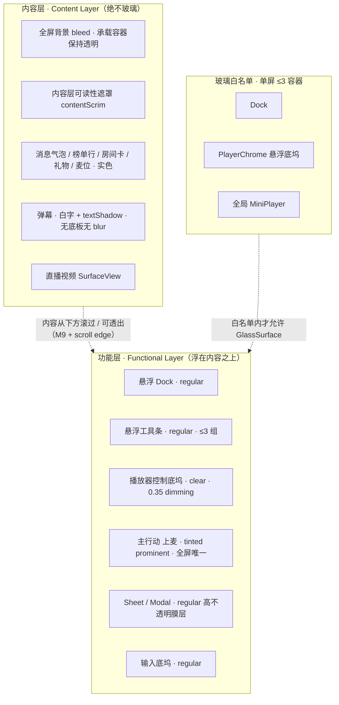

# 口袋48 · Liquid Glass 高级审美 UI 重构文字方案

> **交付角色**：许清楚（产品经理） · 软件团队 · 任务 #3
> **性质**：纯文字视觉方案。**未修改任何 App 源码、未新增依赖、未写实现代码**（仅含 token 数值表、ASCII 线框与分层图）。
> **上游输入**：`01-architecture-and-component-inventory.md`（架构盘点，795 行）、`02-apple-liquid-glass-spec.md`（Apple 规范硬约束清单，335 行）
> **用户风格关键词**：大悬浮 UI · 大圆角 · 英雄文字 · 简洁 · 高度适配液态玻璃

## 依据优先级（落笔前必读）

| 优先级 | 依据 | 说明 |
| --- | --- | --- |
| 1 | **主理人裁决** | 关于 `transparent` 的「看角色不看字面」判定，优先级高于两份文档中的任何冲突表述 |
| 2 | `02-apple-liquid-glass-spec.md` | Apple HIG 规范硬约束，条款编号 M/D/S 与 5.3 验收清单 |
| 3 | `01-architecture-and-component-inventory.md` | 项目事实（文件路径 / 行号 / 版本 / 数量基线） |

✅ **口径一致性说明（主理人复核于交付时更新）**：架构报告已发布 **v1.1 修订版**（814 行），按主理人裁决把原冲突项 C1 拆为 **C1a（承载全屏背景的容器透明 + 整体压暗遮罩 = 合规且必须保留）** 与 **C1b（控件/卡片自身底板的半透明 = 违规需替换）**，并同步修正了 §0.2、§1.5、§5.1、§5.4、§8.1、§8.3、§8.4、§9 等 12 处表述，新增 `contentScrim` 与 `glassDimming=0.35` 分档及「透明对象角色判定表」。此前提示的旧口径残留已全部清除（仅在修订记录中作为被取代的旧说法引用）。**两份上游文档与本方案口径现已完全一致**，本方案 §2.3 / §2.4 即为最终判定依据。

⚠️ **数量基线校准**：架构报告正文多处写「约 240+ 处硬编码 borderRadius」，主理人交叉核验后确认为 **378 处**，本方案统一以 **378** 为准。页面数同理以 **`src/screens/` 实为 30 个 `.tsx`** 为准（`AUDIT_SCREENS.md` / `UI_AUDIT_2.7.1.md` 的 26 页是历史快照，已漂移，不可当事实来源）。

---

## 0. TL;DR：一页纸说清新 UI

**一句话**：彩色内容一路铺到屏幕边缘，只有三块玻璃浮在它上面。

打开 App，第一眼看到的不再是一排贴边的页头和密排的实心小卡片，而是——内容（房间背景、直播画面、成员封面、彩色弹幕）**占满整块屏幕并延伸到悬浮栏下方**；控件不再和内容抢同一平面，而是**抬升成唯一的一层功能平面**：底部一枚大圆角悬浮 Dock、顶部一条悬浮工具条、直播时一条贴在画面上的透明控制底坞。除此之外，屏幕上只有一处醒目的粗体左对齐大字（房间名 / 直播标题），和一枚品牌粉的主行动按钮「上麦」。

**与现状的根本差别，不是「加了多少模糊」，而是「层级被重新分配」**：

| 维度 | 现状 | 新 UI |
| --- | --- | --- |
| 平面关系 | 页头贴边、卡片实心、控件与内容互相挤压在同一平面 | 内容铺满全屏并 bleed 到栏下；控件脱离内容、抬升为单一悬浮功能平面 |
| 玻璃 | 2 处真模糊 + 一堆自称「玻璃」的半透明色块，散落在内容层 | **只有功能层能用玻璃，且单屏 ≤3 个容器**；内容层一律实色 |
| 标题 | 30 页统一 `ScreenHeader` 贴边、硬编码 24/800、`largeTitle` 全 src 0 命中 | 每屏 1 处英雄文字（31sp / Bold / 左对齐），悬浮工具条让出视线 |
| 圆角 | 378 处孤立硬编码；`AppTabBar` bar 28 / cell 28 同值（非同心） | 同心几何 `child = parent − padding`；胶囊 = 高度/2；大容器 28–32dp |
| 导航 | 4 Tab 胶囊贴屏底（bottom 0），可全站隐藏 | 4 Tab 悬浮 Dock、离边留白、常驻、单色、filled 图标、可挂 MiniPlayer accessory |
| 颜色 | 品牌粉可出现在任意处；导航标签可能撞上封面主色 | 内容层保留社区彩色；导航强制单色；品牌粉**只**作唯一 tinted prominent 的背景 |
| 可访问性 | reduceMotion / fontScale / 4 套色 token 全 0 覆盖 | 四条降级矩阵 + 4 套色 token + Dynamic Type 全档，作为 P0 新建 |

**技术前提（已定）**：App = RN 0.81.5 + Expo ~54 + React 19 + React Navigation 7 + zustand + expo-blur，`newArchEnabled=false`（Paper 老架构）；LiquidGlass 引擎是纯 Jetpack Compose Kotlin，两者视图树不互通，**引擎 Composable / API 直接可用项 = 0**。本轮走 **路径 A：RN 侧 expo-blur + 自定义渲染等效实现，不引入原生 Compose 引擎**。理由见 §2.1。因此本方案全部数值是**验收标准**，不是原生 API 移植。

**唯一判定标准**：`02-apple-liquid-glass-spec.md` §5.3 验收清单（本方案 §11 全文引用）。尤其记住：**只做一层 `BlurView` 不达标**——Lensing 近似必须含边缘折射高光 + 亮度自适应 + 触摸实时响应。

---

## 1. 设计定位与视觉语言

### 1.1 五个关键词

| 关键词 | 含义 | 落到界面上是什么 |
| --- | --- | --- |
| **悬浮 Levitation** | 控件与内容不在同一平面 | 栏离屏边 ≥16dp、离内容 ≥24dp，靠分层阴影与 scroll edge effect 抬起，**绝不垫实色/半透明底板** |
| **同心 Concentricity** | 所有嵌套圆角围绕同一个圆心 | `child = parent − padding`；Dock 28 / cell 20；大容器 28–32dp；胶囊 = 高度/2 |
| **留白 Breathing Room** | 用空间而非线条表达层级 | 组间 ≥24dp、组内 8–12dp、屏幕水平 ≥16dp；工具条 ≤3 组、次要动作收进 More |
| **单色克制 Monochrome Restraint** | 彩色属于内容，不属于控件 | 直播/房间/榜单页的 Dock 与工具条强制单色；符号用 filled、无边框、靠 vibrancy 自适应明暗 |
| **一处英雄 One Hero** | 每屏只有一个视觉锚点 | 31sp Bold 左对齐大字 + 唯一一枚品牌粉主行动按钮；其余信息靠字号/字重/颜色分级 |

### 1.2 明确的反词（这套 UI 反对什么）

- 🚫 反对**满屏毛玻璃**：给弹幕、聊天气泡、榜单行、房间卡、礼物、麦位头像套 blur —— 同时违反 [M] D1 与性能红线。
- 🚫 反对**实心卡片压边**：30 页贴边 `ScreenHeader` + 紧贴屏幕的胶囊 + 半透明卡片底板。
- 🚫 反对**小圆角小字密排**：378 处孤立圆角、11–13px 小字、靠透明度区分层级。
- 🚫 反对**彩色导航**：导航标签色与直播封面/弹幕主色相近（[C]/[TB]/[TO] 明确禁止）。
- 🚫 反对**每屏多个主按钮**：每 view 仅 1–2 个 prominent，toolbar 只 1 个且置尾端。
- 🚫 反对**把「高度适配液态玻璃」理解成「到处加玻璃」**：适配的是层级、 bleed、scroll edge、变体语义与 vibrant 色，不是数量。

### 1.3 参考气质

不是「把 iOS 26 截图搬到 Android」，而是取其**层级逻辑**：Apple Music 的悬浮 tab bar + MiniPlayer accessory、Apple TV 的直播内容优先与一键起播、iOS 26 alerts / onboarding 的粗体左对齐排版（[W356] 已核验原文 *"bolder and left-aligned"*）。**内容层依然是口袋48 社区 App 自己的彩色气质**——成员应援色、封面、房间背景、礼物与弹幕都保留，玻璃只做「承托内容的那层透明功能平面」。自研视觉语言与玻璃同调，不与它争抢注意力（[W356]）。

### 1.4 色彩策略

| 层 | 策略 | 具体 |
| --- | --- | --- |
| **内容层** | **彩色，保留** | 房间背景图、直播封面、成员应援色、礼物特效、弹幕文字色——这是社区 App 的灵魂，不因玻璃而褪色 |
| **功能层 / 导航** | **单色（monochromatic）** | 黑白灰 + vibrant 语义色；符号/文字随背后内容明暗自适应（底内容亮→变深，暗→变浅）；直播/房间/榜单页强制单色 |
| **品牌粉** | **唯一 tinted prominent 的背景色** | `#ff6f91`（亮）/ `#ff8fa8`（暗）只用于主行动「上麦」按钮**背景**；[C] 明确「强调主行动时把颜色加在背景而不是符号或文字」，且「不要给多个控件背景加色」 |
| **禁止** | — | 品牌粉不进 tab 标签、不进工具条符号、不进弹幕、不做玻璃统一底色；标签色不得与内容层背景相近 |
| **玻璃上文字** | vibrant 语义色 | 用 4 套色 token 中的 `glassLabel` / `glassLabelSecondary`，禁止固定灰值硬编码 |

### 1.5 材质策略

| 变体 / 处理 | 用在 | 参数 |
| --- | --- | --- |
| `regular` | Dock、悬浮工具条、输入底坞、Sheet / Modal、资料卡、榜单筛选条——凡「文字多、需要保可读」 | 模糊 + 亮度调整；scroll edge effect 辅助 |
| `clear` | **仅**直播播放器悬浮控制底坞（浮在视频这一视觉丰富背景之上） | 高透 + 亮底 `#000` @ **0.35** dimming；底层够暗则不加 |
| 内容层可读性遮罩 | `App.tsx` ImageBackground 之上的整体压暗（现状 0.88 / 0.92） | 归一到单一 `contentScrim` token；属 [LV] content footer darkening / [M] dimming 同性质的**内容层可读性手段**，不是玻璃 |
| 内容层卡片 | 消息气泡、榜单行、房间卡、礼物卡、麦位 | 不透明实色或 standard material 近似 + 圆角 + 分层阴影 |

> **两档 dimming 必须分档管理，禁止混用**：
> - `glassDimming = #000000 @ 0.35` —— [M] **官方硬值**，只作用于 `clear` 玻璃背后、只在底层亮时触发；
> - `contentScrim` —— [LV] *subtle darkening*，**官方未给数值**（【建议值】），作用于内容层整体压暗，可随背景亮度自适应、归一到单一 token，避免 0.88 / 0.92 两套随意值各写各的。

### 1.6 五个风格词的定义与边界

| 词 | 定义（可验收） | 边界（越界即违规） |
| --- | --- | --- |
| **大悬浮 UI** | 控件离屏边 ≥16dp、离内容 ≥24dp，有分层阴影，内容从其下方滚过并可透出 | 只给 3 类功能层组件（Dock / 悬浮工具条 / 播放器控制底坞）+ 主行动按钮；**不靠增加玻璃数量营造大气** |
| **大圆角** | 功能层大容器 28–32dp；中等控件 16–20dp；胶囊 = 高度/2；嵌套同心 | 内容层卡片仍 12–16dp；不得为「大圆角」牺牲消息/榜单的信息密度 |
| **英雄文字** | 31sp / 700 / 左对齐 / lineHeight 38 / 每屏 1 处 / Dynamic Type 到 44sp | 仅限房间名、直播标题、空态主文案；**不得**用于 tab 标签、工具条、弹幕、按钮文字 |
| **简洁** | 工具条 ≤3 组、次要动作进 More、≤5 tab、每屏 1 个 prominent、渐进披露 | 简洁不等于「删掉背景 bleed」——见 §2.3 防误删说明 |
| **高度适配液态玻璃** | 背景 bleed + scroll edge effect（每 view 1 个 / automatic）+ 按语义选 regular/clear + 玻璃上 vibrant 色 + 同屏 ≤3 容器 | 不等于「更多玻璃」，不等于「只加一层 BlurView 就算完成」 |

---

## 2. 分层架构

### 2.1 技术前提与本轮路径（既定事实）

| 事实 | 证据 |
| --- | --- |
| RN 0.81.5 + Expo ~54 + TS 5.9 + React 19 + React Navigation 7 + zustand + expo-blur ~15.0.8 | `package.json` |
| **`newArchEnabled = false`（Paper 老架构）** | `app.json:9`、`android/gradle.properties:38` |
| LiquidGlass 引擎 = 纯 Jetpack Compose Kotlin（`com.jiale.liquidglass`），靠 `RenderEffect` / `BlurEffect` / `CompositionLocal` | `LG/liquidglass/.../*.kt` |
| 两者视图树、布局、渲染循环、构建链完全不互通 → **引擎 Composable / API 直接可用项 = 0** | 架构报告 §7.1 |
| `android/` 无 Compose 依赖、无 `buildFeatures compose`；`DESIGN_SYSTEM.md:71-72` 明令禁止改 `android/` 原生、新增依赖、动播放器覆盖层 | 架构报告 §1.4 / §9 R6 |

**本轮路径 A：RN 侧 `expo-blur` + 自定义渲染做等效实现，不引入原生 Compose 引擎。** 理由：

1. **引擎与本 App 场景天然错配**：引擎 README 自承「背板必须静态」（滚动列表用不了）与「对话框/底部弹层在独立 window 里玻璃会退化成膜层」；而本 App 恰好是**大量 RN `Modal`（独立 window）+ 全屏滚动列表**（30 页几乎都有 FlatList/ScrollView）→ 即使付出桥接成本，在最需要玻璃的弹层上也只会退化，收益远小于成本。
2. **0 原生改动、0 新依赖**，是唯一不破坏 `DESIGN_SYSTEM.md:71-72` 既有规约的方案；现有 `expo-blur` 已有 2 处生产使用、`expo-linear-gradient` 已装、`MiniPlayer.tsx` 已有悬浮窗 + 拖动 + elevation 盖过 SurfaceView 的经验 → 路径 A 是「收敛与统一」，不是从零造轮子。
3. **引擎可复用的不是代码，是契约与数值**（见 §3.6）：六参数单一来源、默认值与区间、性能预算、API 31+ 降级策略、弹层不用真模糊的约束。这些原样搬成 TS 契约，未来 Phase 2 桥接时参数无需二次设计。
4. `legacyBackdrop` **明确不落地**（README 自承是「错误对齐」写法）。

> ⚠️ 需要在文档收敛时解禁的一处历史规约：`DESIGN_SYSTEM.md` 禁止「动播放器覆盖层」，而本方案必须改 `src/player/chrome/PlayerChrome.tsx`（**chrome 视觉层**）。解禁范围应明确写为「**chrome 可改，core 内核与流解析不动**」，与 §9 的「不动清单」一致。

### 2.2 三层结构



**层语义定义**：

| 层 | 可用材质 | 典型元素 | 硬规则 |
| --- | --- | --- | --- |
| **内容层** | 实色 / standard materials / 内容层压暗 | 全屏背景、消息气泡、榜单行、房间卡、封面、弹幕、礼物、麦位头像、`CommunityPostCard`、`Skeleton`、`StateViews` | 🚫 **禁止任何 backdrop blur 与 Liquid Glass**（[M] D1）；禁止半透明卡片底板 |
| **功能层** | `regular`（默认）/ `clear`（仅视频上方） | Dock、工具条、输入底坞、主行动按钮、Sheet | 控件下方**不垫底板**；靠 scroll edge effect 抬起；符号优先；成组渲染 |
| **玻璃白名单** | 单一 `GlassSurface` 组件 | Dock / PlayerChrome 底坞 / 全局 MiniPlayer | **单屏 ≤3 容器 / ≤6 元素**；直播页 ≤3；白名单外一律实色 |

**同屏计数规则**：`GlassSurface` 挂载数由 `useGlassBudget()` 统一统计；超限自动 `degrade()` 为高不透明实色。弹幕（`DanmakuOverlay` 纯白字 + textShadow，无玻璃无底板）、`AppToast`（不带玻璃）、`DanmakuSettingsSheet`（模态，按一次只 1 个计）**不计入 ≤3**。引擎性能预算「同屏 1–3 块小面 ≈ 无感；一页 5 张卡片全玻璃 → 明显掉帧」（README L224-240）直接支撑该白名单。

**Sheet 与 TabBar 的协同**：任一 Sheet / Modal 打开时，按 [SH]「一次只显示一个 sheet」+ [TB]「模态覆盖 tab bar 是唯一隐藏例外」，**收起或降级 Dock 为实色**，避免直播页瞬间叠到 4 个玻璃容器。关闭后恢复。

**4 Tab 事实校准**：当前导航为 **Home / Media(直播) / Rooms(房间) / Settings** 共 4 Tab + 26 Stack（`src/navigation/index.tsx:177-196, 297-333`），**无「我的」Tab**。`02` 清单 §6.1 的「5 tab（首页/房间/直播/榜单/我的）」是通用建议，本项目**保持 4 tab 不变**——导航路由结构不动，不新增路由，不为了填满 ≤5 而加 Tab。

### 2.3 🛑 防误删说明：背景 bleed 不得删除

> **本条为最高优先级的实施防呆条款，任何「清理透明」的工作都必须先读这张表。**

HIG Layout **M9** 要求「全屏背景延伸到 sidebar / toolbar / tab bar 下方」。在 RN 中，让 `ImageBackground` 铺到悬浮 Dock 底下，**恰恰依赖承载背景的容器透明**；删掉透明不仅主动违反 M9，还会**破坏 scroll edge effect 的视觉前提**（浮动控件下方必须有可透出的内容）。判定标准不是「代码里有没有出现 `transparent` / `rgba`」，而是「**这个透明对象的角色是什么**」。

### 2.4 透明对象角色判定表（对象 / 角色 / 判定 / 处理）

| 对象（文件:行） | 角色 | 判定 | 处理 |
| --- | --- | --- | --- |
| `src/navigation/index.tsx:185` `sceneStyle: {backgroundColor:'transparent'}` | 承载全屏背景的容器 | ✅ **合规且必须保留** | 保持。M9 bleed 与 scroll edge effect 的内容透出前提 |
| `App.tsx:641` 根容器 `transparent` | 承载全屏背景的容器 | ✅ **合规且必须保留** | 保持 |
| `src/theme/colors.ts:98-102` `usePageBackground() → transparent` | 承载全屏背景的容器 | ✅ **合规且必须保留** | 保持 |
| `src/navigation/index.tsx:266-267` navTheme / `:303` cardStyle `transparent` | 承载全屏背景的容器 | ✅ **合规且必须保留** | 保持 |
| `App.tsx:701-709` `ImageBackground` + 0.88 / 0.92 压暗遮罩 | **内容层可读性遮罩**（[LV] content footer darkening / [M] dimming 同性质） | ✅ **合规保留** | 归一到**单一 `contentScrim` token**；与 `glassDimming=0.35` 分档管理，避免两套数值各写各的 |
| `src/theme/ui.ts:8-9` `card: rgba(255,255,255,0.88)` | **卡片自身底板** | ❌ **违规** | 改为不透明实色或 standard material 近似（违反 D1 / D2 / M2） |
| `src/theme/ui.ts:9` `cardOnImage: 0.72` | **卡片自身底板** | ❌ **违规** | 同上 |
| `src/components/GlassCard.tsx` 在 `HomeScreen.tsx:614,790`、`RechargeScreen.tsx:64` | **内容层普通卡片**（伪玻璃：半透明实色 + 内描边） | ❌ **违规** | 降级为不透明实色内容卡；`GlassCard` 语义拆分后仅保留给浮层 `GlassSurface` |
| `src/player/chrome/PlayerChrome.tsx:37-41` `expo-linear-gradient` 遮罩 + 悬浮底坞 | 视频上方控件可读性处理 | ⚠️ **需归一** | 收敛到 `clear` 语义：亮底 `#000@0.35` dimming + 单一渐变 token，去掉随手写死的多套渐变 |
| `MediaScreen.tsx:1505-1522` 公告面板 `rgba(18,18,20,0.92)` | 浮层面板自身底（RN `Modal` 独立 window） | ⚠️ **按浮层规则** | `regular` = 高不透明膜层（建议 `opacity ≥ 0.9`）+ 边缘光；**弹层内不用真模糊**；面板改可收起 chip，不长时间遮挡直播 |
| `navigation/index.tsx:270` `bgScrim 0.34` | 全局遮罩 | ⚠️ **需归一** | 从 `glass.ts` 单一来源取值，取消内联 |
| `src/components/DanmakuOverlay.tsx` 纯白字 + `textShadow rgba(0,0,0,0.95)` | **内容层弹幕，无玻璃无底板无 blur** | ✅ **天然合规** | 🚫 **保持原样，禁止误改**；仅补一条注释/规则防止后续给它加 backdrop blur |

> **一句话口径**：**承载全屏背景的容器透明 = 合规且必须保留；控件 / 卡片自身底板的半透明 = 违规需替换。**

---

## 3. 全局 Design Token 表

> 所有数值集中到 `src/theme/`，**禁止内联**。以下为设计交付的数值表，不是实现代码。换算：iOS `pt` ≈ Android `dp`（1:1），字号用 `sp` 并跟随 `fontScale`。

### 3.1 四套色 token（结构 + 关键值）

现状 `src/theme/colors.ts` 仅 light / dark 两套（[C] M18 要求 4 套）。下表 `light/dark` 取现状实测值，`inc-*` 为**【官方未规定·建议值】**，需对比度实测校准。

| 语义 token | light | dark | inc-contrast light | inc-contrast dark | 用途 |
| --- | --- | --- | --- | --- | --- |
| `bg` | `#ECEDF1` | `#0B0B0F` | `#FFFFFF` | `#000000` | 全屏背景（bleed 到底） |
| `surface` | `#F4F5F9` | `#1C1C1F` | `#FFFFFF` | `#16161A` | 内容层实色卡片 |
| `label` | `#111114` | `#F5F5F7` | `#000000` | `#FFFFFF` | 主文字 |
| `labelSecondary` | `#55555C` | `#A9A9B2` | `#33333A` | `#DEDEE4` | 次级文字 |
| `labelTertiary` | `#9A9AA1`（现状，on `#F4F5F9` 对比存疑） | `#8A8A93` | `#4A4A52`（须 ≥4.5:1） | `#C4C4CC` | 三级文字；**inc 变体必须修对比度** |
| `tint` | `#ff6f91` | `#ff8fa8` | `#d94f73` | `#ffb0c2` | **唯一** tinted prominent 主行动背景（上麦） |
| `onTint` | `#FFFFFF` | `#1A1013` | `#FFFFFF` | `#000000` | prominent 按钮上的文字/符号 |
| `glassLabel` | vibrant 语义（随底内容明暗自适应） | 同 | 高对比固定值 | 高对比固定值 | 玻璃上的文字/符号（[M] vibrant 要求） |
| `hairline` | `rgba(0,0,0,0.06)` | `rgba(255,255,255,0.10)` | `rgba(0,0,0,0.20)` | `rgba(255,255,255,0.28)` | 分隔线 |
| `contentScrim` | 归一单值（由 0.88/0.92 收敛） | 归一单值 | 同 | 同 | 内容层整体压暗（[LV] darkening） |
| `glassDimming` | `#000000 @ 0.35` | 同 | 同 | 同 | **仅** `clear` + 亮底（[M] 官方硬值） |

**规则**：不硬编码色值、不重定义语义色（D7）；内容层彩色保留；导航强制单色；品牌粉只作唯一 prominent 背景（D5/D6）。

### 3.2 同心圆角与档位

| 档位 | 数值 | 适用 |
| --- | --- | --- |
| 功能层大容器 | **28–32 dp** | Dock、悬浮工具条、播放器控制底坞、大 Sheet |
| 中等控件 | **16–20 dp** | 按钮、输入底坞、筛选条、卡片式工具组 |
| 胶囊 Capsule | **= 高度 / 2**（高度 ≤56dp 的按钮 / chip / 头像） | 主行动、Pill、返回键、麦位头像 |
| 内容层卡片 | **12–16 dp** | 消息气泡、榜单行、房间卡、礼物卡（不追大圆角，保密度） |
| 同心公式 | **`child = parent − padding`** | 一切嵌套容器 |

> **必须点名的反例**：`AppTabBar.tsx:188` bar 圆角 28、`:231` cell 圆角 28 —— **同值而非父−padding**，是同心几何的标准反例。新值：bar 28 / padding 8 → **cell 20**。现状 `src/theme/radii.ts` 已有 `lg20/md14/sheet22/pill999` 却被 **378 处**硬编码绕过，另有 `ui.ts` 的 tabBar radius 32 与 `src/navigation/tabBarStyle.ts` 的 `mainTabBarStyle()`（全 src 仅定义处 1 命中 = **死代码**）三套并存 → P0 收敛为单一来源 + 清理死代码。

### 3.3 排版

| token | 值 | 性质 |
| --- | --- | --- |
| 默认正文 | `17 sp` | 官方硬值 |
| 最小字号 | **≥ 11 sp**（含弹幕角标、榜单序号、时间戳） | 官方硬值 |
| 英雄文字 | **31 sp / 700 / 左对齐 / lineHeight 38 / 每屏 1 处** | 官方 Large Title + 强调 Bold |
| 英雄文字（品牌增强可选） | 34–41 sp | 【建议值】待用户拍板（§10） |
| Dynamic Type 最大档 | 英雄文字 → **44 sp**，lineHeight 52；正文 → 28 sp | 官方 AX1 |
| Title 1 / 2 / 3 | 25 / 19 / 17 sp | 官方硬值 |
| Headline / Body / Callout / Subhead / Footnote / Caption | 14/600 · 14或17 · 13 · 12 · 12 · 11 sp | 官方 xSmall 档 |
| **字重白名单** | **400 / 500 / 600 / 700**（禁用 100–300） | 官方硬值（现状 `ScreenHeader` 用 `800`，须收敛） |
| 字体家族 | ≤2 套（1 主字体 + 1 等宽数字字体给榜单/计数） | 【建议值】 |
| 层级手段 | 字重 + 字号 + 颜色三者；**禁止靠透明度单独区分层级** | 官方硬值 |

> 现状 `ScreenHeader.tsx` 硬编码 `fontSize:24 / fontWeight:'800'`，`typography.ts` 里 `largeTitle 34` 定义了但全 src **0 使用** —— 英雄文字完全缺失，属于 P0 新建项而非美化项。

### 3.4 间距与阴影

| token | 值 | 用途 |
| --- | --- | --- |
| 组间 | **≥ 24 dp** | 分组留白（[L]） |
| 组内 | **8–12 dp** | 控件间距 |
| 屏幕水平安全边距 | **≥ 16 dp** | 大悬浮 UI 基线 |
| 悬浮栏离屏边 | ≥16 dp，胶囊与边缘另留 **≥8 dp** | 【建议值】 |
| 玻璃容器 spacing | **20–40 dp** 统一常量 | 对应 `GlassEffectContainer(spacing:)`；spacing > 内部 Stack spacing → 静止态融合；相等 → 最近边 ≤ spacing 才 morph |
| 触控目标 | ≥48×48 dp（麦位/播放按钮 ≥44 dp，间距 ≥8 dp） | 【建议值】 |
| 阴影 | 4 档 token（ambient + key 分层），Android 走 elevation | **阴影 ≠ 半透明底板**；不得用底板替代 scroll edge effect |

### 3.5 玻璃参数单一来源 `src/theme/glass.ts`

**照抄引擎 `GlassDefaults` 作为未来接原生引擎的契约**（数值来自 `LG/GlassDefaults.kt` + README L123-151）。以下为数值表：

| 参数 | 默认 | 区间 | 说明 / 作用域 |
| --- | --- | --- | --- |
| `transparency` | `0.38` | `[0.05, 0.70]` | 通透度；**玻璃上压正文不超过 0.5** |
| `refractDp` | `5.0` | `[0, 12]` | 折射强度（路径 A 下为语义占位） |
| `refractMode` | `SCALE` | SCALE / FIELD | 默认 SCALE（1 次绘制最省）；FIELD 更好看但 3–6 次绘制 |
| `edgeWidthDp` | `2.0` | `[0.6, 10]` | 边缘光带宽度；越宽越淡，宽时补 `edgeGlow` |
| `edgeGlow` | `1.0` | `[0.4, 2.5]` | 边缘光亮度倍率 |
| `dispersion` | `0.35` | `[0, 1]` | 色散强度（RN 侧近似，不作硬性视觉验收） |
| `scrim` | `0.55` | `[0, 0.95]` | **背板遮罩**（与玻璃后 dimming 分档管理） |
| `legacyBackdrop` | `false` | — | **不落地**（错误对齐写法） |
| `glassDimming` | `0.35` | 固定 | [M] 官方硬值，`clear` + 亮底专用 |
| `blurRadius` | `12 dp` | — | 大控件默认模糊半径 |
| `compactBlur` / `compactEdgeWidth` | `6 dp` / `1.2 dp` | — | **小控件必须显式收窄**；半径接近控件高度时玻璃里只剩均匀色块 |

**配套契约（以表格描述职责，不写实现代码）**：

| 契约 | 对应引擎 | 职责 |
| --- | --- | --- |
| `GlassParams` TS 类型 + `GlassProvider` + `useGlassParams()` | `GlassParams` + `LocalGlassParams` | **六参数一次下发全树**，替代散落的 intensity 62/82/70 与 rgba |
| `resolveGlass(kind)` | `COMPACT_*` 规则 | 按 `compact / regular / large` 分派 `blurRadius` / `edgeWidth` / 变体 |
| `canBlur` | `Build.VERSION.SDK_INT >= S` | `Platform.Version >= 31` 才有真模糊 |
| `degrade(reason)` | API<31 膜层降级 | **一条降级路径同时服务** `api` / `reduceTransparency` / `lowEnd` / `budget`，返回 `opacity ≥ 0.9` 的高不透明实色配方（保留圆角、层级、单色外观） |
| `GlassSurface` | `LiquidGlassSurface` 语义 | **一个容器**承载模糊 / 膜层 / tint / 顶部高光 / 内缘亮带 / 边缘光，替代 `AppTabBar.tsx:119-158` 的 4 层独立平铺（[SW] M23 成组渲染） |
| `layer` 白名单断言 | — | `layer==='content'` 时直接降级为实色 / 开发期报错，从机制上禁止内容层玻璃 |
| `useGlassBudget()` | README 性能预算 | 运行时统计挂载数，超 ≤3 容器自动 `degrade()` |
| `childRadius(parent, padding)` | — | 同心几何，消除 378 处硬编码 |

> **禁止内联清单**：`AppTabBar` intensity 62/82、`FollowedRoomsScreen` 70、`MediaScreen` `rgba(18,18,20,0.92)`、`navigation` bgScrim 0.34、`App.tsx` 0.88/0.92、`tabBarStyle.ts` 0.96/0.94/0.76/0.72 —— 全部改为从 `useGlassParams()` 取值。

### 3.6 `resolveGlass(kind)` 分派表

| kind | 变体 | 模糊 | 边缘光 | dimming | 典型组件 |
| --- | --- | --- | --- | --- | --- |
| `compact` | `regular` | `compactBlur 6dp` | `compactEdgeWidth 1.2dp` | 无 | 返回键胶囊、Pill、小图标按钮 |
| `regular` | `regular` | `12dp` | `2dp` | 无（用 scroll edge effect） | Dock、悬浮工具条、输入底坞、筛选条 |
| `large` | `regular` | `12dp` + 更不透膜层 | `2dp` | 无 | Sheet / Modal（文字多，且独立 window 不用真模糊） |
| `media` | **`clear`** | 不做 backdrop blur（SurfaceView 取不到采样） | 边缘高光 + 渐变 | **亮底 `#000@0.35`** | 直播播放器悬浮控制底坞 |

---

## 4. 全局布局重构

### 4.1 页头：贴边 `ScreenHeader` → 悬浮工具条

现状：`ScreenHeader.tsx:70-100` `position:'relative'`、`paddingHorizontal:12`、无圆角、`fontSize:24/800`、返回键 36×36 圆，全 30 页复用。

新布局（**≤3 组**）：

```
┌──────────────────────────────────────────────┐
│  ← 全屏背景 / 内容从这里开始 bleed（不裁切）  │
│                                              │
│   ╭──────────────────────────────────────╮   │  ← 悬浮工具条，离屏边 ≥16dp
│   │ [←]   [符号组 A]      [⋯] [ ★ 主行动 ] │   │     圆角 28–32dp，同心 cell 20dp
│   ╰──────────────────────────────────────╯   │     scroll edge effect（automatic，每 view 1 个）
│                                              │
│   英雄文字 31sp / 700 / 左对齐 · 每屏 1 处    │
│   ─────────────────────────────────────────  │
│   （内容层：实色卡片 / 列表 / 视频）           │
│   ... 内容从工具条下方滚过并透出 ...           │
└──────────────────────────────────────────────┘
```

| 项 | 规则 |
| --- | --- |
| 分组 | **≤3 组**：① 导航 + 标题 ② 主功能符号组 ③ More + 唯一 prominent（置尾端） |
| 符号 | 优先可辨识 filled 系统符号、无边框（[TO] M27/D13）；不手写「返回/关闭」文字 |
| 文字 / 符号隔离 | 带文字的控件与带符号的控件**分开**并插 fixed space，避免误读成同一动作（M28/D12） |
| 次要动作 | 分享、举报、设置、筛选收进 **More（ellipsis）**（S9）；不手动加溢出菜单（D11） |
| prominent | **每 view 仅 1 个**，置尾端，`.prominent`；用样式而非尺寸区分主次（S10/D16） |
| 背景 | 不自定义背景/着色控件（M29）；用内容层 informing + `ScrollEdgeEffectStyle` |
| 圆角 | 所有自定义控件圆角 = bar 圆角 − padding（同心） |
| 沉浸 | 可 contextually 隐藏进入全屏观看，但必须提供可靠恢复方式 |

### 4.2 底部：悬浮胶囊 Dock

现状 `AppTabBar.tsx`：`outer bottom:0 + paddingBottom:16`、`bar borderRadius:28 / minHeight:64`、`cell` 定宽 76 / `borderRadius:28`（同值非同心）、4 层独立平铺、可由 `useUiStore.tabBarHidden` 全站隐藏（`navigation/index.tsx:141`）。

新布局：

```
        ╭────────────────────────────────────────╮
        │  [首页]  [直播]  [房间]  [设置]        │  ← regular · 圆角 28–32dp
        │   filled 图标 + 单词标签 · 单色外观     │     cell 同心 20dp（28−8）
        ╰────────────────────────────────────────╯
          ↕ 离屏边 ≥16dp + 胶囊额外 ≥8dp
   ── 内容层继续延伸到 Dock 下方（bleed，不得裁切）──
```

| 项 | 规则 |
| --- | --- |
| 数量 | **保持 4 Tab**（Home / Media / Rooms / Settings），≤5，不用 More 溢出 |
| 常驻 | **移除 `tabBarHidden` 全站隐藏逻辑**，仅模态覆盖时可隐藏（M14/M15/D8） |
| 职责 | 只做导航，不做「上麦 / 发消息」等动作（M13） |
| 标签 / 图标 | 单词标签 + filled 图标（M16）；标签色不与内容层背景相近（M17） |
| 外观 | 内容层花哨时强制**单色**（[C]/[TB]）；符号随底内容明暗自适应 |
| accessory | 可挂 MiniPlayer / 正在上麦条；**滚动时最小化、accessory 内联**；点 tab 或滚到顶恢复（S6） |
| 材质 | 单一 `GlassSurface` 容器（1 个），4 层平铺合并；不垫底板 |
| 计数 | 计入白名单 W1；Sheet 打开时收起或降级实色 |

### 4.3 全屏背景 bleed 与 scroll edge effect

- **背景**：`App.tsx` 的 `ImageBackground` / 房间背景图全屏铺满，**延伸到 Dock / 工具条下方**，不裁切、不垫底板（M9）。承载它的透明容器**必须保留**（见 §2.3 防误删表）。背景被栏遮挡时可用 background extension effect（翻转 + 模糊镜像）补延伸感（S5）；内容压暗归一到 `contentScrim` 单一 token。
- **scroll edge effect**：**只在浮动控件背后有滚动视图时使用**（M10/D10）；**每个 view 只挂 1 个**（M11）；**优先 `automatic`**（M12）——控件多、玻璃外有文字、固定表头时用更不透的 hard 分离；选 soft 必须多场景实测可读性。禁止把它当装饰性 overlay。
- **禁止**：同方向嵌套 scroll view（D17）。

### 4.4 安全区

现状 `src/hooks/useSafeAreaInsets.ts:27-36` 是**纯 JS 经验值**（Android top 24 / bottom 48），且 `package.json:17-23` 刻意 `exclude` 了 `react-native-safe-area-context` 的原生部分，`edgeToEdgeEnabled=true`。这违反 M22「尊重安全区」，且大悬浮 UI 在挖孔屏 / 折叠屏 / 横屏会偏移。

| 方案 | 说明 | 约束 |
| --- | --- | --- |
| **首选** | 接入真实系统 insets（`react-native-safe-area-context` 原生 Provider），Dock / 工具条 / Toast / FAB 全部改用实际 insets | 需**用户解禁**「重新接入原生 Provider / 触碰 autolinking」——见 §10 待确认 |
| **退路（不解禁时）** | 把经验值集中到**单一来源**，统一 `max(insets.top, 经验值)` 兜底（参考 `AppToast.tsx:54` 现有模式），并逐机型回归 | 【建议值】，不能声称「已满足 M22」，需在验收清单中标注为遗留风险 |

> 本项目仓库**无 `ios/` 目录**、`app.json` 无 ios 段、`README.md:11` 标注 Android 单端 → 风险表述应为「Android 挖孔 / 状态栏 / 系统栏避让」，不使用「动态岛」等 iOS 概念。

---

## 5. 逐页面重构描述

> 每页统一给「现状 → 新布局线框 → 关键尺寸 → 玻璃白名单」。**高频两页（聊天室、直播间）写得更细**，因为「大悬浮 UI + 大圆角 + 英雄文字」主要在这两处被感知。

### 5.1 首页 `HomeScreen.tsx`

**现状**：贴边 ScreenHeader；ScrollView + 直播 banner 轮播 + 2 列网格 + 快捷入口 + 工具手风琴 + 续播卡；`GlassCard` 2 处（L614, L790）当内容卡用；无英雄文字。

```
现状 → 新布局
┌──────────────────────────────┐
│ [悬浮工具条: ← | ⋯ ]  ← 28dp  │
│  你好，今天想看谁？          │  ← 英雄文字 31sp/700，每屏唯一
│  ─────────────────────────  │
│  ╭────── 直播 banner ─────╮  │  ← 内容层实色/图片，圆角 12–16dp
│  │  [ LIVE badge ]  ▶ 观看 │  │     一键起播（[LV]）
│  ╰────────────────────────╯  │
│  ╭────╮ ╭────╮              │  ← 2 列房间卡：实色，无玻璃
│  ╰────╯ ╰────╯              │
│  ⋯ 内容从悬浮 Dock 下滚过 ⋯  │
│      ╭─── 悬浮 Dock ───╮     │
└──────┴────────────────┴─────┘
```

- **关键尺寸**：英雄文字 31sp/700/左对齐；banner 圆角 16dp；卡片 12–16dp；组间 ≥24dp；工具条 28dp / cell 20dp。
- **玻璃白名单**：**Dock（W1）仅 1 个**；工具条为 `regular` 但不新增独立玻璃容器（与 Dock 分属不同滚动区）。`GlassCard` 两处**降级为实色内容卡**。
- 直播标识用 badge/symbol/sash，一眼区分 VOD（[LV] S12）；提供进度指示。

### 5.2 直播列表 `MediaScreen.tsx`（Tab · 1956 行）

**现状**：ScreenHeader + 直播/录播双 tab 双列网格 + 首条 banner；**20 处浮层**：公告面板（L1505-1522, `rgba(18,18,20,0.92)`）、送礼 Modal（L1587）、贡献榜 Modal（L1649）、日历（L1802）、弹幕设置 Sheet（L1674）、`PlayerScreen` + `DanmakuOverlay`。

```
┌──────────────────────────────────────┐
│ [←] [直播|录播]        [🔍] [⋯]      │ ← 悬浮工具条 ≤3 组，符号优先
│  正在直播                            │ ← 英雄文字（列表页唯一，或留给直播间）
│  ╭────── LIVE · 全幅封面 ──────╮     │ ← 一键起播，点击后 UI 让位全屏
│  │  ▶ Watch Now   [LIVE sash]  │     │
│  ╰────────────────────────────╯     │
│  ╭────╮ ╭────╮  ... 2 列网格       │ ← 实色卡，绝无玻璃
│  [公告 chip] ← 可收起，不长时遮挡    │
│      ╭──── 悬浮 Dock ────╮          │
└──────┴──────────────────┴──────────┘
```

- **关键尺寸**：封面全幅 + `contentScrim` 压暗 + 白字上浮；卡片 12–16dp；公告改**可收起 chip**，不再用 `position:absolute top:0 zIndex:29` 长时间占顶（[LV] M32/D21）。
- **弹层收敛**：送礼 / 贡献榜 / 日历 / 弹幕设置统一 sheet 管理器，**一次只 1 个**（M31/D18）；打开时收起 Dock。RN `Modal` 内不用真模糊，用 `regular` 高不透明膜层。
- **玻璃白名单**：Dock（W1）；进播放态后切换为 PlayerChrome 底坞（W2）+ 可选 MiniPlayer（W3），合计 ≤3。

### 5.3 直播间 `src/player/PlayerScreen.tsx` ★高频

**现状**：统一外壳 = `PlayerCore`（Exo/Native/Web 内核）+ `PlayerChrome`（渐变遮罩顶栏 + 悬浮底坞，`CONTROLS_HIDE_MS=3500`）+ `FullscreenManager` + `children` 弹幕插槽；`LiveExoView` 是 SurfaceView，内容**无法被 backdrop blur 采样**。

```
┌──────────────────────────────────────────────┐
│                                              │
│        全屏直播画面（SurfaceView）            │ ← 内容层，UI 让位沉浸
│     弹幕：白字 + textShadow，无底板无 blur     │   （DanmakuOverlay 保持原样）
│                                              │
│  ╭──────────────────────────────────────╮   │
│  │ ⏵  ⏸  🔊  [进度]  弹幕  清晰度  ⛶  │   │ ← clear 悬浮控制底坞
│  ╰──────────────────────────────────────╯   │   亮底：#000 @ 0.35 dimming
│   ↑ 3.5s 自动隐藏；唤起/收起方式可预期        │   边缘高光，不做 backdrop blur
└──────────────────────────────────────────────┘
```

- **必须**：`clear` 是**唯一**合法的高透场景（浮在视频上）；亮底加 `#000@0.35` dimming，底层够暗则不加（M6/M7/D3）；相关符号控件**共享同一块玻璃**（[W201]/[SW] S14）；`interactive()` 实时按压响应；一键起播后 UI 让位全屏沉浸（M32/D21）；切频道即时视觉反馈；离开 Media Tab 停音频（[LV]）。
- **禁止**：不用 `regular` 遮住画面；不加控件底板；不做淡入淡出作为唯一出现方式；导航层不长时间遮挡画面；不在 Reduce Motion 下做 z 轴 / morph 动画。
- **关键尺寸**：dimming **0.35**；玻璃容器 **1 个**；按压 80–150ms；控制条圆角 28dp / cell 20dp；最小文字 11sp、对比 ≥4.5:1。
- **玻璃白名单**：PlayerChrome 底坞（W2）；播放态下 Dock 收起（模态/沉浸例外），MiniPlayer 若存在算 W3 → **合计 ≤3**。
- **SurfaceView 特别约束**：控制条**不做 backdrop blur**（采样不到视频内容，会出现黑块），用渐变 + 0.35 dimming + 边缘高光近似 `clear`；弹幕保持透明无底板；z-order / 触摸穿透需真机回归（§10 R3）。

### 5.4 房间聊天室 `FollowedRoomsScreen.tsx` ★高频（**不是独立路由**，内嵌 Rooms Tab）

**现状**：`ScreenHeader overlay`(L2341)；大/小房间 segmented + 搜索 + 粉丝过滤 + 上麦入口包在 `BlurView intensity 70`（L2361-2419，功能层工具条，**可保留改造**）；FlatList 消息流；18 处浮层；25 处 rgba；`RoomRankPanel`；房间背景图。

```
┌──────────────────────────────────────────────┐
│  ← 房间背景图全屏 bleed（透明容器必须保留）   │
│  ╭──────────────────────────────────────╮   │
│  │ [←] [大房间|小房间] [🔍] [⋯] [★上麦] │   │ ← 悬浮工具条 ≤3 组 / regular
│  ╰──────────────────────────────────────╯   │   28dp / cell 20dp；唯一 prominent
│  「星梦剧院 · 今日公演」                     │ ← 英雄文字 31sp/700/左对齐（高频感知点）
│  ─────────────────────────────────────────  │
│  ╭ 消息气泡 · 实色 · 12–16dp ╮              │ ← 内容层，🚫 禁止逐条玻璃
│  ╭ 消息气泡 ╮        ╭ 我 ╮                │
│  ⋯ 消息从工具条/输入底坞下滚过并透出 ⋯      │
│  ╭──────────────────────────────────────╮   │
│  │ [😊][@][📎]  |  输入……  |  [发送]   │   │ ← 输入底坞 regular（1 容器）
│  ╰──────────────────────────────────────╯   │   文字按钮与符号按钮分开 + fixed space
│        ╭───── 悬浮 Dock ─────╮              │
└────────┴────────────────────┴──────────────┘
```

- **大悬浮 UI 如何落地**：工具条与输入底坞各自抬升、离内容 ≥24dp、有分层阴影；内容（房间背景 + 消息）从二者下方滚过并可透出；**不垫任何底板**。这就是「大悬浮」在聊天室的全部表达——**不是给气泡加玻璃**。
- **大圆角如何落地**：工具条 / 输入底坞 28–32dp，内部 cell 同心 20dp；返回键、上麦按钮、Pill 用胶囊（= 高度/2）；消息气泡保持 12–16dp 以保密度。
- **英雄文字如何落地**：房间名 31sp/700/左对齐，每屏 1 处，位于工具条下方、内容之上；Dynamic Type 到 44sp 时房间头与麦位行改纵向堆叠。
- **输入区**：作为 **1 个**玻璃容器；「发送」（文字）与符号按钮**分开**并插 fixed space（M28/D12）；仅 1 个 prominent；次要动作（表情/图片/@）收进 More 或同组符号共享一块玻璃；大字号时高度自适应。
- **上麦**：全页**唯一 tinted prominent**，品牌粉加在**背景**（[C] D5）；麦位列表是内容层实色，不给每个头像套玻璃。
- **玻璃白名单**：工具条（由现有 BlurView 改造为单一 `GlassSurface`）+ 输入底坞 + Dock → **≤3**；`experimentalBlurMethod="dimezisBlurView"` 收敛到统一 GlassSurface，消除多套模糊实现。
- **禁止**：给每条气泡套玻璃 / backdrop blur（D1 + 性能红线）；同方向嵌套 scroll view；贴边页头；25 处内联 rgba 与 378 处硬编码圆角中的本页部分须收敛。

### 5.5 上麦 `OnMicScreen.tsx`

**现状**：Stack 页，全成员上麦扫描列表（`useOnMicStore` 扫 serverId/channelId）；ScreenHeader；FlatList；无玻璃。

```
┌──────────────────────────────┐
│ [悬浮工具条: ← | 筛选 | ⋯ ]  │
│  正在上麦                    │ ← 英雄文字 31sp/700
│  ╭──── 麦位行 · 实色 ────╮   │ ← 内容层，胶囊头像 + 同心圆角
│  │ (头像) 成员名  [静音] │   │
│  ╰────────────────────────╯   │
│  ╭──────────────────────╮    │
│  │   ★ 申请上麦          │    │ ← 唯一 tinted prominent，品牌粉背景
│  ╰──────────────────────╯    │   胶囊 = 高度/2，宽敞区可 XLarge
│      ╭── 悬浮 Dock ──╮       │
└──────┴──────────────┴───────┘
```

- **关键尺寸**：主行动 XLarge（宽敞区域 + 玻璃强调，[W356] S18）；胶囊按钮；按钮 ≥44dp、间距 ≥8dp；组间 ≥24dp。
- **玻璃白名单**：主行动按钮（`compact` 档 `regular`，可计入 1 个容器）+ Dock；**麦位行一律内容层实色**。
- 状态切换（空闲/在麦/静音）用 `interactive()`；瞬时状态可用 [M] M3 的「激活时呈现玻璃」例外（slider/toggle 类），不作为常驻玻璃。

### 5.6 榜单 `MeleeRankScreen.tsx`（+ MediaScreen 贡献榜 Modal + RoomRankPanel）

**现状**：Stack 页，鸡腿/乱斗排行榜（周/总/年 + 成员贡献榜）；分段 chips + 概览数字条；`ScreenHeader`；榜单容器按 `02` §6.8 属内容层。

```
┌──────────────────────────────┐
│ [悬浮工具条: ← | 周/总/年 | ⋯ ]│ ← 筛选条 = 功能层 regular
│  本周榜单                     │ ← 英雄文字（或 Sheet 内关键文案更粗左对齐）
│  ╭────────────────────────╮   │
│  │ ① 头像 成员名  12,480  │   │ ← 榜单行：内容层实色，无玻璃
│  │ ② ...          9,210   │   │   数字用等宽字体，≥11sp，≥4.5:1
│  ╰────────────────────────╯   │
│      ╭── 悬浮 Dock ──╮       │
└──────┴──────────────┴───────┘
```

- **Sheet 形态**：`regular`（文字多）、medium / large detent + grabber + 下滑关闭、**一次只 1 个**、Done 必配 Cancel 或 Back（不三者同现）（M31/D18/S11）；按钮圆角与 sheet 同心。
- **玻璃白名单**：筛选工具条（1 容器，符号优先）+ Dock；**榜单行绝无玻璃**（D1）。
- 分类与直播 content footer / EPG 保持一致（[LV] S13）；数字不用 Ultralight 字重。

### 5.7 社区 `CommunityScreen.tsx`（+ 帖子详情）

**现状**：Area48 社区，推荐/最新双 Tab 帖子流、发帖底部 sheet、右下 FAB；头注明确「fill2 底分段 + FAB 56 + radii.sheet 发帖 sheet」。

```
┌──────────────────────────────┐
│ [悬浮工具条: ← | 推荐/最新 | ⋯]│
│  社区                         │ ← 英雄文字
│  ╭──── CommunityPostCard ──╮  │ ← 内容层实色，无玻璃
│  │ 作者 → 标题 → 正文 → 图 │  │
│  ╰────────────────────────╯  │
│                    ╭────╮    │
│                    │ ＋ │    │ ← FAB 用实际 safe area 避让；胶囊
│      ╭── 悬浮 Dock ──╮ ╰────╯    │
└──────┴──────────────┴─────────┘
```

- **关键尺寸**：发帖 sheet `regular` + medium detent + grabber；FAB 56dp、尊重系统 insets；卡片 12–16dp。
- **玻璃白名单**：工具条 + Dock（≤2）；发帖 Sheet 打开时**收起 Dock**（一次只 1 个 sheet）。`CommunityPostCard` 一律实色。

### 5.8 设置 `SettingsScreen.tsx`（Tab）

**现状**：版本/致谢、账号、主题/背景图、语言、自动签到、下载/日志、成员统计；分组列表。

```
┌──────────────────────────────┐
│ [悬浮工具条: 设置 | ⋯ ]       │
│  设置                         │ ← 英雄文字 31sp/700
│  ╭─ 外观 ─────────────────╮  │ ← 分组留白 ≥24dp
│  │ 深浅外观  /  减少透明效果 │ ← 新增 a11y 开关（P0）
│  │ 减少动态效果 / 字号      │
│  ╰────────────────────────╯  │
│  ╭─ 账号 / 关于 ──────────╮  │ ← 实色分组卡，无玻璃
│      ╭── 悬浮 Dock ──╮       │
└──────┴──────────────┴───────┘
```

- 设置页承载 **「减少透明效果」开关**（`degrade()` 的用户侧兜底）与动态效果 / 字号档；可作为未来「玻璃实验台」调试页的落点（引擎 Slider/Switch 概念复刻，[架构 §7.3 #11]）。
- **玻璃白名单**：工具条 + Dock（≤2）；分组卡内容层实色。

### 5.9 全屏播放器与弹幕

| 项 | 规则 |
| --- | --- |
| 弹幕层 | **`DanmakuOverlay.tsx` 保持原样**——纯白字 + `textShadow rgba(0,0,0,0.95)`，无玻璃、无底板、无 blur，**天然合规，禁止误改**；仅补注释/规则防后续加 backdrop blur |
| 弹幕可读性 | 文字 ≥11sp、对比 ≥4.5:1；可用内容层渐变遮罩（[LV] darkening 思路），**不是玻璃底板** |
| 礼物 / 闪光特效 | 内容层；响应 **Dim Flashing Lights**（[A] 视频播放必须）；Reduce Motion 下减少自动/重复动画；不以动效作为唯一反馈（补 haptics / 音频 / 文案） |
| 精简模式 | 可整体隐藏弹幕与礼物特效，只保留播放 + 聊天 + 返回（Assistive Access，【建议值】） |
| 全屏沉浸 | 起播后导航层让位；control 3.5s 自动隐藏方向合规；公告改可收起 chip；一次只 1 个 sheet |
| 玻璃白名单 | 仅 PlayerChrome 控制底坞（`clear`）；SurfaceView 之上不做 backdrop blur |

### 5.10 Sheet 与弹层（统一规则）

| 项 | 规则 |
| --- | --- |
| 数量 | **一次只显示 1 个**；关闭一个回到另一个会让人迷失（M31/D18） |
| 退出 | Done 必配 Cancel 或 Back；**不同时出现三者** |
| 变体 | `regular`（文字多）；**不用 `clear`**（D3） |
| detents | `medium`（≈半高，渐进披露）/ `large`；可缩放 sheet 带 **grabber**；支持**下滑关闭** |
| 材质 | RN `Modal` 是独立 window（引擎 README 自承退化），统一「**不用真模糊**」→ 高不透明膜层（建议 `opacity ≥ 0.9`）+ 边缘光 + 同心圆角；同时满足 Reduce Transparency 降级 |
| 与 Dock | Sheet 打开时**收起或降级 Dock**（[TB] 模态覆盖是唯一隐藏例外），避免玻璃容器超 ≤3 |
| 排版 | 关键文案更粗、左对齐（[W356]）；按钮圆角与 sheet 同心 |
| 覆盖组件 | 上麦申请、资料卡、榜单详情、举报、送礼、贡献榜、日历、弹幕设置、`FullScreenPlayer` 播放列表 sheet、`ZoomImageModal` 工具条、`MemberPicker`、公告 Modal |

---

## 6. 组件映射表

现有 `src/components/` 25 个 `.tsx` 中关键组件的处置（角色：**保留改造 / 降级为内容层实色 / 新建 / 废弃**）。

| 组件（路径） | 现状 | 重构后角色 | 处置要点 |
| --- | --- | --- | --- |
| `src/components/AppTabBar.tsx` | 底部悬浮胶囊，BlurView intensity 62/82，4 层平铺，bar 28 / cell 28 同值，可被 `tabBarHidden` 隐藏 | **保留改造 · 白名单 W1** | 大悬浮化（离边留白）、参数取 `glass.ts`、4 层合并为单一 `GlassSurface`、cell 同心 20dp、单色外观、常驻、filled 图标、accessory 最小化 |
| `src/components/GlassCard.tsx` | 「伪玻璃」半透明实色 + 内描边，被当内容层普通卡片（HomeScreen:614,790 / RechargeScreen:64） | **拆分 · 降级为内容层实色** | 内容卡分支改不透明实色；浮层分支并入 `GlassSurface`；**去掉「伪玻璃」命名与半透明底** |
| `src/components/ScreenHeader.tsx` | 全 30 页贴边 `position:'relative'`，标题 24/800，返回键 36×36/18，`overlay` 分支用 `surfaceGlassStrong` | **保留改造 → 悬浮工具条** | 悬浮化 ≤3 组、符号优先、文字/符号分开、唯一 prominent 置尾端、英雄文字档、返回键胶囊同心、`overlay` 统一走 `glass.ts`；字重收敛到 700 |
| `src/components/AppToast.tsx` | 「iOS 26 banner」顶部胶囊，spring 入场，2.2s 自动消失 | **保留改造 · 不计入 ≤3** | 顶部胶囊、尊重实际 safe area、单色；**不带玻璃**；Reduce Motion 下改静态/短 fade |
| `src/components/MiniPlayerBar.tsx` | 自称「Liquid Glass 浮层」，圆角 28、纯半透明 + 阴影，无 BlurView | **保留改造 · 白名单 W3** | 改为单一 `GlassSurface`（`regular`），参数取 `glass.ts`；去掉伪玻璃命名 |
| `src/components/MiniPlayer.tsx` | 全局应用内悬浮小窗（Video / LiveExoView + 拖动层 + 按钮层，3s 隐藏） | **保留改造 · Dock accessory** | 作为 Dock accessory，滚动时内联；elevation 盖过 SurfaceView 的经验保留；计入 ≤3 |
| `src/components/Pill.tsx` | 「玻璃底 + 描边」注释，实际 `fill3` 实底，`borderRadius:999` | **保留（语义修正）** | 胶囊 = 高度/2；去掉「玻璃底」误导命名；作为 `compact` 档控件 |
| `src/components/Button.tsx` | filled / tinted / plain，`onTint` 前景 | **保留改造** | 唯一 tinted prominent 样式（品牌粉加在背景）；字重白名单；圆角同心；按压 80–150ms |
| `src/components/HeaderAction.tsx` | 页头右侧文字操作 | **保留改造** | 文字控件与符号控件**分开**并插 fixed space；次要动作收进 More |
| `src/components/DanmakuOverlay.tsx` | 纯白字 + textShadow，泳道调度，memo 单条 Bullet，**无玻璃无底板无 blur** | ✅ **完全保留 · 禁止误改** | 仅补注释/规则防止后续加 backdrop blur；内容层红线标杆 |
| `src/components/Skeleton.tsx` | 自称「玻璃色块骨架屏」，实为 rgba 脉冲色块，无 blur | **保留（语义修正）** | 去掉「玻璃」命名；内容层实色脉冲；不加 blur |
| `src/components/DanmakuSettingsSheet.tsx` | 弹幕设置 Modal（开关/区域/速度/字号/不透明度） | **保留改造 · Sheet** | `regular` 高不透明膜层、medium detent + grabber、一次只 1 个、不用真模糊 |
| `src/components/FullScreenPlayer.tsx` | 音乐全屏播放器 Modal（黑胶、歌词、播放列表 sheet、下拉关闭） | **保留改造 · Sheet** | 播放列表 sheet 按统一 Sheet 规则；一次只 1 个 |
| `src/components/ZoomImageModal.tsx` | 全屏图片查看器 | **保留改造 · 浮层工具条** | 工具条走 `glass.ts`；Reduce Motion 下缩放动画降级 |
| `src/components/MemberPicker.tsx` / `RuntimeLogViewer.tsx` | 选择 / 日志 Modal | **保留改造 · Sheet** | 统一 `regular` 高不透明膜层 |
| `src/components/CommunityPostCard.tsx` / `StateViews.tsx` / `LoginPrompt.tsx` | 内容层卡片 / 空错态 / 引导卡 | **降级为内容层实色** | 去内联 rgba，圆角 12–16dp，禁止玻璃 |
| `src/components/Motion.tsx` (`FadeInView` / `ScalePressable`) | 入场淡入 / 按压缩放 | **保留改造** | 按压 80–150ms flex + 边缘高光；**不得只用 opacity** 表现玻璃出现；Reduce Motion 降级 |
| `src/components/CoverArt.tsx` / `NetworkImage.tsx` / `PerfFlatList.tsx` / `Loaders.tsx` / `ErrorBoundary.tsx` | 内容层 / 列表 / 加载 / 边界 | ✅ **完全复用** | 无需改造；保持内容层无玻璃 |
| `src/player/chrome/PlayerChrome.tsx` | 渐变遮罩顶栏 + 悬浮底坞，`CONTROLS_HIDE_MS=3500` | **保留改造 · 白名单 W2** | `clear` 语义 + `#000@0.35` dimming 单一参数 + 边缘高光；渐变收敛；符号共享一块玻璃；**不做 backdrop blur**（SurfaceView 采样不到） |
| `src/player/PlayerScreen.tsx` / `chrome/FullscreenManager.tsx` | 播放器外壳 / 全屏管理 | **保留改造（外壳）** | 弹幕插槽保持透明；沉浸策略对齐 M32/D21；**core 内核不动** |
| **新建 `GlassSurface`** | — | **新建 · 核心** | 单一容器承载模糊 / 膜层 / tint / 顶部高光 / 内缘亮带 / 边缘光；`layer` 白名单断言；`interactive()` 触摸响应；成组渲染 |
| **新建 `src/theme/glass.ts`** | — | **新建 · 单一来源** | §3.5 / §3.6 全部契约与数值 |
| `src/navigation/tabBarStyle.ts` (`mainTabBarStyle()`) | 全 src 仅定义处 1 命中 = **死代码** | **废弃** | 删除或改为从 `glass.ts` 取值；消除三套 tabBar 配置并存 |

---

## 7. 动效与交互

| 交互 | 参数 | 规则 |
| --- | --- | --- |
| **按压反馈** | **80–150 ms**，`scale 1.0 → 0.97` + 边缘高光增强（flex / energize） | `interactive()` 实时响应触摸（M26）；直接触摸反馈强于指针输入（[MO]）；触摸结束回弹，弹簧收紧 |
| **出现 / 消失** | **200–300 ms** | 动画参数是**折光强度 / 高光 / 模糊半径 / 亮度**的联合调制；🚫 **不得只用 opacity 淡入淡出**（D22 / [W219]）；玻璃出现是「逐渐调制折光」而非 fade |
| **菜单弹出** | — | 从触发按钮**原地 pop open**，维持「单一悬浮平面」隐喻（[W219] S23）；不做全屏淡入 |
| **morph 过渡** | **300–400 ms** | 间距内用 `matchedGeometry` 语义、远距离用 `materialize`；系统应用的不只是 opacity 变化（S15） |
| **玻璃容器 spacing** | 20–40 dp 统一常量 | spacing > 内部 Stack spacing → 静止态融合成一块玻璃；相等 → 最近边 ≤ spacing 才 morph（[SW]） |
| **scroll edge** | automatic，每 view 1 个 | 内容从玻璃控件下方滚过并透出；不做装饰性 overlay（M10/M11/M12/D10） |
| **高频交互** | **不加自定义动效** | 发消息、点赞、弹幕刷新、列表错峰入场（[MO]「frequently occurring interactions」） |
| **可取消** | — | 动画不得锁住输入，尤其上麦、发送、切房间（D19 / [MO] *Let people cancel motion*） |
| **不以动效为唯一通道** | — | 补 haptics / 音频 / 文案（M34） |
| **页面转场** | — | 现状 `withPageMotion` 的 opacity + translateY 入场须复核：不得与玻璃出现方式冲突；Reduce Motion 下改静态/短 fade |

**Reduce Motion 降级**（[A]/[MO] M35/D20）：关闭 lensing 形变 / morph / lift / 高光流动；控件切换改静态或短 fade；按压改静态或极短；**避免 z 轴深度变化**、**避免进出模糊动画**、x/y/z 位移改 fade；收紧弹簧减回弹；动画跟随手势。

---

## 8. 可访问性与降级

### 8.1 四条降级矩阵（现状全 src **0 覆盖 → P0 新建**）

| 系统设置 | 官方状态 | 本项目落地 |
| --- | --- | --- |
| **Reduce Transparency** | [M] 仅说明「变体外观会响应 reduce transparency / increase contrast 设置」，**HIG 未给具体降级数值或实现**（【官方有条款，实现未规定】） | `degrade('reduceTransparency')`：关 blur / lensing / 折射高光 → 高不透明实色（**建议 `opacity ≥ 0.9`**，【建议值】）；**保留**圆角、间距、层级、单色外观、vibrant 文字色；严禁只留半透明导致不可读；设置页提供 **「减少透明效果」开关**兜底（系统能力不可用时） |
| **Increase Contrast** | [A] 官方硬值 | 4 套色 token 齐备；玻璃切 `regular` / 提高不透明度；`labelTertiary` 等存疑色在 inc 变体必须修到 ≥4.5:1；加大分隔线与边框对比；深浅两套都要验 |
| **Reduce Motion** | [A]/[MO] 官方硬值 | 见 §7 末；关闭 morph / lift / z 轴 / 进出模糊；Provide 触觉/音频/文案替代反馈 |
| **Dim Flashing Lights** | [A]「If your app supports video playback, ensure that it responds appropriately」官方硬值 | 直播礼物特效、闪光、弹幕高亮、连击动画必须可降级 / 关闭 |

> **一条降级路径复用**：`degrade(reason)` 同时服务 `api`（API<31 只有膜层）/ `reduceTransparency` / `lowEnd` / `budget`（超 ≤3 容器），避免四套各自实现。

### 8.2 对比度

- ≤17sp **4.5:1**；18sp **3:1**；Bold **3:1**（WCAG AA，Accessibility Inspector 基准）。
- 玻璃上文字、选中态 tab、弹幕白字、榜单数字全部实测；**加 0.35 dimming 后需复测**。
- 现状 `labelTertiary #9A9AA1 on #F4F5F9` 对比存疑、`MediaScreen` 公告面板 11/13px 小字、`AppTabBar` 0.86/0.88 底 + 白色高光 → 均为重点回归项。

### 8.3 Dynamic Type 全档

- 全 `fontScale` 档位验收；**英雄文字 31 → 44 sp**、lineHeight 38 → 52；正文 → 28 sp。
- `fontScale ≥ 1.3` 时房间头 / 麦位行 / 榜单行 / 输入区**横排改纵向堆叠**、减少列数。
- 图标随字号放大；玻璃容器高度自适应；**尽量少截断**，主元素在超大字号下仍保持在视图顶部（D15）。
- 自定义字体也要实现 Dynamic Type；现状 `DynamicType` / `fontScale` 全 src **0 命中** → P0 新建。

### 8.4 其他

- **Bold Text**：字重白名单 400/500/600/700，禁用 100–300（现状 `ScreenHeader` 用 800 须收敛）。
- **Assistive Access**：提供「精简模式」（隐藏弹幕与礼物特效，只保留播放 + 聊天 + 返回）——【建议值】。
- **安全区**：见 §4.4；尊重实际 insets 是 M22 硬要求。
- **多设备 / 多字号 / 多语言 / 横竖屏**预览；i18n 已有 en/ja/ko/zh-Hant，英雄文字 31–41sp 在窄屏与长文案下需 `numberOfLines` / `flexShrink` 回归。

---

## 9. 分阶段落地顺序与改动清单

> 顺序原则：**先建单一来源与全局壳，再动高频页，最后按命中数分批改其余 30 页**。预计触碰 **≈55–60 个源码文件 + 6 份文档**（架构师估算）。

### P0 · 新建基础能力（无视觉变化，先立规矩）

| 项 | 文件 | 要点 |
| --- | --- | --- |
| 玻璃单一来源 | **`src/theme/glass.ts`（新建）** | §3.5 / §3.6 全部契约：`GLASS_DEFAULTS` / `GlassParams` / `GlassProvider` / `useGlassParams()` / `resolveGlass()` / `canBlur` / `degrade()` / `GlassSurface` / `layer` 断言 / `useGlassBudget()` / `childRadius()` |
| 主题出口 | `src/theme/index.ts` | 导出 glass |
| 4 套色 token | `src/theme/colors.ts` | 补 inc-contrast ×2；清理 `surfaceGlass*` 误导命名；**保留 `usePageBackground()` 的 transparent 分支**（裁决） |
| 去半透明卡底 | `src/theme/ui.ts` | 删 `card` / `cardOnImage` 半透明值；`tabBar` 配置并入 `glass.ts`；`contentScrim` 归一 |
| 圆角 / 字号 / 间距 | `src/theme/radii.ts` / `typography.ts` / `spacing.ts` | 新增 hero 档、同心公式、`compact/regular/large` spacing；收敛 **378 处**硬编码圆角；字重白名单 |
| a11y | `src/hooks/useAppTheme.ts`（或新建 `useA11y`）、`src/store/`（新增 a11y 开关）、`src/theme/motion.ts` | 四条降级矩阵 + 4 套色订阅 + Dynamic Type + 80–150/200–300/300–400ms 动效档 |
| 安全区 | `src/hooks/useSafeAreaInsets.ts` | 改真实 insets（需解禁）或集中单一来源 + max 兜底 |
| 死代码 | `src/navigation/tabBarStyle.ts` | 删除 / 改为从 `glass.ts` 取值 |
| **CI 静态守卫雏形** | `scripts/` | 规则基线：禁止新增内联 `rgba(...)` 玻璃底色 / `BlurView` / `borderRadius: 数字` |

### P1 · 全局壳（视觉变化第一次可见）

- `src/components/AppTabBar.tsx`：大悬浮 Dock、4 层合并 `GlassSurface`、同心 28/20、单色、常驻（**移除 `tabBarHidden` 全站隐藏**，仅模态覆盖例外）、accessory 最小化。
- `src/components/ScreenHeader.tsx` → 悬浮工具条（≤3 组、符号优先、文字/符号分开、唯一 prominent、英雄文字）。
- `App.tsx`：🛑 **保留**根容器 transparent 与 ImageBackground 压暗遮罩（仅归一到 `contentScrim`）；公告 Modal 改 `regular` 高不透明膜层 + 可收起 chip。
- `src/navigation/index.tsx`：🛑 **保留** `sceneStyle` / navTheme / cardStyle transparent（M9 bleed）；`bgScrim 0.34` 改从 `glass.ts` 取；移除 `tabBarHidden`；`withPageMotion` 复核。
- 全屏背景 bleed + 每 view 1 个 automatic scroll edge effect 接入。

### P2 · 高频两页（用户最能感知「大悬浮 + 大圆角 + 英雄文字」）

- `src/screens/FollowedRoomsScreen.tsx`：聊天工具条 `BlurView 70` → 单一 `GlassSurface`；输入底坞；英雄文字房间名；气泡实色；25 处 rgba 收敛；`RoomRankPanel` 按 Sheet 规则。
- `src/player/PlayerScreen.tsx` + `src/player/chrome/PlayerChrome.tsx` + `chrome/FullscreenManager.tsx`：`clear` + `#000@0.35` dimming、渐变归一、控制底坞共享一块玻璃、3.5s 隐藏与沉浸策略、SurfaceView 不做 backdrop blur。
- `src/screens/MediaScreen.tsx`：一键起播、LIVE sash、公告 chip 化、送礼/贡献榜/日历/弹幕设置统一 sheet 管理器（一次 1 个）。
- `src/screens/HomeScreen.tsx`：`GlassCard` 两处降级实色、英雄文字、banner 一键起播。

### P3 · 其余 30 页

按内联 rgba / 硬编码圆角命中数排序分批：`MediaScreen`(26 rgba / 17 圆角)、`FollowedRoomsScreen`(25 / 43)、`AnalysisScreen`(20 圆角)、`HomeScreen`(16)、`PrivateMessagesScreen`(16 处气泡圆角)、`VideoLibraryScreen`(7 rgba)、`RoomAlbumScreen`(7)、`BilibiliLiveScreen`(5)、`OnMicScreen`、`MeleeRankScreen`、`CommunityScreen`、`SettingsScreen` … 每页统一：实色内容卡、同心圆角、英雄文字每屏 1 处、浮层白名单化。

### P4 · 文档收敛与 CI 守卫

- **六份 UI 文档**（`DESIGN_SYSTEM.md` / `DESIGN_UI_2026-08-15.md` / `UI_LAYOUT_PLAN_v2.md` / `UI_OVERHAUL_2026-08-16.md` / `UI_AUDIT_2.7.1.md` / `AUDIT_SCREENS.md`）**合并为一份 Liquid Glass 版 `DESIGN_SYSTEM.md` 作为唯一事实来源**，其余标记 deprecated；修正 26/27/30 页与色值/圆角/字号漂移；写明「所有玻璃数值只能来自 `src/theme/glass.ts`」。
- 文档收敛时**明确解禁范围**：允许改 `src/player/chrome/` 视觉层（原「禁止动播放器覆盖层」），但 `core/` 内核不动。
- CI 静态守卫上线：禁止在 `src/screens/` 新增内联 rgba 玻璃底色 / `BlurView` / 硬编码 `borderRadius`；白名单外的 `GlassSurface` 直接失败。

### 9.1 预计改动文件

| 类别 | 数量 | 代表 |
| --- | --- | --- |
| 新增 | 1（+可能 1） | `src/theme/glass.ts`；`src/store/a11y.ts` |
| 主题 / 导航 / 根 | ≈9 | `theme/*`、`App.tsx`、`navigation/index.tsx`、`tabBarStyle.ts` |
| 组件 | ≈19 | `AppTabBar` / `GlassCard` / `ScreenHeader` / `AppToast` / `MiniPlayerBar` / `Pill` / `Button` / `HeaderAction` / 各 Sheet 与 Modal |
| 播放器外壳 / 控制层 | 3 | `PlayerScreen.tsx` / `chrome/PlayerChrome.tsx` / `chrome/FullscreenManager.tsx` |
| 页面 | **30** | `src/screens/*.tsx` 全部 |
| 文档 | **6** | 收敛为 1 份 |
| 建议改 | ≈8 | `useSafeAreaInsets.ts` / `useAppTheme.ts` / `motion.ts` / `Motion.tsx` / `Loaders.tsx` / `FollowedRoomsScreen` 模糊实现 / `store` a11y |

### 9.2 🚫 明确**不动**清单

- **全部业务逻辑层**：`src/api/*`、`src/auth/*`（WASM 签名）、`src/services/*`、`src/utils/*`、`src/types/*`、`src/i18n/*`、`src/constants/*`、`src/store/*`（仅新增 a11y 开关）、`src/native/*`。
- **播放器内核**：`src/player/core/PlayerCore.tsx` / `ExoKernel.tsx` / `NativeKernel.tsx` / `WebKernel.tsx`、`src/player/resolve/*`、`src/player/store/*`（流解析与内核选择不动）。
- **`android/` 全部**（路径 A 下）：`MainActivity.kt`、`LiveExoView*`、`LivePlayerActivity.java`、各 Module/Package/Service、`AndroidManifest.xml`、gradle 配置、`res/*`。
- `package.json` / `app.json`（**不新增依赖、不改 `newArchEnabled`**）/ `package-lock.json` / `metro.config.js` / `tsconfig.json`。
- **导航路由结构**：30 页路由名与 params（`src/navigation/types.ts`）保持向后兼容，**保持 4 Tab 不变，不新增「我的」Tab**；只改视觉与容器。
- `__tests__/` / `scripts/`（除新增 CI 守卫）/ `assets/` / `2.wasm` / `_r2.png`。
- `src/components/DanmakuOverlay.tsx`（保持原样，禁止误改）。

---

## 10. 风险与待用户确认

| # | 风险 / 待确认 | 影响 | 建议 |
| --- | --- | --- | --- |
| R1 | **三星 / 中端真机卡顿** | 直播视频解码 + 4Hz 弹幕 spawn + 全局 MiniPlayer SurfaceView + 页面入场动画 + 玻璃叠加；引擎预算「同屏 1–3 块无感，一页 5 张全玻璃明显掉帧」 | ≤3 容器 + `useGlassBudget()` + 一键降级 + 中端机目标 **≥50 fps**（【建议值】）实测。**待确认**：目标机型、最低配置、现有帧率基线 |
| R2 | **API < 31 只有膜层是否接受** | `minSdk 26`，README 明确 API 31+ 才有真模糊；大量用户只得到「膜层 + 边缘光」，不同 ROM 深浅不一致 | `degrade('api')` 前置，统一高不透明实色 + 边缘光；**待确认**：用户机型分布与「只有膜层」的接受度 |
| R3 | **直播 SurfaceView 与玻璃叠加** | `LiveExoView` / `<Video>` 的 SurfaceView 内容取不到 backdrop 采样，玻璃里可能是黑的；z-order / 触摸穿透 / 闪烁 | 控制条**不做 backdrop blur**，用渐变 + 0.35 dimming + 边缘高光近似 `clear`；弹幕保持透明；**待确认**：是否需切 TextureView、控制条玻璃化程度 |
| R4 | **引擎是否留到 Phase 2 桥接** | 真折射 / 色散 / lensing 在路径 A 下只能近似 | 本轮按「不引入原生引擎」定稿；`glass.ts` 已按引擎六参数设计，未来桥接无需二次设计。**待确认**：是否接受 Phase 2 才做真 lensing |
| R5 | **是否解禁改 `android/` 原生 / 新增依赖** | `DESIGN_SYSTEM.md:71-72` 明令禁止；路径 B/C 与「接入真实 safe area Provider」都需解禁 | 本轮路径 A **不需要解禁**；但 §4.4 安全区最优方案需要。**待确认（阻塞级）**：是否允许重新接入 `react-native-safe-area-context` 原生 Provider |
| R6 | **英雄文字 31 vs 34–41 sp 拍板** | 31sp 是 Large Title 官方值；34–41sp 是品牌增强【建议值】 | 建议默认 **31sp / 700**，品牌增强作为可选档；**待用户拍板** |
| R7 | **文档以哪份为准** | 六份 UI 文档互相矛盾（26/27/30 页、色值、圆角、字号、三套 TabBar 配置、死代码、已删组件仍被引用） | P4 收敛为**一份 Liquid Glass 版 `DESIGN_SYSTEM.md`**，其余 deprecated；**待确认**：是否同意合并 |
| R8 | **`opacity ≥ 0.9` 降级值 / 4 套色 token** | [M] 未给具体降级数值（【官方有条款，实现未规定】） | 作为【建议值】先行，对比度实测后定稿；**待确认**是否拍板 |
| R9 | **`tabBarHidden` 业务场景** | 现状可全站隐藏 Dock，违反 M14/M15/D8 | 改为「仅模态覆盖时隐藏」；**待确认**：全屏播放器是否属于该例外 |
| R10 | **多语言 / 窄屏 / 大字溢出** | 英雄文字 31–41sp + 大悬浮 UI 在小屏、en/ja/ko/zh-Hant 长文案下可能挤 | `numberOfLines` / `flexShrink` / `minWidth` 回归；**待确认**：目标语言清单与最小支持屏宽 |
| R11 | **iOS / 动态岛适用性** | 仓库无 `ios/` 目录、`app.json` 无 ios 段、Android 单端 | 风险统一表述为「Android 挖孔 / 状态栏 / 系统栏避让」；**待确认**：是否计划扩展 iOS |
| R12 | **「禁止动播放器覆盖层」历史规约** | 本方案必须改 `PlayerChrome`（chrome 层） | 文档收敛时明确解禁「chrome 视觉层可改，core 内核不动」；**待确认** |

---

## 11. 验收清单（唯一判定标准）

> **全文引用 `02-apple-liquid-glass-spec.md` §5.3。** 任何视觉方案、组件实现、CI 守卫均以本清单为唯一判定标准，不以「看起来像玻璃」为准。

- [ ] 内容层（弹幕 / 消息气泡 / 榜单卡 / 房间卡）无任何 Liquid Glass，仅 standard materials 或实色
- [ ] 单屏玻璃容器 ≤3 个，玻璃元素 ≤6 个（直播页 ≤3）
- [ ] 同组玻璃控件共享同一容器，圆角同心（子 = 父 − padding）
- [ ] `clear` 仅出现在视频/图片上方；亮底已加 `#000` @ 35% dimming
- [ ] 控件下方无实色/半透明底板，靠 scroll edge effect 分离；每个滚动区仅 1 个边缘效果
- [ ] 全屏背景延伸到 tab bar / toolbar 下方（🛑 **承载背景的透明容器不得删除**）
- [ ] tab bar ≤5 个、常驻、只做导航、单词标签、filled 图标、未被禁用/隐藏
- [ ] toolbar ≤3 组、符号优先、文字/符号控件分开、仅 1 个 prominent 主行动
- [ ] 每屏仅 1 个 tinted 主行动按钮，颜色加在背景而非文字
- [ ] 内容层花哨时导航为单色外观，标签色不与内容撞色
- [ ] 所有文字 ≥11 sp；字重仅 400/500/600/700；英雄文字 31–41 sp Bold 左对齐、每屏 1 处
- [ ] 玻璃上文字对比度满足 4.5:1 / 3:1；深浅色两套都验
- [ ] 4 套色 token（light / dark / inc.contrast ×2）齐备
- [ ] 支持 Dynamic Type 全档，大字号横排改堆叠、层级不丢失、无截断
- [ ] Reduce Transparency / Increase Contrast / Reduce Motion / Dim Flashing Lights 四条降级路径均已实现并实测
- [ ] 尊重安全区，多设备、多字号、多语言、横竖屏预览通过
- [ ] 中端 Android 机直播页帧率达标，Reduce Transparency 下无半透明不可读

**追加一条本方案特有的硬验收**（对应 `02` §5.2 第 8 条）：

- [ ] **只做一层 `BlurView` 不达标** —— Lensing 近似必须含**边缘折射高光 + 随背后内容亮度自适应 + 触摸实时响应**；仅一层高斯模糊应判定为「毛玻璃卡片」，不予验收。

---

*本方案为纯文字视觉交付物，未修改任何 App 源码文件、未新增依赖、未写实现代码。所有数值凡 Apple 官方未规定者已标注为【建议值】并列入 §10 待确认；所有项目事实均可回溯至 `01-architecture-and-component-inventory.md` 的文件路径与行号；所有规范条款均可回溯至 `02-apple-liquid-glass-spec.md` 的 M/D/S 编号与 Apple 官方 URL。*
